# Sotsugyou for WonderSwan (WonderSwan) - AI English translation patch v1.0

**Sotsugyou for WonderSwan** (卒業 for WonderSwan, "Graduation for WonderSwan") is a school-teacher simulation for the monochrome WonderSwan, published by Bandai Visual (developed by Image Works) in 1999. It is a port of the PC series *Sotsugyou* ("Graduation"). You are a new male teacher who takes over class 3-B of Seika Girls' High School, with five problem seniors (Takagi, Arai, Shimura, Kato and Nakamoto) who have no plans for after school. Over one school year you plan their weeks (classes, discipline, rest), run Sunday activities, sit through exams and a quiz, handle random events, and at graduation each girl gets one of 24 endings. The tone is comedy with a lot of risqué material. It was released only in Japan. This patch translates the whole game and redraws the pictures that carry lettering. It comes as two editions: the standard one, and an Ending Viewer edition that shows endings the developers cut.

> **Please read:** this translation was made **with AI** (Claude), as a hobby project. A person (me) made every judgement call before release, but nobody on the project is a professional translator. I'm sharing it as it is for anyone who wants to play. Please **don't upload it to romhacking sites** (romhacking.net and the like). It may not be up to the standard of a real fan translation and it doesn't belong there.

**Content note (both editions):** the game is a comedy about a teacher and five high-school seniors, and the base game includes adult material. In its events a heroine can work in a soapland (a Japanese brothel that is legally described as a bathhouse), in an SM club, or as a hostess, and the teacher can run into her there; the jokes are written in euphemisms and the English keeps them as they are. The heroines are high-school seniors. I was asked whether to soften this and approved translating it faithfully, neither softer nor harsher than the Japanese. Nothing is cut.

**Content warning for the Ending Viewer edition: adult content, 18+.** The game's developers cut a group of endings before release: each of the five heroines has three "adult video" endings (A, B and C) that the game's ending selector can never choose, and ten more no-job endings (B and C) are unreachable too. The text is still in the ROM. Some lines are explicit in words, and three of the C endings involve debt (Arai), a bondage video after being misled (Shimura) and fraud (Kato). There is no explicit picture; the viewer is text only. The edition shows these endings as found, with nothing added to or toned down. The adult-video endings have no picture of their own (the slot in the ROM is an empty 16-byte file), so the viewer shows each heroine's idol picture, the one used in her showbiz endings, as a stand-in. It is a curiosity; if you just want to play the game, use the standard patch.

**What's translated**

* **All the game's text:** about 3,000 text strings: the day loop and menus, the 35 events, the 100-question quiz, the five heroines' endings, the album, the staff roll and every message. 3,042 of the 3,249 text strings now read English. The other 207 are never drawn by the game (165 quiz questions numbered 1040 and up, 17 unused intro and letter strings, and 25 name-entry strings; the player has no name in this game), so they stay Japanese.
* **31 picture sheets redrawn in English** in the original style: rank stamps, activity labels, exam boards, the result banner, race ranks, the record table, the chalkboard, student names and the stat labels.
* **A variable-width font engine** (about 2.4 KB of new code) replaces the game's fixed 12-pixel kana cells, so English fits the boxes. In some places the English letters are smaller than the Japanese ones because the boxes are fixed.
* **Names and wording:** the heroines are Reiko Takagi, Kiyomi Arai, Mami Shimura, Mika Kato and Shizuka Nakamoto, following the English dub of the 1995 *Graduation* OVA, and given name first in prose. In the narrow name strips they are Taka, Arai, Shim, Kato and Naka. Everyone calls the player **Sensei**. The wording choices were put to me on a decision page with pictures, 12 items, and I approved all of them as built.
* **My choices, in short:** the heroines say "Sensei" rather than "Teacher". The adult-content events are translated as written (above). 11 quiz questions only work in Japanese (they ask about wari, the iroha poem, kana and so on); they keep the same question with the Japanese word explained, except that the money proverb (questions 3 and 23) became "Money makes the world go ___." with the answers Round and Roaming, because the literal English answers were near-synonyms. "Adm.Okita" is the joke answer for the Shinsengumi leader (the Japanese joke names Captain Okita of *Space Battleship Yamato*; "Cpt.Okita" would pass as a real answer). "Mistress" is used for 女王様 in the SM club. 退学 is "Expelled" everywhere. A few quiz answers had to be written in short forms to fit the answer cards (Kobayasi, Yamanasi, Persim., Chopstix, Sept., 365 dys). I also asked why one quiz picture shows an upside-down "!" before a name; it is the classroom art (a student's raised pencil), and it looks the same in the Japanese game.
* **Saves:** the patch changes no save layout (the save memory holds no text), so saves are interchangeable with the Japanese version.
* **File size:** the patched image is **4 MiB** (the original 2 MiB sits in the upper half). It runs through every check in an emulator, but I have not tried a 4 MiB image on real hardware or a flash cartridge, so I don't know whether your cartridge accepts it.

**Two patches: Standard and Ending Viewer edition**

* **Standard** (`sotsugyou-en-1.0`): the translation above, and nothing else. Play this one.
* **Ending Viewer edition** (`sotsugyou-en-endings-1.0`): the same translation, plus a viewer for the 25 cut endings. On the title menu, select **Mini Game** and press **DOWN** once more. Three notices appear (accept them), then you choose a heroine (Takagi, Arai, Shimura, Kato, Nakamoto) and an ending (`Adult Video A`, `Adult Video B`, `Adult Video C`, `No Job B`, `No Job C`). The ending plays as in the game, with its music and one line per button press, and you return to the list afterwards; B goes back one list, and B at the heroine list returns to the title. These labels are mine: A, B and C are only the three variants in the game's own order, and they do not run from best to worst for every heroine. Nothing else changes: the ending selector, the saves and every other screen are as in the standard patch. The viewer does not unlock album entries and does not write a save slot; I compared the cartridge save memory before and after a viewer ending and the signature, teacher and student records, calendar and save-slot area stayed equal (about 830 bytes of the game's scratch variables change, as they do when the title idles). The viewer's notices and labels are stored in unused game strings.

**How it was made: AI translation, independent checks, human decisions**

* Claude worked out how the cartridge stores its text (uncompressed, in nine data files addressed by number rather than by pointer) and its graphics (280 picture resources), wrote the English, redrew the picture text, wrote the new text engine and rebuilt the ROM.
* The final build passed a full automated run of 12 checks: a static check of all 4,278 string slots (0 mismatches), a rendering sweep of 3,249 strings in their real boxes with default and widest player names (0 flagged; the same sweep finds Japanese on the original), a runtime detector over 87 runs and 522,580 frames that found no Japanese on the English build (it does find it on the original), the attract loop on both ROMs, the endings, a measured alignment audit of 73 screen pairs, 70 event and ending pictures, and a soak of 29 saved states and 3,480,000 frames of random presses with no freeze. 104 screens were reviewed for English and alignment.
* Three independent reviewers read the system, event and ending text against the Japanese, and the mechanics of the text engine (lookups, widths, name handling, save limits) were audited separately. The findings were fixed.
* The Ending Viewer edition was tested separately: all 25 endings open and print every string of their group with no Japanese drawn, the attract loop is identical to the standard build's, a soak of 3,480,000 frames raised no flag, and all 25 viewer pages were read by eye by an independent reviewer. The first builds were rejected by that review (stray tile marks around the stand-in picture), which is why the release waited for the fix.
* The 12 decision items were answered by me on 2026-11-28.

**What was not seen on screen** (please report anything odd)

* **No human playtest through the whole game.** The game was checked with scripted routes in an emulator, not on real hardware or a flash cartridge, and nobody has played the two years through by hand.
* The good endings and their stamps were reached by setting the game's memory directly (test-only), not by playing to them; the three endings that came from real play were seen as played.
* Not seen on screen: the monthly report rows and month names (the game has no caller for them), the exam answer bubble as a separate screen (its words were swept and forced one by one), the part-time job list, the day-banner words, the "In Love" label and the word "Roadwk", the name list, the album grid and the numbers the game draws itself, and the staff roll except in sampled pages. The standard game was checked on 56 of its 76 listed screens.
* Two quiz-only items were seen by forcing the question: "Roaming" and "Mistress" were seen on screen that way, not by chance in play.
* The Ending Viewer edition is not in the 12-check run (its static check expects the replaced strings) and was not run through the attract and inventory checks beyond those listed above; the standard patch is unchanged by it.

**Changelog**

* **v1.0**: first public release (standard and Ending Viewer edition).

**Sources consulted**

* Japanese text: the WonderSwan ROM itself.
* Names and terms: the game's own text and the project's notes; the heroines' English forms and the school name follow the 1995 OVA's English dub (Anime News Network cast list, MyAnimeList). The English game *Graduation for Windows 95* (1997) is *Sotsugyou II* with a different cast, so I did not use it for names. I searched for another English translation of this game on 2026-11-27 (web searches, cdromance, retrogametalk, gametranslate.us, GitHub, the claims board): none found. If a human translation is released, that one should be preferred.

**Images** (original on the left, English on the right)

1. Title screen: the title picture and its buttons (New Game, Load Game, Album Mode, Mini Game) were already English in the original and are unchanged

   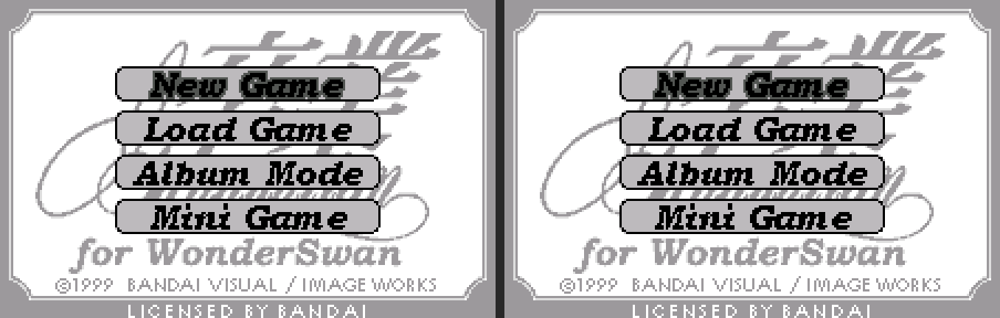

2. The publisher logo, EMOTION (Bandai Visual's label), unchanged

   

3. Choosing the teacher type (Rich, Athletic, Bookworm, Hot-blooded, Ladies' man), with the Sensei status panel

   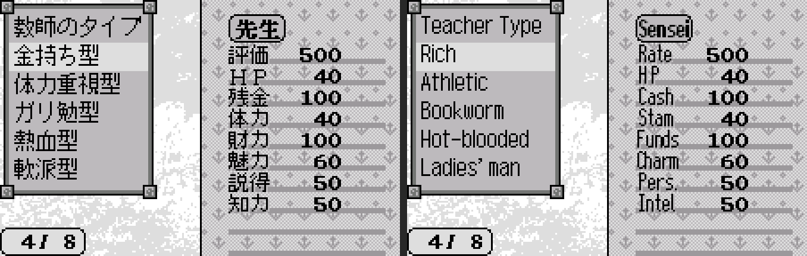

4. A heroine's profile card (Kiyomi Arai): birthday, sign, blood type and two personality traits

   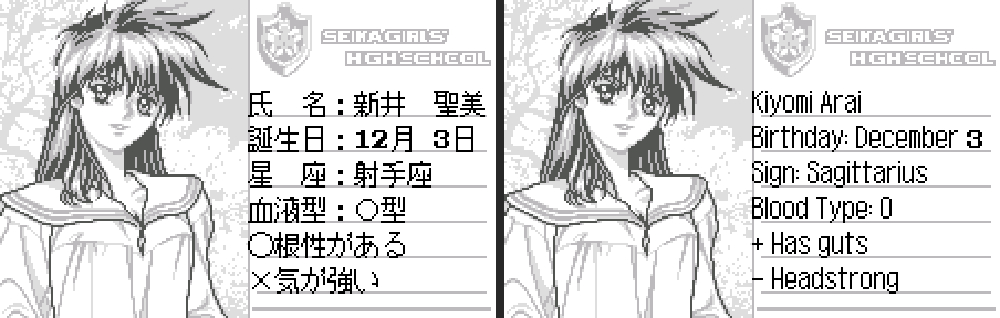

5. The weekly planning table: "Coach a student in the 1st half of this week.", with the five heroines' activities

   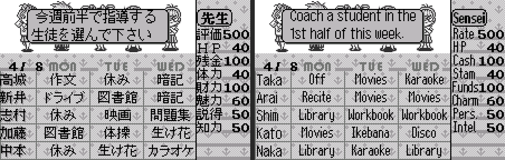

6. Planning a student's week: the lesson menu (Class, Essay, Recite, Workbook) and "Decide Takagi's schedule."

   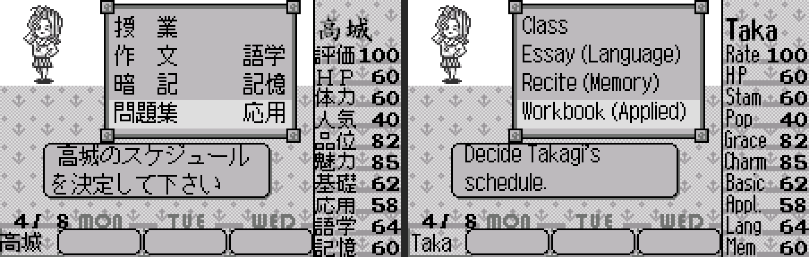

7. A message box: "Takagi is playing truant." beside her stat panel

   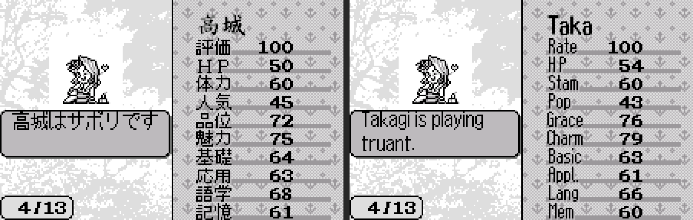

8. The weekly table filled in for April 15, with the heroines' pictures above

   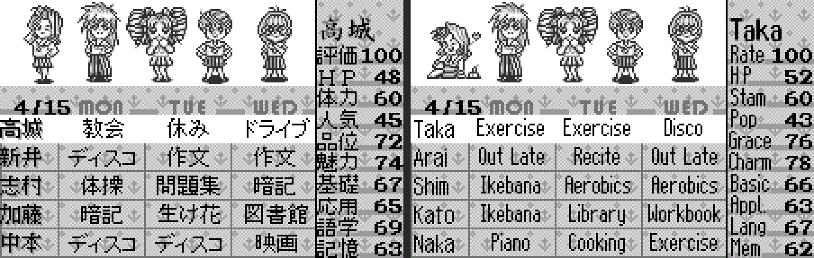

9. The Sunday patrol menu: Patrol, Town, Tail Her, Search (greyed out)

   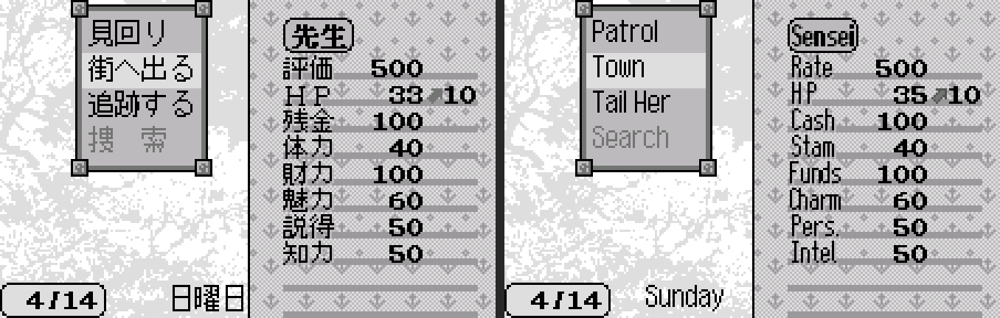

10. The system menu: System, Events, Save, Sound

   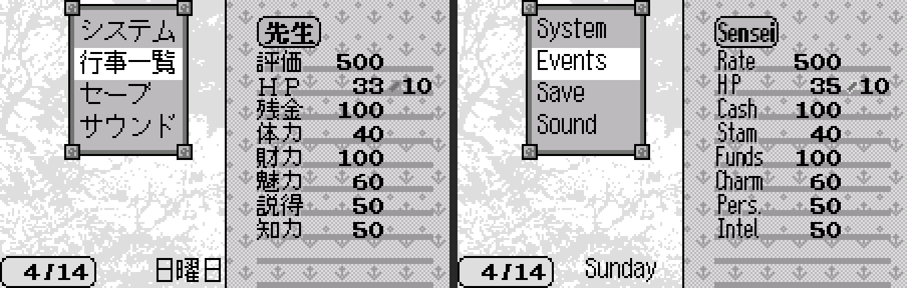

11. A random event message: "Kato, who ran off, has come back."

   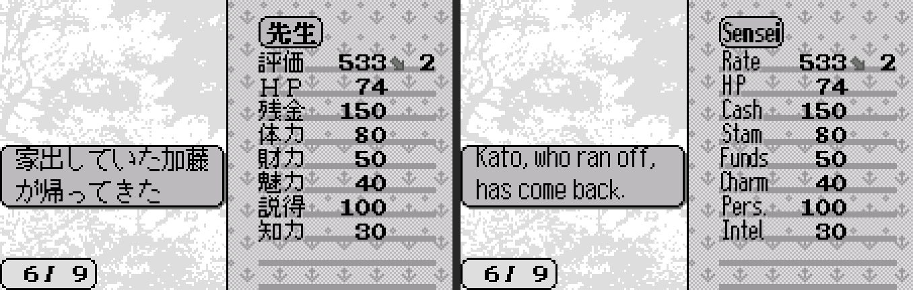

12. The sports-festival relay: "1st Runner: Kiyomi Arai, Stamina 60"

   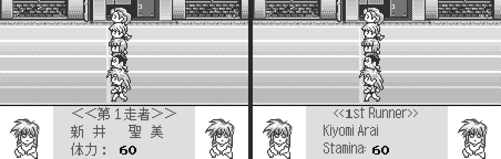

13. An ending page, a heroine's picture with her closing line

   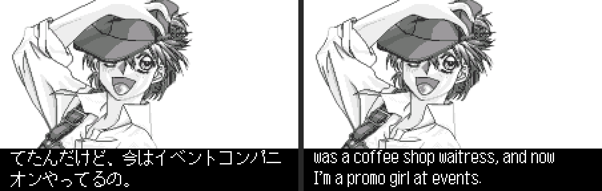

14. The album notice after an ending: "You got a Bonus Picture. Cavalry (1 or more endings)"

   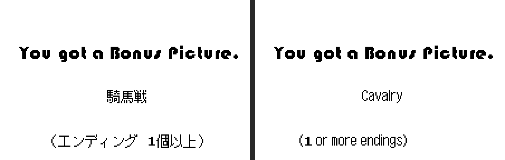

15. Ending Viewer edition only: the Heroine list and the Ending list (both pictures are from the edition; the original has no such screens)

   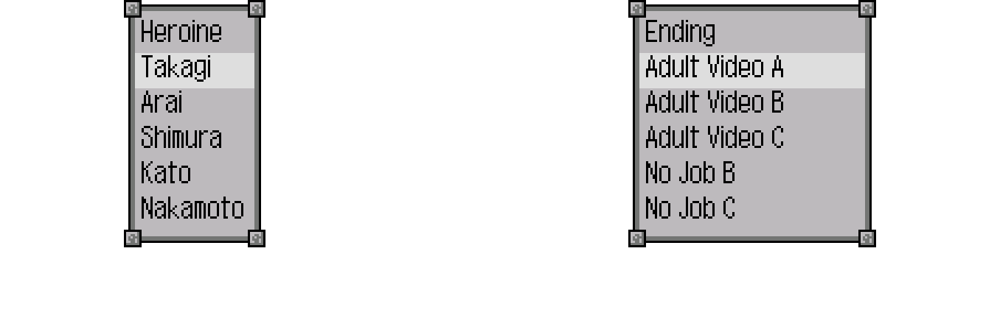

16. Ending Viewer edition only: the first page of one of the cut endings (Takagi, Adult Video A) with her idol picture as the stand-in (the original has no such screen)

   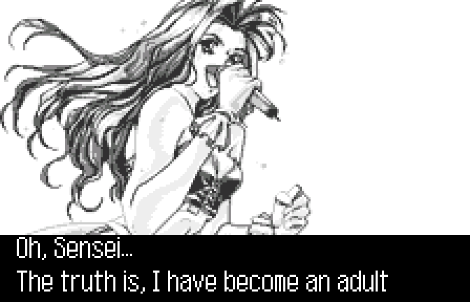

**How to patch**

Apply the BPS file to the Japanese ROM **Sotsugyou for WonderSwan (Japan).ws** (2,097,152 bytes, CRC32 `F016DFE1`) in your browser with the [Swan Revival patcher](https://swanrevival.com/patcher/), or with Floating IPS, beat or ROM Patcher JS. The result is 4,194,304 bytes:

* Standard: `sotsugyou-en-1.0.bps`; the result should be CRC32 45A9DC8D.
* Ending Viewer edition: `sotsugyou-en-endings-1.0.bps`; the result should be CRC32 1E8FFBC3.

It's a mono WonderSwan game, so keep the .ws extension. You must provide your own copy of the original Japanese game to apply it. The patch only fits this dump (CRC32 `F016DFE1`); another revision is refused or gives a wrong result. Remember that the result is a 4 MiB image and that I could not test it on real hardware or flash cartridges.

**Download:** `sotsugyou-en-1.0.bps`, `sotsugyou-en-endings-1.0.bps` on the [release page](https://github.com/PokemonGoDB/wonderswan-english-patches/releases/tag/sotsugyou-v1.0).

**Known issues**

* It hasn't been played start to finish by a person (see "What was not seen on screen"). If you find leftover Japanese or anything broken, please tell me where it happened.
* Whether a real WonderSwan flash cartridge accepts the 4 MiB image is unknown.
* In some boxes the English lettering is smaller than the Japanese; long quiz answers use short forms (Kobayasi, Yamanasi, Persim., Chopstix, Sept., 365 dys).
* A save state made on the Japanese ROM and loaded on the English build keeps some Japanese tiles (for example the weekday chip) until the game redraws them. A fresh game shows English.
* Quiz answers for the word-puzzle questions are the Japanese words explained in English, not rebuilt English puzzles; the question about the money proverb is reworded as described above.

**Credits:** Translation and hacking: Claude (Anthropic) for the WonderSwan Translation Project.

**A Note On My Justifications for AI Use**

I have been an avid fan of the Wonderswan system for a very long time now. It was actually a motivating factor for my various attempts to learn Japanese (which have all failed so far). I always wanted to explore the game catalog more, but the lack of English translations made it extremely difficult to do so. Here's the thing: There's a reason many of these games have not been translated yet. It's not just the fact that Japanese > English translation is difficult. There's also the fact that the original developers used all kinds of tricks and technical feats to make these games work. Most games do not have a searchable directory of text that you can just replace with English equivalents. While some are easier than others, translations for some of these would take not only an expert in Japanese > English translation, but also someone with vast game development and programming experience.

I say all that to say: I get why people are apprehensive about AI usage for this type of thing. However, these games have been around for a very long time now and most of them have still not received a translation. I (and others) have chosen to spend our time and money to utilize AI to translate the games and actually make them playable for the wider community. If you don't agree with that, that's completely fine. I am more than happy to remove any of my translations if better, human ran translations are released at a later date. We already decided to skip any games where someone is actively working on a manual translation. While nowhere near what a manual translation effort would be, I do spend a considerable amount of time trying to work through each game's translation. I stress over small details and try my best to make the right calls. And I've probably messed some stuff up, which is why I welcome feedback.

I'm just looking forward to digging through all of these games. It's a great time to be into Wonderswan games.
