# Super Robot Taisen Compact 2 Part 1: Earth Upheaval - AI English translation patch v1.1

**Super Robot Taisen Compact 2 Part 1: Earth Upheaval** (スーパーロボット大戦コンパクト2 第1部 地上激動篇) is the first of three cartridges that tell one story: Banpresto's tactical-RPG crossover of the Super Robot Wars series for the monochrome WonderSwan (2001-02). You move your robots on a map, fight with spirit commands and weapons, and read the story between stages. This cartridge's story is set in: Earth: Japan, the world, Byston Well and Jaburo. It was released only in Japan. This patch translates all the text the game shows into English. The other two parts are separate patches.

> **Please read:** this translation was made **with AI** (Claude), as a hobby project. A person (me) made every judgement call before release, but nobody on the project is a professional translator. I'm sharing it as it is for anyone who wants to play. Please **don't upload it to romhacking sites** (romhacking.net and the like). It may not be up to the standard of a real fan translation and it doesn't belong there.

**What's translated**

* **Everything the player reads:** the story scenes, the battle quotes, every menu, list and status page, the name-entry screen, the staff roll and the epilogue (17,280 text units in all, 11,665 of them drawn and checked in their real boxes).
* **Text drawn as pictures:** the episode cards, menu words, credit cards and the like were redrawn in English in the original's style.
* **Title screen:** the original art is kept untouched; an English line "PART 1: EARTH UPHEAVAL" sits below it.
* **Names and terms:** official English where it exists (the English releases of the Original Generation games for Banpresto's own characters, the licensed anime releases for the rest) and the fan-standard forms otherwise; the sources are in `games/srw-compact-2/termbase.json`.
* **Letter size:** story text uses a 12 px face, as tall as the original's kana; menus, lists and battle quotes use a 9 px face because the original's fields are narrow, and a few labels are shortened (for example "Clr. Data", "Dbl Img 2", "Wtr Gnd").
* **Saves and clear data:** the patch keeps the original's save and clear-data code; clear data passes between the parts as in the Japanese game.
* **Stays as it was:** the credits' own typos (Coodinator, Programer, Scienario, Exective, BANPRESOFT, Charactor), "Episode1" and "Last Episode".

**How it was made: AI translation, independent checks, human decisions**

* Claude worked out the game's text format (one id table, banks of messages and quotes, a names block, cut-in and prologue tables), wrote the English, redrew the picture text and rebuilt the ROM, repacking text into free space so that lines fit the original boxes. The ROM stays 4 MiB, like the original.
* The final build (r20) went through the project's automated test run: 17 of 18 checks passed. The one that did not is the random-play soak: from one saved state the screen held still a little longer than on the original. That same flag has come up in every run since early builds; the frames were looked at each time and nothing was wrong on screen. The run includes:
  * every string decoded, re-encoded and rebuilt byte for byte; no Japanese text candidate uncovered;
  * 11,665 text units drawn by the game's own renderer: 0 flagged; the same sweep on the original flags Japanese, so the check can see it;
  * 119 starts from saved states across the game, 330,827 frames of menus, map and dialogue: no Japanese on screen at runtime; the same run on the original sees it;
  * attract mode and the endings and credits on both ROMs, 129 inventory screens paired with the original, and the measured alignment audit.
* The English was read against the Japanese by independent read-only Claude reviewers; the screens that changed after each review were looked at again on enlarged side-by-side pictures.
* The mechanics were audited (name entry and name limits, name comparisons, save and clear-data code, widest values).
* All 47 decision items (names, wording, lettering, the title screens) were put to the owner and answered.

**What was not seen on screen** (please report anything odd)

* the battle-screen box for cut-ins, the timers of timed messages
* the widest hero / partner names on the unit list, the forecast and the status box; turns 9999 and funds 9999999 on the map status box and the unit lists
* the hero name drawn by a message from a save made with the English keyboard (the capture shows the garble of a Japanese save)
* part 1 scene 0Eh frames of the original that come from a different moment than the English ones (the English reads correctly)
* **The game was not played from start to finish by a person**, and not on real hardware.
* **Result captions (1.1):** the five captions that depend on the defending unit (Double Image, Mach Special, True Mach Special, Getter Vision, Aura Barrier) were not reached in a real battle; real battles showed only Beam Coating and Critical. All nine were checked in the Debug edition's Battle Test.

**Changelog**

* **v1.1** (2026-11-28): nine battle result caption pictures (Double Image, Critical, Beam Coating, E-Field, Mach Special, Aura Barrier, Getter Vision, True Mach Special, Shield) were still Japanese in 1.0 and are now English. They turned up when we checked this game after a player sent screenshots of the same kind of fault in Compact 3: thanks to that player. Saves keep working: the 1.0 and 1.1 builds differ only in those nine pictures and the checksum (checked by comparing the two ROMs byte by byte; I did not load a 1.0 save into 1.1). Apply the 1.1 patch to the original Japanese ROM, not to an English ROM. It applies to the standard and the Debug edition.
* **v1.0**: first public release.
* **v1.0, Debug edition added**: a second patch whose Debug Menu opens with Y1 + START on the title; the standard patch is unchanged.

**Sources consulted**

* Japanese text: the WonderSwan ROM itself.
* English names and terms: the English releases of Super Robot Wars Original Generation, the licensed English releases of the anime (Discotek, Bandai, Media Blasters, ADV and others), Gundam.info and fan wikis; per-term sources are in `games/srw-compact-2/termbase.json`.
* The project's own notes on the game's text format (`games/srw-compact-2/TEXT-FORMAT.md`) and the QA run summaries.
* I looked for another English translation: gametranslate.us lists this part as in progress with no released patch (seen 2026-11-25). If a human translation is released, that one should be preferred.

**Images** (original on the left, English on the right)

1. Title screen: the original art with an English PART 1: EARTH UPHEAVAL line below it

   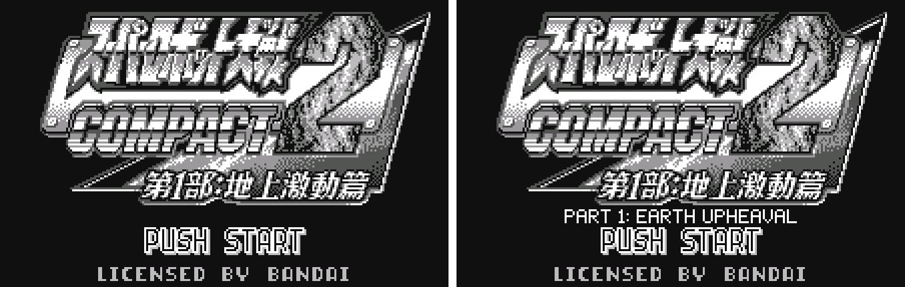

2. Title menu

   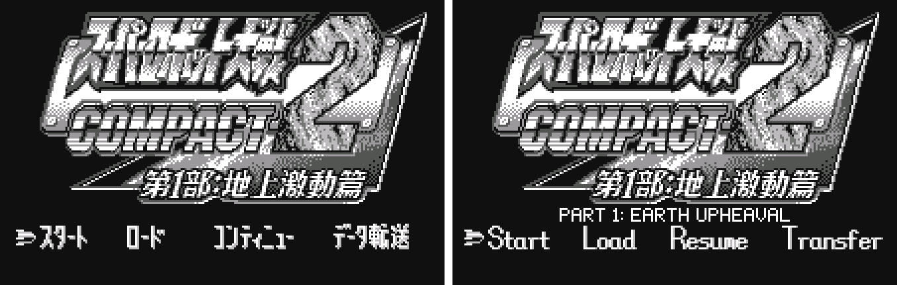

3. Hero setup (name, nickname, sex, piloting)

   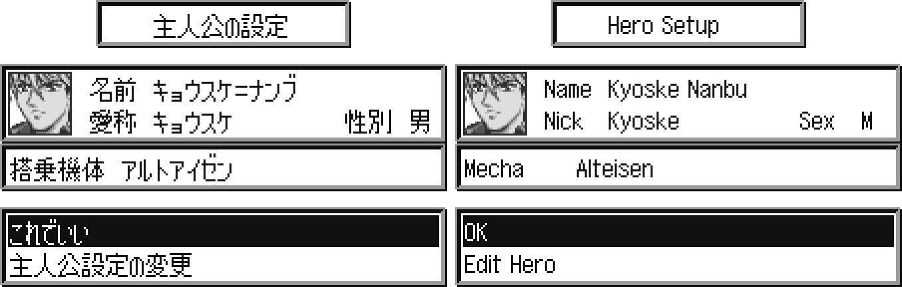

4. Name entry

   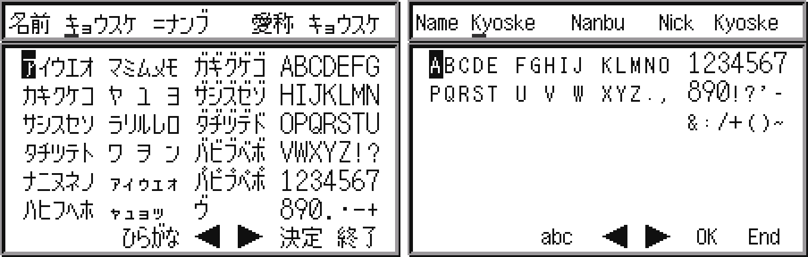

5. Story dialogue with portrait

   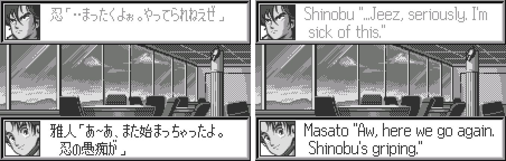

6. Episode title card

   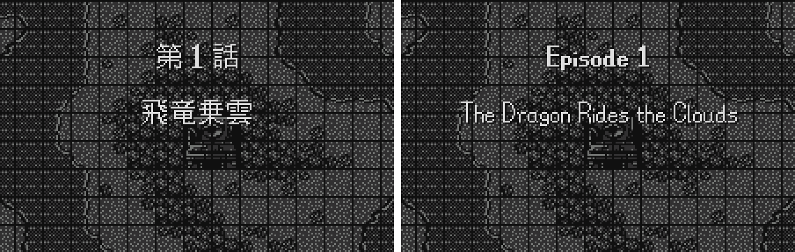

7. Map menu

   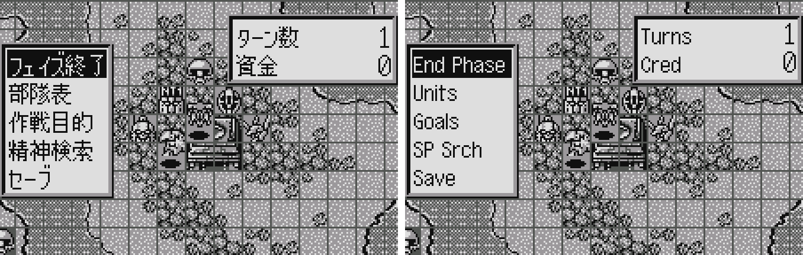

8. Unit command menu

   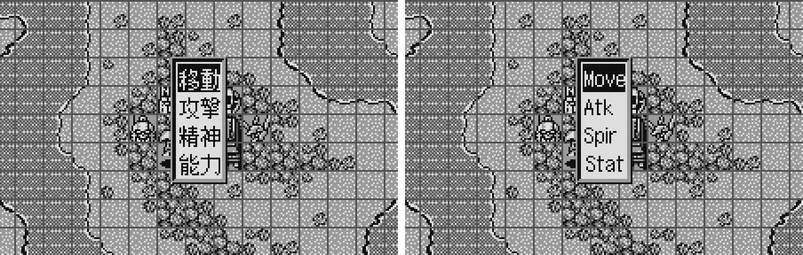

9. Unit status

   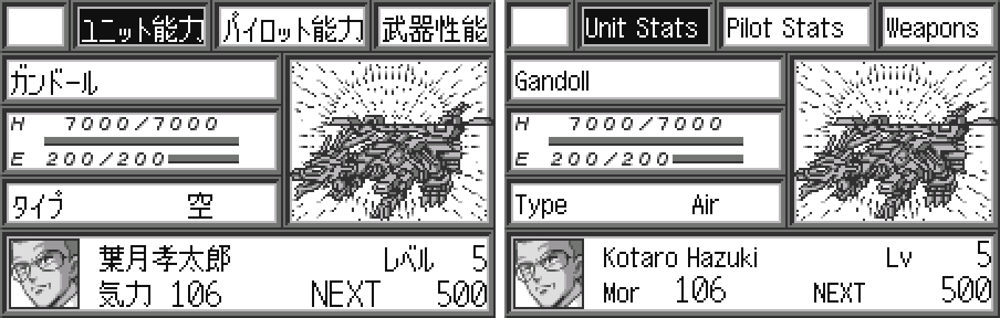

10. Weapon list

   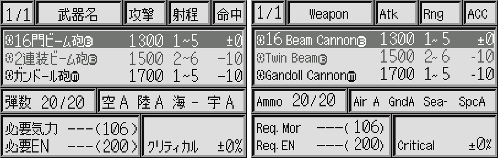

11. Attack forecast

   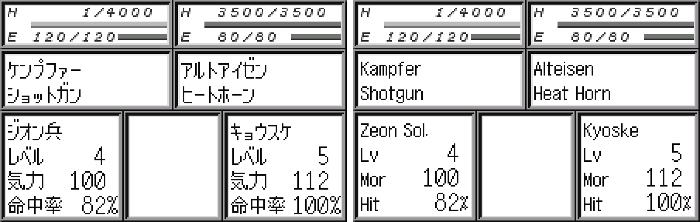

12. Battle scene with a quote

   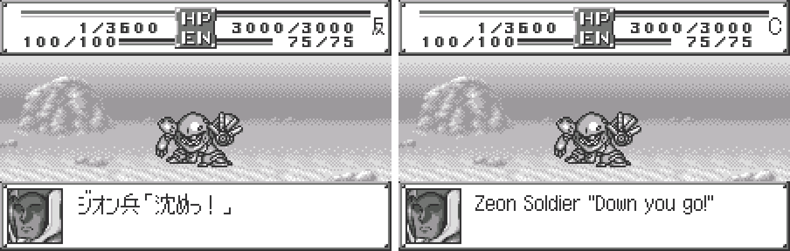

13. Rewards box (Credits and EXP)

   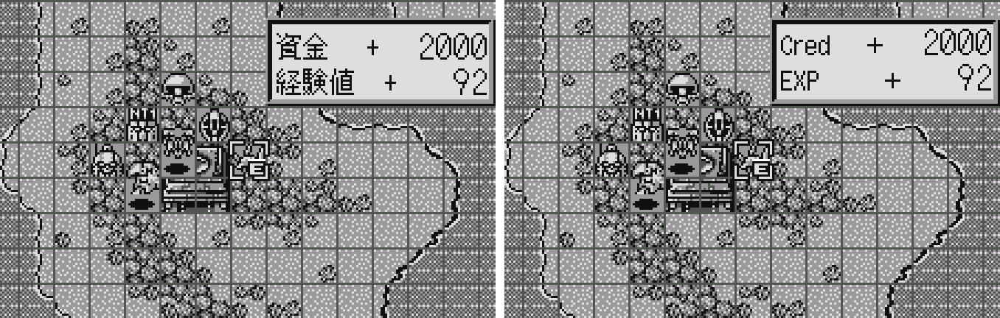

14. Intermission menu

   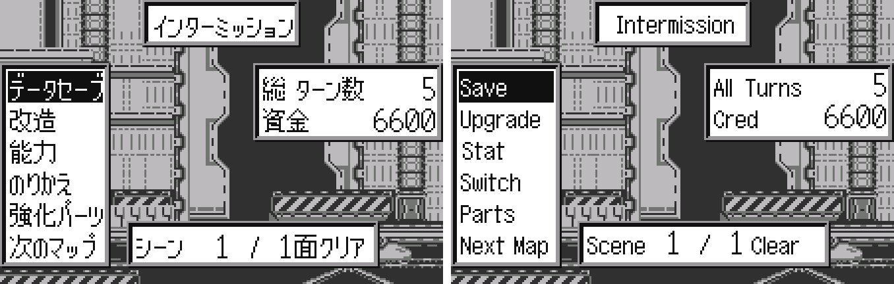

15. Upgrade list

   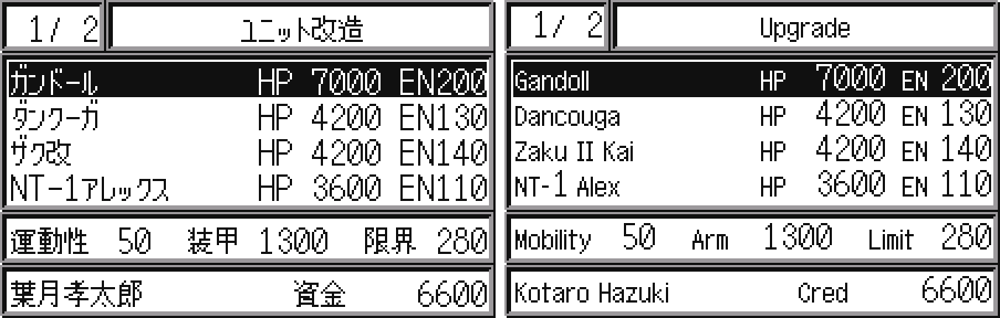

Debug edition only (the original's developer screens, forced by RAM pokes, on the left; the original has no Debug menu, so picture 17 shows its Battle Test, and its forced Flag Editor draws garbage where the digits belong):

16. The title menu of the Debug edition: the same as the standard patch (Y1 + START opens the Debug menu)

   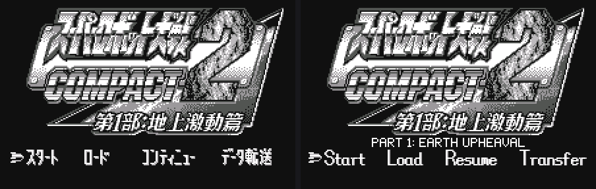

17. The Debug menu (Battle Test, Viewer, Flag Editor)

   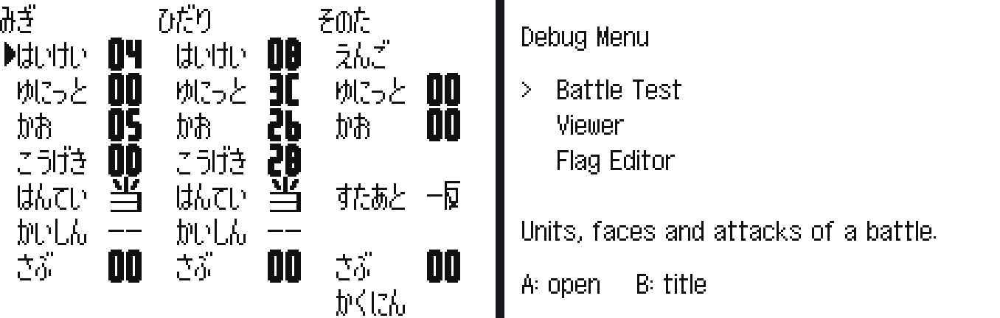

18. Battle Test with English labels

   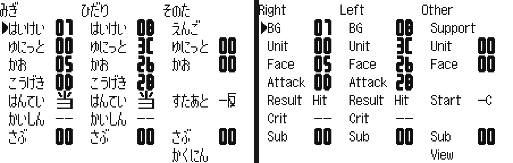

19. Flag Editor (the digits are readable in the Debug edition)

   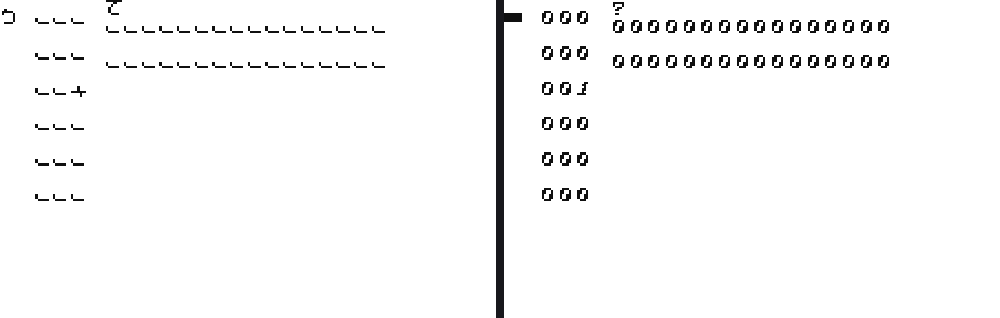

20. Battle result caption (Critical) in the Debug edition's Battle Test: the 1.0 build on the left (caption still Japanese), 1.1 on the right; the left side is not the Japanese original (new in 1.1)

   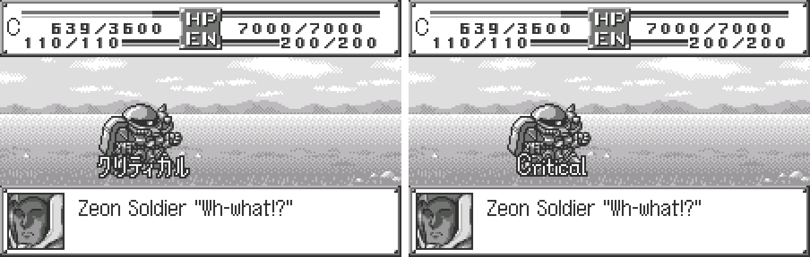

**Editions**

Both patches go on the same Japanese ROM and give a 4,194,304-byte file; each is released on its own.

| Patch | File | Result CRC32 | Result SHA-1 |

| --- | --- | --- | --- |

| Standard | `srw-compact-2-part1-en-1.1.bps` | `AA88E0A3` | `49d7f346a659fe810b1c8597cdcc18334fc94410` |

| Debug | `srw-compact-2-part1-en-debug-1.1.bps` | `A37089E8` | `9272d7115589b77fbeadbec18d9de9dc903976d8` |

**Debug**

The same translation as the standard patch, plus a **Debug Menu**: on the title screen hold **Y1** and press **START** (at PUSH START or on the title menu). The title screen and the title menu look exactly as in the standard patch; there is no menu entry. The combination opens a small English menu with the three developer modes the cartridge still contains and the retail game never selects: **Battle Test** (choose the units and values; START plays one real battle, from a battle setup copied into RAM, and returns to the Debug menu), **Viewer** (the portraits and unit graphics) and **Flag Editor** (edits the game's flag, turn and event numbers; START returns to the Debug menu). The menu and the Battle Test labels are in English; B on the menu returns to the title. The title entries are unchanged.

**How to patch**

Apply the BPS file to the Japanese ROM **Super Robot Taisen Compact 2 - Dai-1-bu - Chijou Gekidou Hen (Japan).ws** (4,194,304 bytes, CRC32 `782877BC`) in your browser with the [Swan Revival patcher](https://swanrevival.com/patcher/), or with Floating IPS, beat or ROM Patcher JS. The result is 4,194,304 bytes:

* Standard: `srw-compact-2-part1-en-1.1.bps`; the result should be CRC32 AA88E0A3.
* Debug edition: `srw-compact-2-part1-en-debug-1.1.bps`; the result should be CRC32 A37089E8.

It's a monochrome WonderSwan game, so keep the .ws extension. You must provide your own copy of the original Japanese game to apply it. The patch only fits this dump (CRC32 `782877BC`); another revision is refused or gives a wrong result.

**Download:** `srw-compact-2-part1-en-1.1.bps`, `srw-compact-2-part1-en-debug-1.1.bps` on the [release page](https://github.com/PokemonGoDB/wonderswan-english-patches/releases/tag/srw-compact-2-part1-v1.1).

**Known issues (Debug edition)**

* Debug edition: save states made on the standard patch do not carry over to the Debug edition, and the other way round.
* Debug edition: the Battle Test copies the data of a real battle into RAM and sets a flag at RAM 0FF0 (the four bytes `DBG!`) that tells the end-of-battle code to return to the Debug menu. It is not proven that the game never uses that address; it was 0 in every state checked.
* Debug edition: the Flag Editor edits RAM values only and is most meaningful with a game running; its START exit goes to the Debug menu, not to the map.
* Debug edition: on the Battle Test exit with the Y button, one frame shows part of the old screen.
* Debug edition: the Debug Menu is opened by holding Y1 and pressing START on the title screen (at PUSH START or on the title menu); the title screen and the title menu are exactly those of the standard patch. The standard English game does nothing with Y1 on the title, so no retail control is taken away; the combination was checked against near misses (START alone, Y1 alone, Y2 / Y3 / Y4 + START, Y1 + A / B, UP + START).
* Debug tour (about 165,000 random-button frames per part, no hang; no kana or kanji on the debug screens, checked by pixels against the Japanese ROM as control; title screen, title menu and Start / Load / Resume identical to the standard patch, Y1 + START opens the Debug Menu, other button combinations do not): see `games/srw-compact-2/qa/debug-tour.md`. The Viewer shows the original's pictures: in part 1 face 03 is a picture with Japanese in it (a picture, not text; parts 2 and 3 were not searched for such pictures).

**Technical notes (for the curious)**

* The Debug edition (`srw-compact-2-part1-en-debug-1.1.bps`) is the standard build plus `tools/sr2_debug_edition.py`: a Y1 + START check in the two key tests of the title, a new mode 16h menu, English labels in mode 12h and a few code hooks in unused ROM space (3DE000h-3DFFFFh); it is a separate patch, not part of the standard patch. It was checked by applying it to the original ROM and comparing with the Debug build byte for byte; the standard build was not changed.

**A Note On My Justifications for AI Use**

I have been an avid fan of the Wonderswan system for a very long time now. It was actually a motivating factor for my various attempts to learn Japanese (which have all failed so far). I always wanted to explore the game catalog more, but the lack of English translations made it extremely difficult to do so. Here's the thing: There's a reason many of these games have not been translated yet. It's not just the fact that Japanese > English translation is difficult. There's also the fact that the original developers used all kinds of tricks and technical feats to make these games work. Most games do not have a searchable directory of text that you can just replace with English equivalents. While some are easier than others, translations for some of these would take not only an expert in Japanese > English translation, but also someone with vast game development and programming experience.

I say all that to say: I get why people are apprehensive about AI usage for this type of thing. However, these games have been around for a very long time now and most of them have still not received a translation. I (and others) have chosen to spend our time and money to utilize AI to translate the games and actually make them playable for the wider community. If you don't agree with that, that's completely fine. I am more than happy to remove any of my translations if better, human ran translations are released at a later date. We already decided to skip any games where someone is actively working on a manual translation. While nowhere near what a manual translation effort would be, I do spend a considerable amount of time trying to work through each game's translation. I stress over small details and try my best to make the right calls. And I've probably messed some stuff up, which is why I welcome feedback.

I'm just looking forward to digging through all of these games. It's a great time to be into Wonderswan games.
