# Super Robot Taisen Compact 3 (WonderSwan Color) - AI English translation patch v1.0

**Super Robot Taisen Compact 3** (スーパーロボット大戦コンパクト3) is a turn-based strategy RPG from Banpresto for the WonderSwan Color (2003). It is a crossover of mecha anime: the Mazinger series, Getter Robo, Combattler V, Mechander Robo, several Gundam series, Aura Battler Dunbine, The Vision of Escaflowne, Betterman and Acrobunch, plus an original side of enemies called the Shura. You move units on a map, fight with battle animations and spoken quotes, and between scenarios use the intermission menus to upgrade units and spend the Stage Bonus on your pilots. This patch translates all the text the game shows into English.

> **Please read:** this translation was made **with AI** (Claude), as a hobby project. A person (me) made every judgement call before release, but nobody on the project is a professional translator. I'm sharing it as it is for anyone who wants to play. Please **don't upload it to romhacking sites** (romhacking.net and the like). It may not be up to the standard of a real fan translation and it doesn't belong there.

**What's translated**

* **Everything the player reads:** the story, the battle quotes, every menu, list and status page, the name-entry screen, the title menu, the 36 chapter cards, the HUD marks, the prologue scroll, the endings and the staff credits. The game's text catalog holds 17,188 text units and all of them are covered; the boot copyright page is romanized.
* **Names and terms:** pilots, robots, attacks and terms follow official English and fan-standard names (details under "Sources consulted"). Where the game's original Shura side has no English precedent, the spellings were my choice (for example Fernando, Altis, Maysis, Magnaz and the robot Ialdabaoth). Honorifics are dropped.
* **Letter size:** story text and battle quotes are drawn in a 12 px face, the size of the original's kana, and so are the menus. A smaller 9 px face is used for 492 menu strings that do not fit their field in the larger one.
* **Short forms where text had to fit:** 25 weapon names are shortened to fit their list field (for example `H. Mega Launcher`, `Haou Shu. Hadoha`, `KishinSokutaigeki`, `SDX Borot Punch`); the full names are in the story text. Spirit marks are single letters and the spirit commands use short names such as `Strike` and `Luck`.
* **Money** is called `Credits` everywhere. The map box that shows Turns and Credits is one cell wider so that 7 digits fit (9,999,999 was checked in the map box, the intermission, the upgrade lists and the weapon upgrade).
* **Pictures with text** (title logo, title menu, chapter cards, HUD marks) were redrawn in English.
* **Name entry:** the grid lost 13 rarely used marks and 10 capital accented letters to make room for the 9 px letters.
* **Saves:** LOAD, CONTINUE and the save prompts were tested from a real save, with the same flow as the original.

**Editions**

Three patches, each applied on its own to the same Japanese ROM:

* **Standard** (`srw-compact-3-en-1.0.bps`): pilot names up to 6 letters (first name, nickname and last name), robot name up to 10 letters.
* **Long Names** (`srw-compact-3-en-longnames-1.0.bps`): the same, but robot names can have up to 12 letters. Pilot names stay at 6 letters: I planned 8, but eight wide letters (W, M) did not fit the 6-cell name fields with the 12 px font and wrote over the labels.
* **Debug** (`srw-compact-3-en-debug-1.0.bps`): the same translation as the standard patch, with a visible **Debug** entry added to the title menu. It opens the developers' own debug modes, which are in the original cartridge but cannot be reached from the title menu. Move the cursor right of LOAD (or right of CONTINUE if you have a suspended game) and press A on Debug. The menu has four entries:
  * **Battle Test:** the battle-animation test (background, units, portraits, attack, hit result, then the battle with its quotes). It is started with values taken from a real battle, because all-zero values freeze it. START plays the battle; afterwards the game continues on the chapter-1 map, as the original does.
  * **Viewer:** a portrait and unit-sprite viewer.
  * **Map Debug:** a map screen with the turn number, event flags and unit values, shown only as digits. The meaning of its fields is not known, so they are not labelled.
  * **Map Overview:** a minimap of the whole map with unit dots (no text).

  Press A+B+START in any mode to return to the title. The Debug edition stays in the smaller 9 px font, and one kanji code and four icons stay Japanese in it (among the icons are the value icons 当 and 反 in Battle Test; the kanji code appeared once in a stage-5 test run, and the original draws it at the same point). It is for the curious; play the standard or Long Names patch.

**How it was made: AI translation, independent checks, human decisions**

* Claude worked out the game's text format, wrote the English, and rebuilt the ROM with variable-width fonts and a text renderer added to the cartridge, so that lines and names fit the original boxes. The ROM stays 8 MiB, like the original.
* The final build (S17a) went through a full automated test run, QA14, of 12 checks, and all 12 passed:
  * every one of the 22,287 catalogued text units of the original is covered by a translation or a reviewed exclusion, the English passes the width rules, and the strict build is byte for byte the ROM that was tested;
  * all 18,353 story messages and battle quotes were drawn by the game in the real dialogue box with the widest player names (640,274 letters drawn, nothing flagged: no Japanese, nothing past the right edge, no box with too many lines);
  * random-button walks from 52 saved states (9.68 million frames, 6.08 million letters drawn) found no Japanese on the English build; the same walks on the original flagged 4,726 times, so the check can see it;
  * all 11 ending variants were played to the credits (2,383 English screens, none flagged);
  * every one of the 77 screens of the screen inventory was captured on both ROMs and read;
  * a measured alignment audit found no new misaligned row (679 flagged rows were looked at, none left open), and a soak test of 2.38 million frames from 30 saved states raised no flags (12 of the 30 states react little to random presses, so they prove less).
* The English text was read against the Japanese by 17 read-only Claude reviewers: 135 findings, of which 127 were fixed and 6 rejected with a reason, and the other two were noted for later. A second independent read of the 12 px rewordings and the weapon names found 4 errors and 8 preferences, all fixed. Reviewers also read the captured screens beside the originals; none is left pending.
* Every decision that was mine to make was put on three decision pages, 40 items in all (letter size, name spellings, wording, the Long Names edition, the title logo and so on), with options and pictures, and I answered every one of them.

**What was not seen on screen** (please report anything odd)

* **Real play stopped at the end of scenario 3.** Nobody has played the whole game. Scenarios after 3 were not played by hand: the automated tour reaches every stage and the ending, and it found no Japanese and no freeze, but those screens were not read one by one the way scenarios 1 to 3 were.
* **Test-only help:** to get through battles and reach the end of scenario 3, the test runs refilled my units' HP and set enemy HP to 1, and moved one enemy per turn next to my unit. This was only in the test runs, never in a patch. Some screens (the debug modes) were reached by forcing a mode with a test ROM.
* **Not seen:** a pilot at level 99 on the lists, and a battle result box with a 7-digit gain (I could not find a way to set either; both should use the same digit drawing as the screens that were seen with 7-digit Credits). The level-up box of every pilot was not seen; level-ups of five pilots were.
* **Long Names edition:** the widest case (a 12-letter robot name) was seen on the unit list, pilot list, unit status, map unit list and battle setup. It was not seen in spoken dialogue, in map unit labels or in the Stage Bonus list, and a mixed-letter 12-letter name was not tried.
* **Debug edition:** the four modes were launched and read on an earlier build of the edition (with the original as control); the final Debug ROM was built and its patch checked byte for byte, but I did not read its screens again. In the debug modes I only jumped to stages 5, 12, 25 and 39.
* **What the checks cannot see:** the detector does not see kana drawn with codes that the English font reuses for spaces and punctuation, nor text drawn as pictures outside the pictures that were listed; those screens were checked by screenshot.
* The game was not played from start to finish by a person, and not on real hardware.

**Changelog**

* **v1.0**: first public release.

**Sources consulted**

* Japanese text: the WonderSwan ROM itself.
* English names and terms: the project's termbase of 1,311 entries, each with its source. The most used are Akurasu (akurasu.net) and the Super Robot Wars Wiki (superrobotwars.fandom.com), then Wikipedia, the series wikis on Fandom (Gundam, Escaflowne, GaoGaiGar, Getter Robo, Mazinger and others) and Anime News Network. Official English text was used where it exists: the English subtitles of *Super Robot Wars T* (Bandai Namco Asia, 2019, as quoted by Siliconera) and the ADV Films English release of Aura Battler Dunbine (2003, episode titles).
* The Shura characters' names have no English precedent in the game's own world, so they rest on fan sources and on two Sentinel RIOBOT product names; they are my choices (see above).
* The project's own notes on the game's text format, story and terms, and the QA run summaries.
* I searched for another English translation of this game on 2026-11-18. gametranslate.us lists Super Robot Taisen Compact 3 as in progress at 0%, reverse engineering, with no patch; I found no other released patch. If a human translation is released, that one should be preferred.

**Images** (original on the left, English on the right)

1. Title screen

   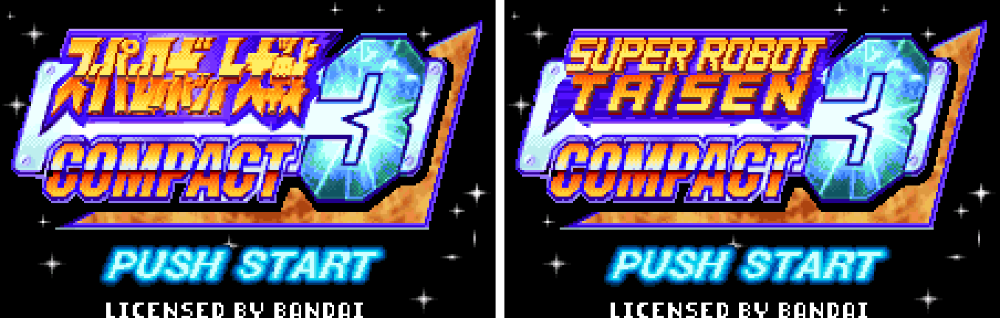

2. Title menu (START / LOAD / CONTINUE)

   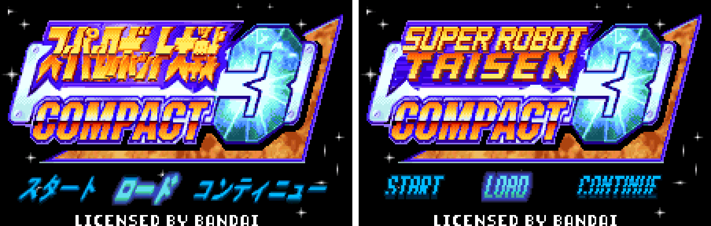

3. Name entry

   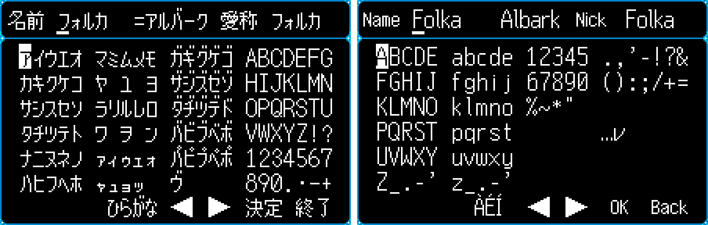

4. Hero setup (name, nickname, sex, piloting)

   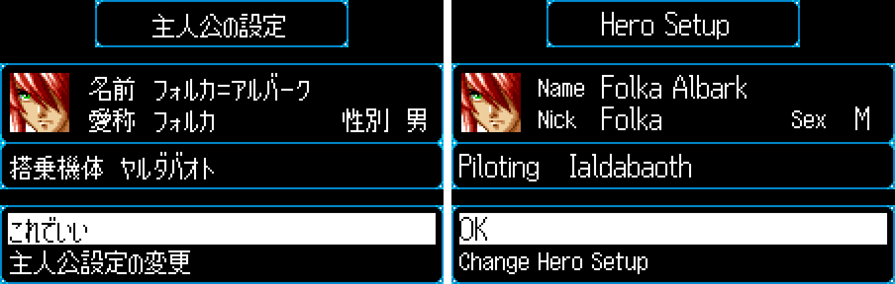

5. Story dialogue with portraits (the opening of Episode 1)

   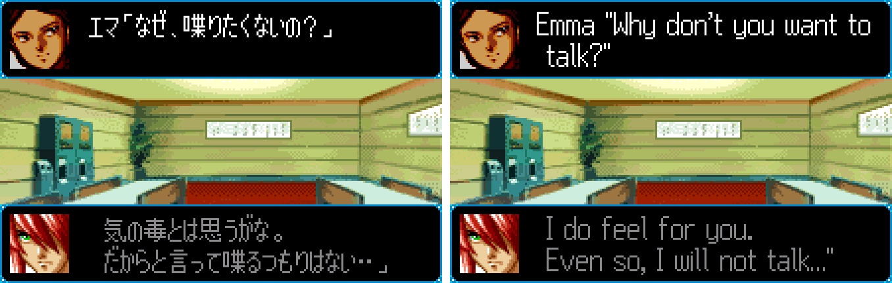

6. Map with the unit command menu

   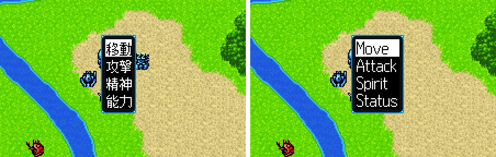

7. Unit status page (Argama)

   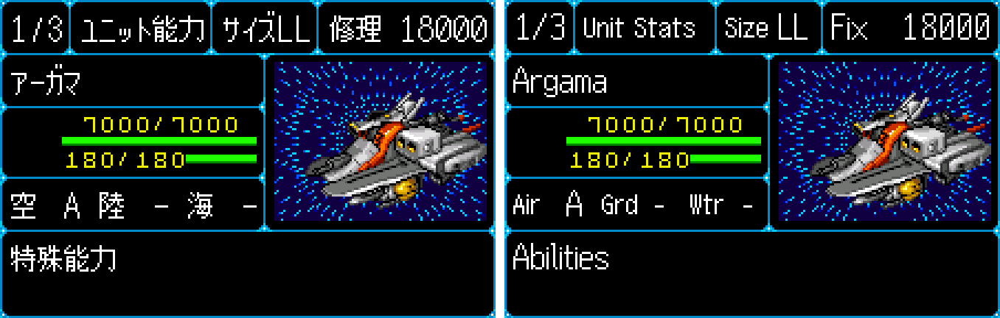

8. Battle animation with a quote

   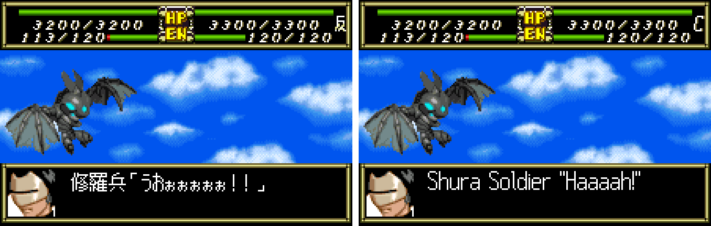

9. Map with the battle result box (Credits, EXP, PP)

   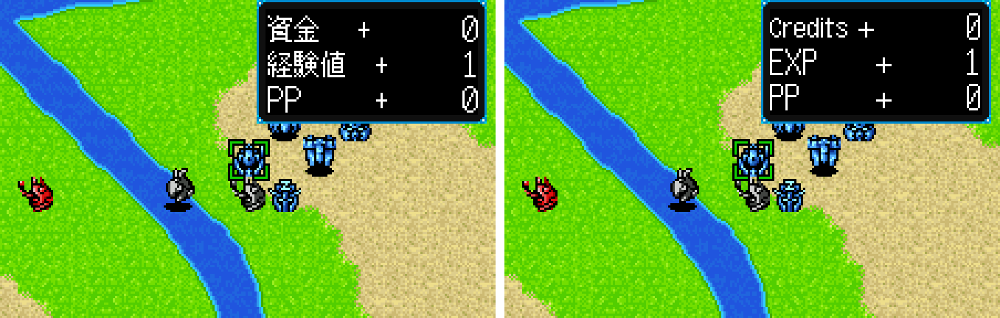

10. Intermission menu

   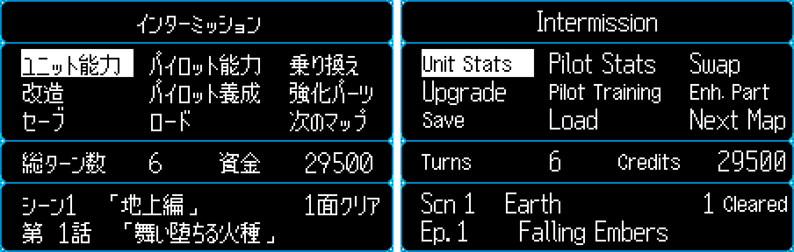

11. Unit upgrade list

   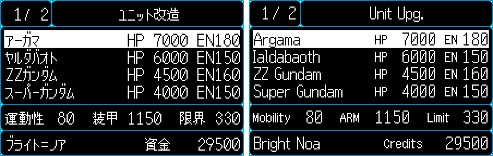

12. Stage Bonus panel

   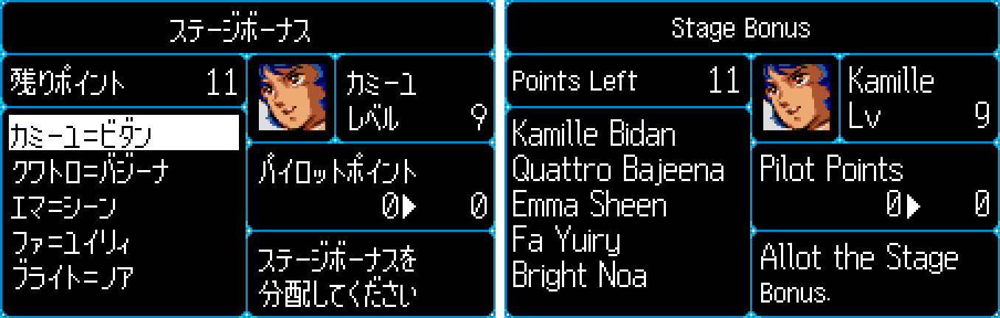

13. Staff credits (the original's credits are already romanized; the English build re-centres them)

   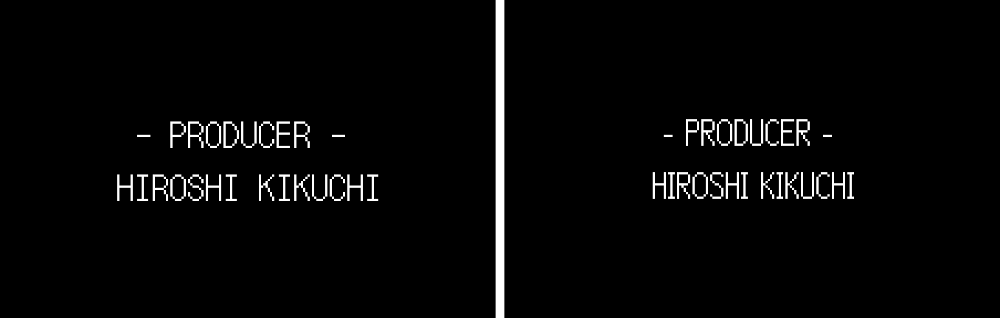

**How to patch**

Apply one BPS file to the Japanese ROM **Super Robot Taisen Compact 3 (Japan).wsc** (8,388,608 bytes, CRC32 `188CA644`) in your browser with the [Swan Revival patcher](https://swanrevival.com/patcher/), or with Floating IPS, beat or ROM Patcher JS. Every result is 8,388,608 bytes:

* Standard: `srw-compact-3-en-1.0.bps`; the result should be CRC32 B5EA1DE0.
* Long Names edition: `srw-compact-3-en-longnames-1.0.bps`; the result should be CRC32 9B68E1B8.
* Debug edition: `srw-compact-3-en-debug-1.0.bps`; the result should be CRC32 0BB721AC.

It's a WonderSwan Color game, so keep the .wsc extension. You must provide your own copy of the original Japanese game to apply it. Apply only one patch to the original ROM, not one on top of another.

**Download:** `srw-compact-3-en-1.0.bps`, `srw-compact-3-en-longnames-1.0.bps` and `srw-compact-3-en-debug-1.0.bps` on the [release page](https://github.com/PokemonGoDB/wonderswan-english-patches/releases/tag/srw-compact-3-v1.0).

**Known issues**

* It hasn't been played start to finish by a person (see "What was not seen on screen"). If you find leftover Japanese or anything broken, please tell me where it happened.
* The serif of a capital I touches the unit icon box in the sortie list (`Ialdabaoth`); the original's kana sit 2 to 3 px away.
* A one-frame scrambled box appears while the battle result box is built; the original does the same.
* Some dialogue pages end on a single word, where the original pages end.
* `Iron Castle` in the stage list is the short form of the chapter card's `The Castle of Black Iron`; a few menu rows and `Bonus.` use the smaller 9 px face, and a wide gap sits before `learned` in the level-up message.
* In the Debug edition, the debug screens use the smaller font and a few developer labels stay Japanese; the Map Debug fields are unlabelled.
* Save states made in an emulator on the Japanese ROM do not carry over to the patched ROM.
* It was tested in an emulator only, not on a real WonderSwan.

**Technical notes (for the curious)**

* The game keeps 17,188 text units (story messages, battle quotes, pool strings for menus and fields, the prologue scroll and a few dictionary words). The patch replaces the text and the fonts and adds code in unused ROM space; the ROM stays 8 MiB.
* The Debug edition changes the title cursor code so that its fourth slot (empty in the original) opens a menu that dispatches to the four developer modes already in the cartridge, and rewrites the Battle Test labels, which are tile numbers inside code. The original's only fixed key combination, A+B+START (soft reset), is used to leave the debug modes.
* The three patches were checked by applying each to the original ROM and comparing with the tested build byte for byte.

**A Note On My Justifications for AI Use**

I have been an avid fan of the Wonderswan system for a very long time now. It was actually a motivating factor for my various attempts to learn Japanese (which have all failed so far). I always wanted to explore the game catalog more, but the lack of English translations made it extremely difficult to do so. Here's the thing: There's a reason many of these games have not been translated yet. It's not just the fact that Japanese > English translation is difficult. There's also the fact that the original developers used all kinds of tricks and technical feats to make these games work. Most games do not have a searchable directory of text that you can just replace with English equivalents. While some are easier than others, translations for some of these would take not only an expert in Japanese > English translation, but also someone with vast game development and programming experience.

I say all that to say: I get why people are apprehensive about AI usage for this type of thing. However, these games have been around for a very long time now and most of them have still not received a translation. I (and others) have chosen to spend our time and money to utilize AI to translate the games and actually make them playable for the wider community. If you don't agree with that, that's completely fine. I am more than happy to remove any of my translations if better, human ran translations are released at a later date. We already decided to skip any games where someone is actively working on a manual translation. While nowhere near what a manual translation effort would be, I do spend a considerable amount of time trying to work through each game's translation. I stress over small details and try my best to make the right calls. And I've probably messed some stuff up, which is why I welcome feedback.

I'm just looking forward to digging through all of these games. It's a great time to be into Wonderswan games.
