# Super Robot Taisen Compact for WonderSwan Color - AI English translation patch v1.1

**Super Robot Taisen Compact for WonderSwan Color** (スーパーロボット大戦コンパクト for WonderSwan Color) is a turn-based strategy RPG from Banpresto for the WonderSwan Color (2001), the colour remake of the first Super Robot Taisen Compact. It is a crossover of mecha anime: Mazinger Z and Great Mazinger, Getter Robo, Brave Raideen, Daimos, Daitarn 3, Dancouga, several Gundam series (the One Year War, Zeta, ZZ, Char's Counterattack, F91, Wing Endless Waltz), Aura Battler Dunbine and Heavy Metal L-Gaim. You move units on a map, fight with battle animations and spoken quotes, and between stages use the intermission menus to upgrade units and pick the next map. This patch translates all the text the game shows into English.

> **Please read:** this translation was made **with AI** (Claude), as a hobby project. A person (me) made every judgement call before release, but nobody on the project is a professional translator. I'm sharing it as it is for anyone who wants to play. Please **don't upload it to romhacking sites** (romhacking.net and the like). It may not be up to the standard of a real fan translation and it doesn't belong there.

**What's translated**

* **Everything the player reads:** the opening text crawl, the story dialogue, the battle quotes and attack quotes, every menu, list and status page, the title menu, the stage names and Next Map briefings, the HUD marks, the endings and the staff roll. The game's text catalog holds 15,400 text units that the game can show, and the translation covers all of them. About 6,900 messages that the cartridge holds but never shows are left in Japanese (see "Left in the cartridge" below).
* **Names and terms:** pilots, robots, attacks and terms follow official English and fan-standard names (details under "Sources consulted"), in a termbase of 1,214 entries with a source for each. Honorifics are dropped. The game's own story is kept as it tells it, even where it differs from the series (for example the Muge war comes before the One Year War).
* **Letter size:** story text, battle quotes, the opening crawl and most menus are drawn in a 12 px face, the size of the original's kana. A smaller 9 px face is used where a label does not fit its field in the larger one, so a few screens mix both sizes.
* **Short forms where text had to fit:** some long unit, pilot, weapon and terrain names are shortened in the lists and panels that have a fixed width (for example `Large M. Part. Cn.`, `Deathscythe H.C.`, `Genova M9`, `Photon Lab`); the full names are in the story text. Spirit commands use short names (`SelfDest.`, `Spirit`, `Inspire`) and the status pages use short labels (MEL, SHT, REA, EVD).
* **Money** is called `Credits` everywhere; the Turns / Credits box and the battle result box were rebuilt so the digits all use one size.
* **Pictures with text** (the title logo, the "MISSING NO." placeholder portraits, the stage title cards) were redrawn in English.
* **Saves:** the save prompts, the save list and the LOAD / CONTINUE screens were captured from a real save and work as in the original.

**Left in the cartridge: the story of Compact 2 Part 3**

The cartridge holds 9,809 story messages, but this game shows only about 2,800 of them. The other 6,936 sit in five message banks (banks 14, 16, 17, 18 and 3B) that no part of the game ever reads. They are not text cut from this game: they are **byte-for-byte copies of the same five banks of Super Robot Taisen Compact 2 Part 3 "Ginga Kessen Hen"** (the mono WonderSwan game from 1999). That game uses 6,911 of those 6,936 messages in its own scripts. This colour Compact was built on Compact 2 Part 3's engine and ROM image; its makers wrote their own story into banks 13, 15 and 1A only and left the old game's text in the other banks. The leftover text names Compact 2 characters that this game never mentions (Director Hazuki, the Einst, Rom Stol, Janera, Dangaioh).

How this was checked (details and per-id lists are in the project notes, `qa/unused-messages-recheck.md`):

* The routine that shows a message has 8 callers in the whole ROM, all script commands, plus a second route inside the staff-roll command that only reaches bank 1A. Every one of the 40 event scripts, 110 battle-effect scripts and 33 stage branches (the Sea of Ren and Mount Gara routes included) was walked, and every message id is written into a script; none is computed. None of them names a message in the five banks, except two lines in a battle-effect script that only start for a unit with a transform code that no unit in this ROM has.
* The three developer debug modes in the cartridge do not call the message routine either.
* The game was run in an emulator for 213 runs (1.49 million frames, from save states, the debug states and power-on with random buttons) with a breakpoint on the message routine and read watches on all five banks: 353 different messages were shown, every one in banks 13, 15 or 1A, and none in the five banks.
* Comparing with the other games: the five banks are identical to Compact 2 Part 3's; Compact 2 Parts 1 and 2 share only short common lines with them; Compact 3 filled the same eight-bank layout with its own story.

A few examples (Japanese, then a gloss of the meaning; nothing in this game can show them):

* 0E00 (bank 3B): ミア「このまま落ちたら…!/ダンガイオー…みんなを守って…」 - Mia: "If we fall like this...! Dangaioh... protect everyone..."
* 0BAD (bank 14): …ムゲ=ゾルバドスの宇宙で/現れたアインスト…レジセイアと言ったか? - "...The Einst that appeared in Muge Zorbados's universe... Regisseia, was it called?"
* 3100 (bank 17): ジャネラ「…変わらないのじゃ…宇宙は…」 - Janera: "...Nothing changes... the universe..."

So no screen of this game can show these messages, and they were not translated: translating them would have meant about 70 percent more work on another game's text that no player of this game can see. Another 47 lines in the banks the game does use are never referenced either (developer placeholders such as "Richter's line 1", eight copies of "GAME OVER", six "got N credits" lines); those were left alone too. If you find a way to make one of these messages appear in this game, please tell me.

**How it was made: AI translation, independent checks, human decisions**

* Claude worked out the game's text format, wrote the English, and rebuilt the ROM with variable-width fonts and a text renderer added to the cartridge, so that lines and names fit the original boxes. The ROM stays 4 MiB, like the original.
* The final build (scw12b) went through a full automated test run, scw12c, of 12 checks, and all 12 passed:
  * every piece of Japanese-looking text in the ROM is either translated or a reviewed exclusion (map data and number tables), the English passes the width rules, and the strict build is byte for byte the ROM that was tested;
  * 13,955 story messages, battle quotes, attack quotes and prologue lines were drawn by the game in the real dialogue box with the widest player names (489,250 letters drawn, nothing flagged: no Japanese, nothing past the right edge, no box with too many lines); the 1,423 menu and name strings are checked on the screens below;
  * random-button walks from 70 saved states (5.79 million frames, 3.79 million letters drawn) found no Japanese on the English build; the same walks on the original flagged 8,408 times, so the check can see it;
  * the three ending states were played to the credits and back to the title (295 English screens, none flagged);
  * every one of the 53 screens of the screen inventory that can be reached was captured on both ROMs (113 captures; 6 more could not be reached, with the reason written down) and read;
  * a measured alignment audit found no new misaligned row (726 flagged rows were looked at, none left open), and a soak test of 2.46 million frames from 31 saved states raised no flags.
* The English text was read against the Japanese by independent read-only Claude reviewers, in two passes over the text (the first listed 64 findings), and the captured screens were read beside the originals in every test round; every finding was fixed, rejected with a reason or put on a decision page, and no screen is left pending review.
* Every decision that was mine to make was put on three decision pages, 46 items in all (letter size, name spellings, wording, the Debug edition, the unused messages and so on), with options and pictures, and I answered every one of them.

**What was not seen on screen** (please report anything odd)

* **Real play stopped early.** A clean play-through from power-on (no edited save data) reached the clear of stage 1 (turn 14), the intermission, and the first turn of stage 2. Nobody has played the whole game. The later stages, the endings and the credits were checked by the automated tour from save states and by screenshot, not played by hand.
* **Test-only help:** the play-through searched for good moves by reloading its own save states, and some checks (a roster of 10+ units, level 99, big EXP values) used save data edited for the test, which is disclosed in the project notes. Debug modes were reached by forcing a mode with a test ROM.
* **Not seen:** a level-up in real play, 4-5 digit EXP, a real roster of 10 or more units, a pilot at level 99 in real play, the game-over screen, funds above 64,000 in the battle result box, support attack and support defence screens, and the clear-data screens in full; a few labels in the sort tab and the intermission lists were only seen on test ROMs. The "MISSING NO." placeholder portraits are drawn but no screen shows them.
* **What the checks cannot see:** the detector does not see kana drawn with codes the English font reuses, nor text drawn as pictures outside the pictures that were listed; those screens were checked by screenshot.
* The game was not played from start to finish by a person, and not on real hardware.
* **Placeholders in weapon lists (1.1):** the `??` placeholders in the weapon lists of an unscanned enemy have no screen route that I could find, so they were checked only in the card.

**Changelog**

* **v1.1** (2026-11-28): fixes after a player report. In the unknown-enemy card the labels overlapped the `??` placeholders; they now clear them. Critical hits were checked: the CRITICAL banner was already English in 1.0 (seen with test builds that force the roll). Thanks to the player who sent screenshots. Saves keep working: the 1.0 and 1.1 builds differ only in pictures, window layout and the checksum (checked by comparing the two ROMs byte by byte; I did not load a 1.0 save into 1.1). Apply the 1.1 patch to the original Japanese ROM, not to an English ROM. It applies to both editions.
* **v1.0**: first public release (2026-11-20).
* **v1.0, Debug edition added** (2026-11-25): a second patch with a Debug entry on the title menu; the standard patch is unchanged.

**Sources consulted**

* Japanese text: the WonderSwan ROM itself; for the unused messages, the Compact 2 Part 3 ROM.
* English names and terms: the project's termbase, built from Compact 3's (which is itself checked against Akurasu (akurasu.net) and the Super Robot Wars Wiki (superrobotwars.fandom.com), then Wikipedia, the series wikis on Fandom and Anime News Network) plus this game's own additions: the 33 stage titles had no English anywhere and a number of names had no standard spelling, so those are my choices, each listed on the decision pages with its alternatives. Official English text was used where it exists (as in Compact 3), and ranks follow the English Gundam dub ladder (Ensign, Lieutenant, Lieutenant Commander, Captain).
* The project's own notes on the game's text format, story and terms, and the QA run summaries.
* I searched for another English translation of this game on 2026-11-19. gametranslate.us lists a "Super Robot Taisen Compact" at 83%, stage 11 of 12 ("Human QA"), updated 2026-11-19, with no released patch, and does not say whether it is this colour remake or the 1999 mono original. I found no released patch for this game. If a human translation is released, that one should be preferred.

**Images** (original on the left, English on the right)

1. Title screen

   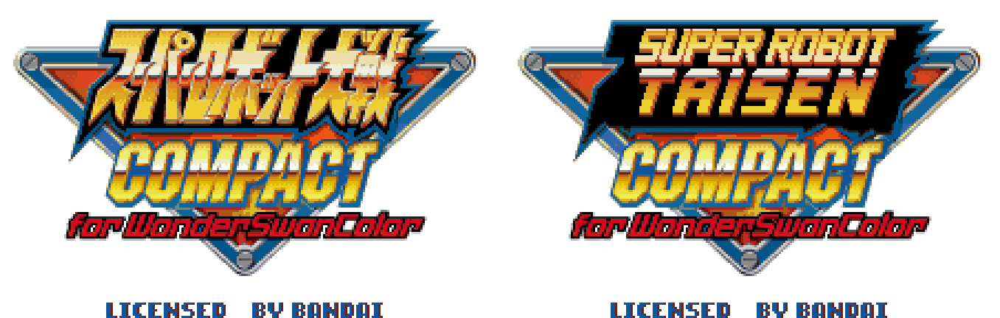

2. Title menu (Start / Load / Continue)

   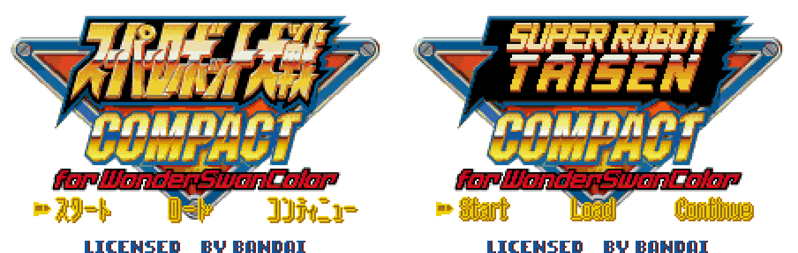

3. Opening text crawl

   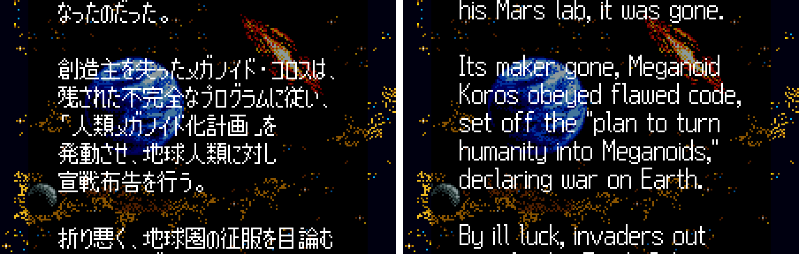

4. Story dialogue with portraits

   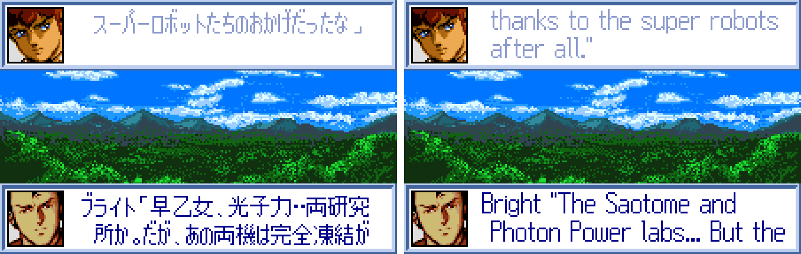

5. Map with the phase menu and the Turns / Credits box

   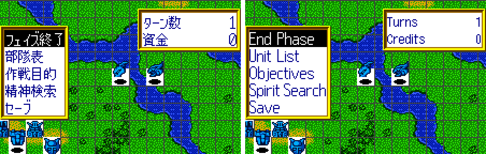

6. Map with the unit command menu

   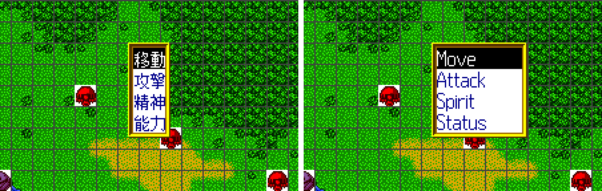

7. Weapon list

   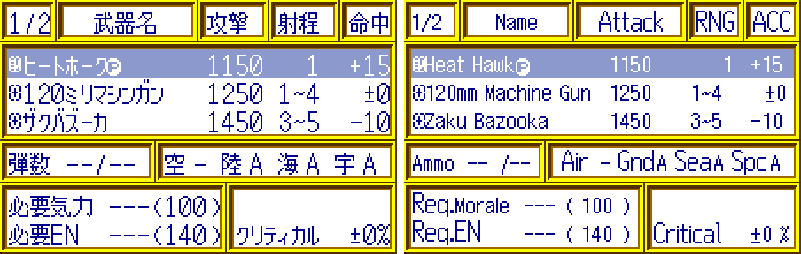

8. Battle animation with a quote

   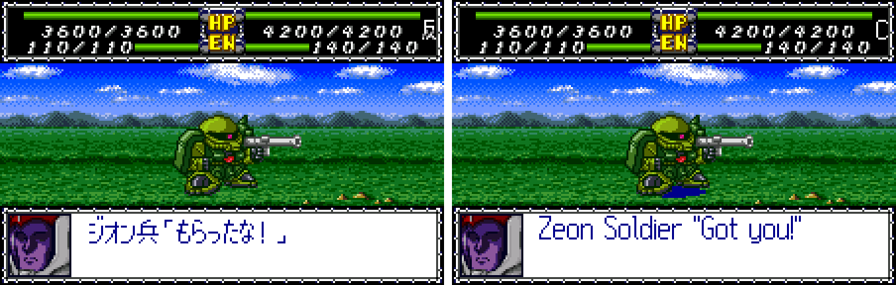

9. Map with the battle result box (Credits, EXP)

   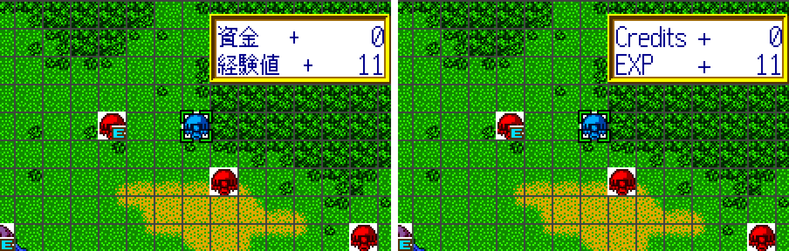

10. Unit status page

   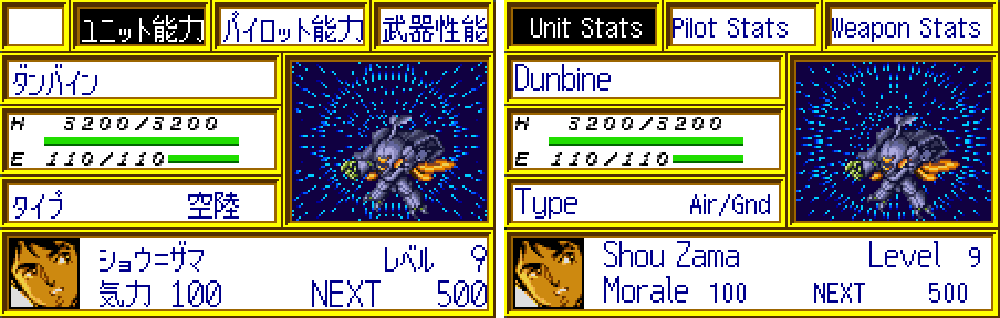

11. Intermission menu

   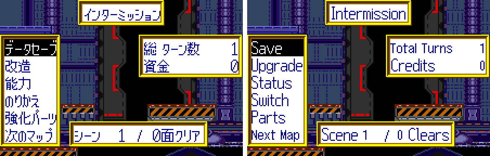

12. Next Map list

   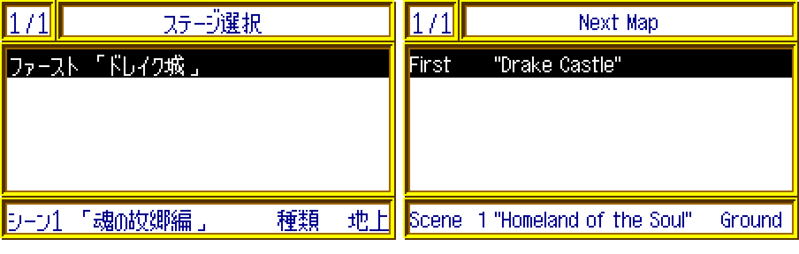

Debug edition only (the original's developer screens, forced by RAM pokes, on the left):

13. Title menu with the Debug entry

   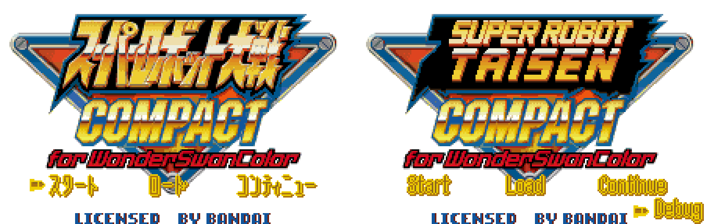

14. The Debug menu (Battle Test, Viewer)

   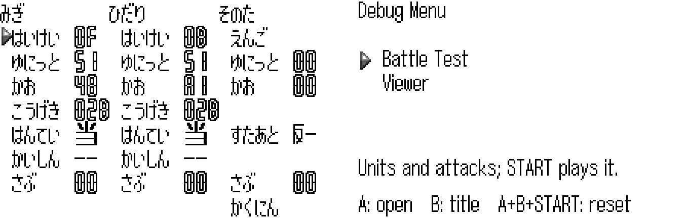

15. Battle Test with English labels

   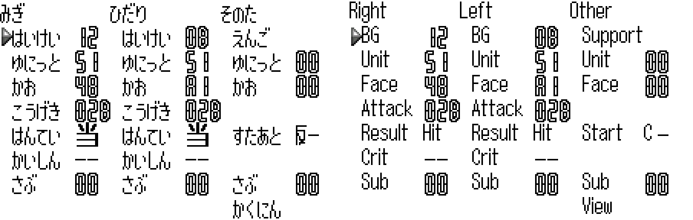

16. Status card of an enemy you have not scanned yet (new in 1.1)

   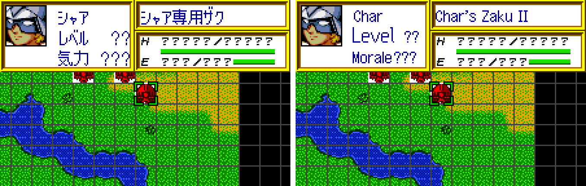

17. Battle with a critical hit (new in 1.1)

   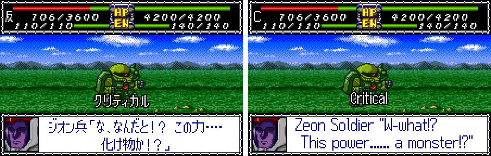

**Editions**

Both patches go on the same Japanese ROM and give a 4,194,304-byte file; each is released on its own.

| Patch | File | Result CRC32 | Result SHA-1 |

| --- | --- | --- | --- |

| Standard | `srw-compact-wsc-en-1.1.bps` | `74498827` | `1a0ec25a2a811003d287a71a7a4eea9f60202078` |

| Debug | `srw-compact-wsc-en-debug-1.1.bps` | `8FFB7B79` | `5609a2d17a9c05027dca14befde2266309782e59` |

**Debug**

The same translation as the standard patch, plus a visible **Debug** entry on the title menu, under the right end of Continue. It opens a small English menu with two of the developers' unused modes: **Battle Test** (choose the units, faces, attack and result values, then START plays one battle with the English battle quotes and returns to the menu) and **Viewer** (the portraits and unit sprites; START or Y1 returns). Their labels are in English, and B on the menu returns to the title. Start, Load and Continue work as in the standard patch.

The cartridge has a third developer mode, a map debug screen. It is not offered: it could not be made to work (started from the title its digits are garbage, and after Battle Test it gives a white screen). The map overview is not offered either. The title menu has a hidden fourth slot that opens the clear-data transfer to the sequel. In the Debug edition that slot is replaced by Debug, so the transfer is not reachable in this edition; use the standard patch for it.

**How to patch**

Apply one BPS file to the Japanese ROM **Super Robot Taisen Compact for WonderSwan Color (Japan).wsc** (4,194,304 bytes, CRC32 `16E0D929`, SHA-1 `bf212cecbbc51ee32ee2655a072f55e7bf70b9ec`) in your browser with the [Swan Revival patcher](https://swanrevival.com/patcher/), or with Floating IPS, beat or ROM Patcher JS. The result is 4,194,304 bytes:

* Standard: `srw-compact-wsc-en-1.1.bps`; the result should be CRC32 74498827.
* Debug edition: `srw-compact-wsc-en-debug-1.1.bps`; the result should be CRC32 8FFB7B79 (also 4,194,304 bytes).

It's a WonderSwan Color game, so keep the .wsc extension. You must provide your own copy of the original Japanese game to apply it.

**Download:** `srw-compact-wsc-en-1.1.bps`, `srw-compact-wsc-en-debug-1.1.bps` on the [release page](https://github.com/PokemonGoDB/wonderswan-english-patches/releases/tag/srw-compact-wsc-v1.1).

**Known issues**

* It hasn't been played start to finish by a person (see "What was not seen on screen"). If you find leftover Japanese or anything broken, please tell me where it happened.
* The weapon list header reads `Name / Attack / RNG / ACC` and the requirement rows `Req.Morale`; some labels, tabs and rows use the smaller 9 px face next to 12 px ones.
* In the phase menu, the save confirmation, the battle result box and the Sea of Ren briefing the text starts at the left frame where the original leaves 1 px.
* The sort tab on the unit list reads `By Mor.` and `By Lv.`; `Clears`, `Next Map` and a few other labels are short forms of the longer wording.
* Several long unit, pilot, weapon and terrain names are short forms in lists and the battle panel (see above).
* Save states made in an emulator on the Japanese ROM do not carry over to the patched ROM.
* It was tested in an emulator only, not on a real WonderSwan.
* Debug edition: for about two frames (0.05 s) while the Debug menu fades in, a light-blue band shows at the top of the screen.
* Debug edition: the map debug screen and the map overview are not offered, and the clear-data transfer to the sequel is not reachable (see above).
* Debug edition: save states made on the standard patch do not carry over to it, and the other way round.

**Technical notes (for the curious)**

* The game keeps its text in message banks, battle quote banks, a name and weapon pool and a prologue block; the patch replaces the text and the fonts and adds code in unused ROM space; the ROM stays 4 MiB. The engine is the one Compact 3 uses, so the patch builds on that translation's tools.
* The patch was checked by applying it to the original ROM and comparing with the tested build byte for byte.
* The Debug edition (`srw-compact-wsc-en-debug-1.1.bps`, the cartridge's Battle Test and Viewer developer modes behind a title-menu entry) is a separate patch; it is not part of the standard patch.

**A Note On My Justifications for AI Use**

I have been an avid fan of the Wonderswan system for a very long time now. It was actually a motivating factor for my various attempts to learn Japanese (which have all failed so far). I always wanted to explore the game catalog more, but the lack of English translations made it extremely difficult to do so. Here's the thing: There's a reason many of these games have not been translated yet. It's not just the fact that Japanese > English translation is difficult. There's also the fact that the original developers used all kinds of tricks and technical feats to make these games work. Most games do not have a searchable directory of text that you can just replace with English equivalents. While some are easier than others, translations for some of these would take not only an expert in Japanese > English translation, but also someone with vast game development and programming experience.

I say all that to say: I get why people are apprehensive about AI usage for this type of thing. However, these games have been around for a very long time now and most of them have still not received a translation. I (and others) have chosen to spend our time and money to utilize AI to translate the games and actually make them playable for the wider community. If you don't agree with that, that's completely fine. I am more than happy to remove any of my translations if better, human ran translations are released at a later date. We already decided to skip any games where someone is actively working on a manual translation. While nowhere near what a manual translation effort would be, I do spend a considerable amount of time trying to work through each game's translation. I stress over small details and try my best to make the right calls. And I've probably messed some stuff up, which is why I welcome feedback.

I'm just looking forward to digging through all of these games. It's a great time to be into Wonderswan games.
