# Star Hearts: Hoshi to Daichi no Shisha (WonderSwan Color) - AI English translation patch v1.0

**Star Hearts: Hoshi to Daichi no Shisha** (スターハーツ ～星と大地の使者～, "Star Hearts: Messenger of the Stars and the Earth") is Bandai's 2001 action RPG for the WonderSwan Color, released only in Japan. You play the child of Inde Village's chief, sent out on the day you come of age to free the land's spirits and fairies from the Evil Emperor Zorg. It is a top-down adventure with magic, animal abilities, weapon "Arts", charms you fit to your gear, a pet that hatches from a meteorite egg and fights other players' pets over the link cable, and an online bazaar on Bandai's WonderGate service.

This patch translates it into English.

> **Please read:** this translation was made **with AI** (Claude), as a hobby project. A person (me) made every judgement call before release, but nobody on the project is a professional translator. I'm sharing it as it is for anyone who wants to play. Please **don't upload it to romhacking sites** (romhacking.net and the like). It may not be up to the standard of a real fan translation and it doesn't belong there.

**What's translated**

* The whole script: every story event, the fairy and creature scenes, the narrated prologue and the ending.
* Every menu: magic, animal abilities, weapons and armor with their charms, Talismans, Amulets, equipment items, key items, events, status, the fairy list, the Arts list, options and the e-Pet screen; item, spell and Arts names and descriptions; shops and the smith.
* Everything drawn as a picture: the title, the new-game screens, the menu headings, the item prompts, the atlas cards shown when you first reach a country, and the map screen.
* Speaker name tags and map labels now show full names (Leprechaun, Sagittarius, Inde Village, Ousa's Tent), drawn in narrow letters made for this patch; the original's tags allowed only 8 letters.
* Link cable: the pet battles work between two English cartridges and between the English patch and a Japanese cartridge, in both directions. During a link battle your pet's name is shown in full-width letters so a Japanese console can read it.
* WonderGate: the Gate Bazaar's membership, visitor counters and error messages.
* A few characters suddenly speak English in the original ("I AM YOUR FATHER"); those lines keep the original's wide full-width letters.

**Hidden names**

Like the original, the name screen reacts to some names. Japanese names typed on the kana pages give the original's results. English names have their own list:

* **VJUMP** (or Vjump, VJump, V-Jump, V-JUMP): the V-Jump magazine code. Your hero starts with 140 Life and Magic and every stat at 7.
* Rows of a's: a, aa, aaa ... aaaaaaaa (or A ... AAAAAAAA) become Lazybone, Meh, LAZY, LAZIER, LAZIEST, Couch, Zzzzz... and No Drive.
* The names the original already accepted in Latin letters or digits, now typed in English: hi-ge, tai-pin, mi-na, tsu-yo, gunpey, kao, KAO, hiromi, toshibo, exe, DGM, GM, gO, RPG, 110 (also 911), 177 and 1242 (mostly the developers' nicknames and phone-number jokes).
* Zelda, Link and Shiren are refused (XXX), as in the original; Ultraman, Baltan, Miffy, Kyonkyon, Kimutaku, Mipolin, Noripi and chacha have their jokes.

**How it was made: AI translation, independent checks, human decisions**

* Claude translated everything directly from the Japanese in the ROM and did all the hacking. The ROM grows from 4 to 8 MiB to hold the English. The game's text renderer draws English with variable widths, the speaker tags and map labels got a new variable-width renderer, and the game's runtime messages (item pickups, numbers, link errors) were fitted to English.
* Nine separate Claude reviewers checked the whole game against the Japanese, scene by scene and list by list. Their findings were verified and fixed.
* On screen: every one of the 10,238 text boxes was drawn in the game's real box with the widest names and checked for overflow and leftover Japanese. Random walks covered 69 maps with every story flag set and a full inventory, with the original ROM as a control. All 479 maps were loaded, 531 graphics archives were examined for lettering, 12 minutes of the attract loop were recorded, and every menu, the shop, the save and continue screens, game over and the staff roll were compared side by side with the original for alignment.
* Link cable: complete pet battles on two linked emulated consoles, English-English, English-Japanese and Japanese-English.
* Online: the WonderGate Bazaar was played for real against a private copy of Swan Revival's server, on both the original and the English ROM, including the 1,000th-visitor prize and a refused connection. The live server was not used for testing.
* The judgement calls (names, terms, jokes, sensitive material, abbreviations) were listed with the Japanese and the options, and I decided all 106 by hand over four rounds.

**Things to know**

* Start a new game: a save from the Japanese version keeps its Japanese names.
* The cartridge header now declares the 32 KB of save memory the game really uses, so saves work in emulators and on flash carts (the original's header claims 8 KB and loses the end of every save).
* The game asks for your real birthday at the start and uses your real age in a few lines: if you are in your thirties, a child asks "By the way, big bro, are you married?". This is kept as in the original, whichever hero you play.

**Changelog**

* **v1.0**: first release.

**Sources consulted**

* Japanese text: the WonderSwan Color ROM itself.
* Mythological and astronomical names (Gae Bolg, Claíomh Solais, Manannan mac Lir, the zodiac): their usual English spellings.
* WonderGate behaviour: the game's code and Swan Revival's notes on this game.

**Images** (original on the left, English on the right)

1. Title screen

   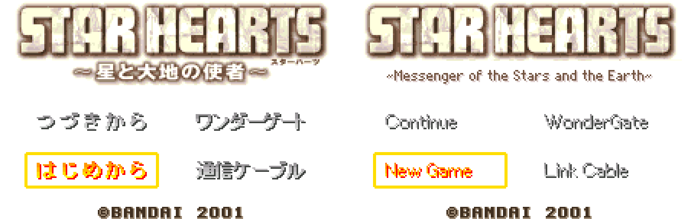

2. The opening: the Nanny wakes you

   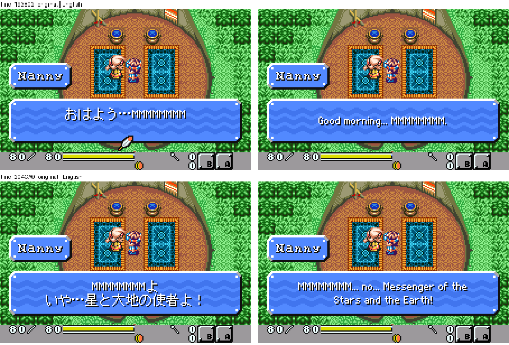

3. Wampa's blessing and your first item

   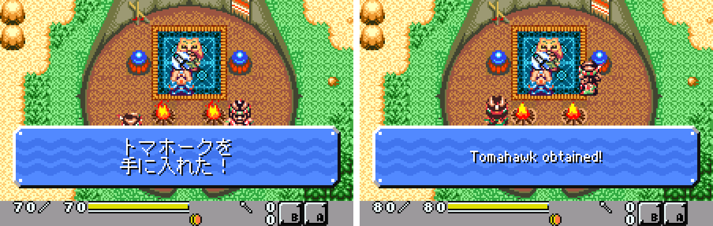

4. The main menu

   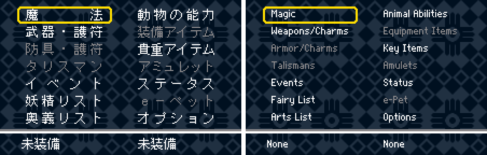

5. Weapons and their charms

   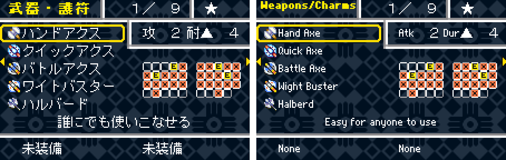

6. The Arts list

   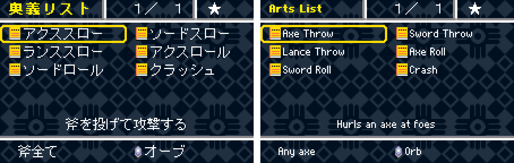

7. A shop

   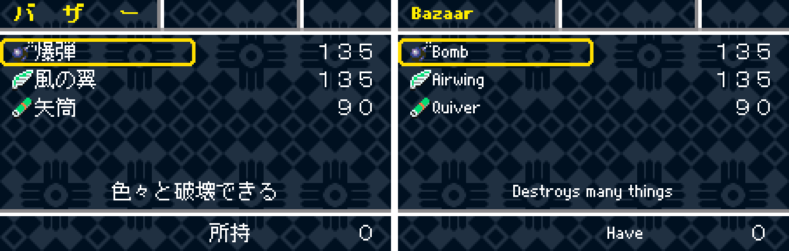

8. The map screen with full labels

   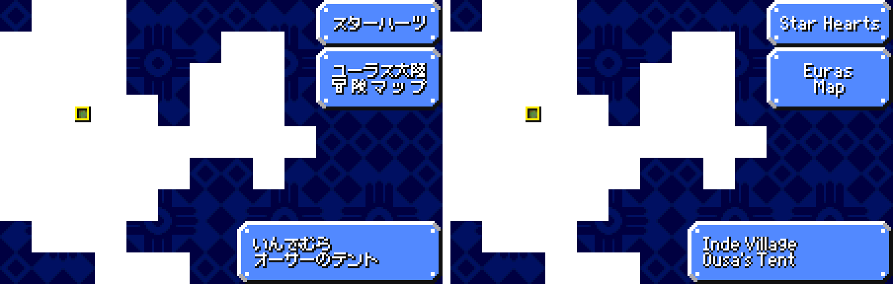

9. An atlas card

   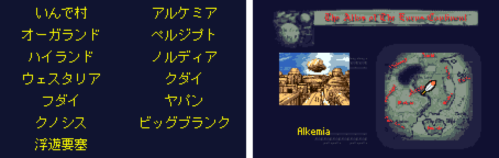

10. The e-Pet screen

   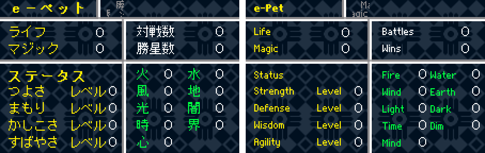

11. A link-cable pet battle (English and Japanese consoles)

   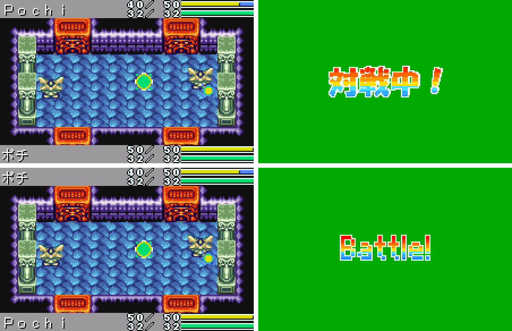

12. The Gate Bazaar (a real WonderGate session)

   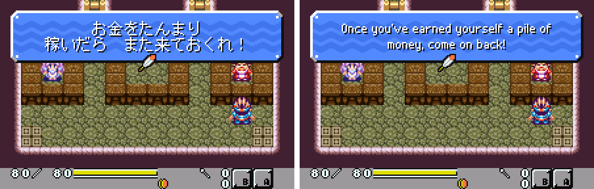

13. The staff roll

   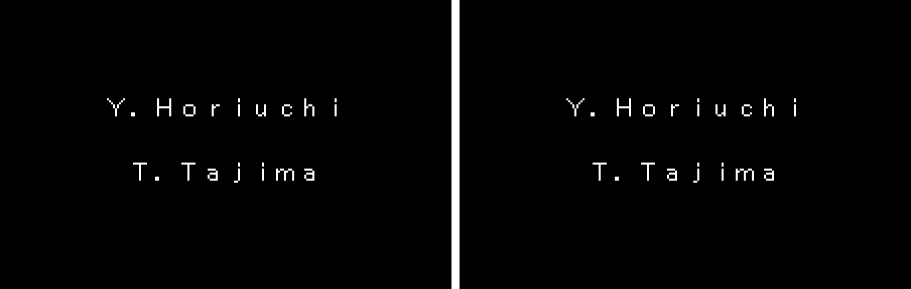

**How to patch**

Apply `star-hearts-en-1.0.bps` to the Japanese ROM "Star Hearts - Hoshi to Daichi no Shisha (Japan)" (CRC32 138D1018) in your browser with the [Swan Revival patcher](https://swanrevival.com/patcher/), or with Floating IPS, beat or ROM Patcher JS. The result is an 8 MB ROM with CRC32 8892AE15 (SHA-1 02428d6a2af4bf84b84321b336db98c8b718b347).

It's a WonderSwan Color game, so keep the .wsc extension. You must provide your own copy of the original Japanese game to apply it.

**Download:** `star-hearts-en-1.0.bps` on the [release page](https://github.com/PokemonGoDB/wonderswan-english-patches/releases/tag/star-hearts-v1.0).

**Known issues**

* It hasn't been played start to finish by a person. The opening, the first areas, the menus, shops, saving, continuing and game over were played; later areas were reached by random walks with every story flag set. The final battle and the ending scenes were not played to: their text was checked in the game's own boxes, and the staff roll was seen on screen. The music room was not reached; its titles were checked the same way. If you find leftover Japanese or anything broken, please tell me where it happened.
* Link Cable needs a hatched pet. Choosing it without one crashes the game, as it does in the original.
* Bandai's WonderGate server is long gone. Swan Revival's server supports this game's Gate Bazaar.

**Technical notes (for the curious)**

* The English needs more room than the Japanese, so the ROM grows from 4 MB to 8 MB; the English text lives in the added half.
* The game's dialogue renderer draws English letters with variable widths. The speaker name tags and map labels had a separate tile-based renderer limited to 8 characters; it was replaced with a variable-width one and a narrow font, so tags and labels show full names.
* The name screen's hidden names are checked by the original code against Japanese kana; a hook adds a second table for the English names, including the V-Jump code.
* English letters use codes the Japanese font doesn't have. For Link Cable play, the pet's name is converted to full-width letters (which both versions can draw) when the link mode starts, and back when it ends; the link mode never saves the pet record, so the save only ever holds the English codes.
* The original's cartridge header declares 8 KB of save memory, but the game writes 32 KB. The header now declares 32 KB, so emulators and flash carts keep the whole save.
* The game copies an item's name into the "obtained!" message through a buffer with no length check, and a longer name would overwrite the message. Every English item name fits in 9 character codes (two letters can share one code) and 84 pixels, and the build refuses a longer one.

**A Note On My Justifications for AI Use**

I have been an avid fan of the Wonderswan system for a very long time now. It was actually a motivating factor for my various attempts to learn Japanese (which have all failed so far). I always wanted to explore the game catalog more, but the lack of English translations made it extremely difficult to do so. Here's the thing: There's a reason many of these games have not been translated yet. It's not just the fact that Japanese > English translation is difficult. There's also the fact that the original developers used all kinds of tricks and technical feats to make these games work. Most games do not have a searchable directory of text that you can just replace with English equivalents. While some are easier than others, translations for some of these would take not only an expert in Japanese > English translation, but also someone with vast game development and programming experience.

I say all that to say: I get why people are apprehensive about AI usage for this type of thing. However, these games have been around for a very long time now and most of them have still not received a translation. I (and others) have chosen to spend our time and money to utilize AI to translate the games and actually make them playable for the wider community. If you don't agree with that, that's completely fine. I am more than happy to remove any of my translations if better, human ran translations are released at a later date. We already decided to skip any games where someone is actively working on a manual translation. While nowhere near what a manual translation effort would be, I do spend a considerable amount of time trying to work through each game's translation. I stress over small details and try my best to make the right calls. And I've probably messed some stuff up, which is why I welcome feedback.

I'm just looking forward to digging through all of these games. It's a great time to be into Wonderswan games.
