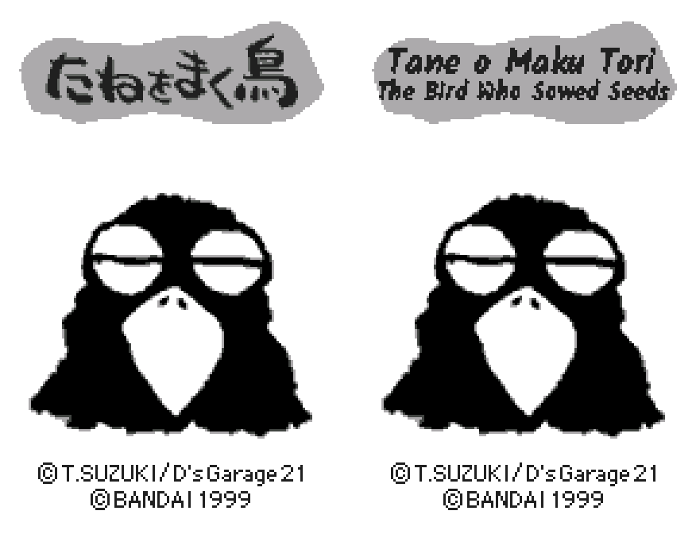
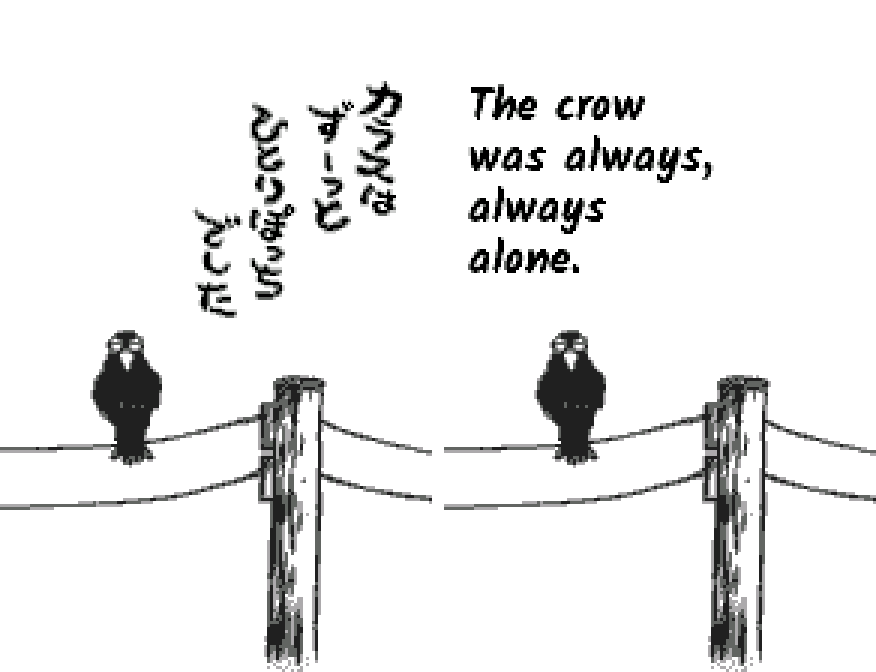
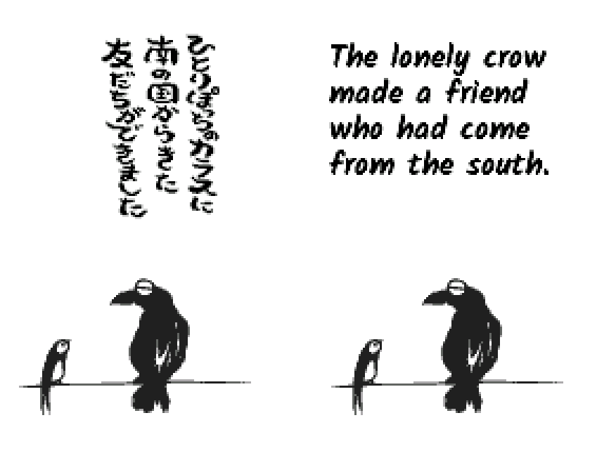
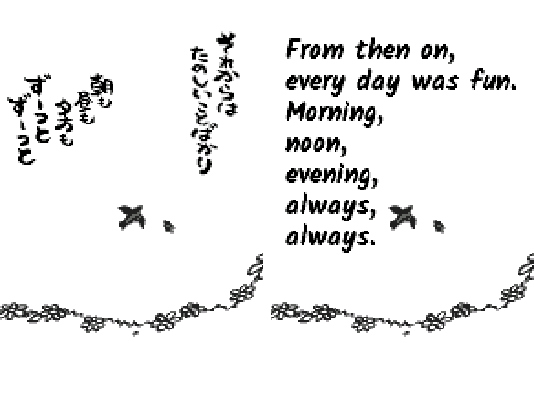
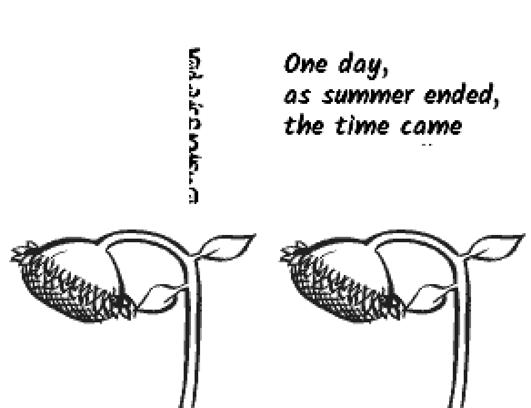
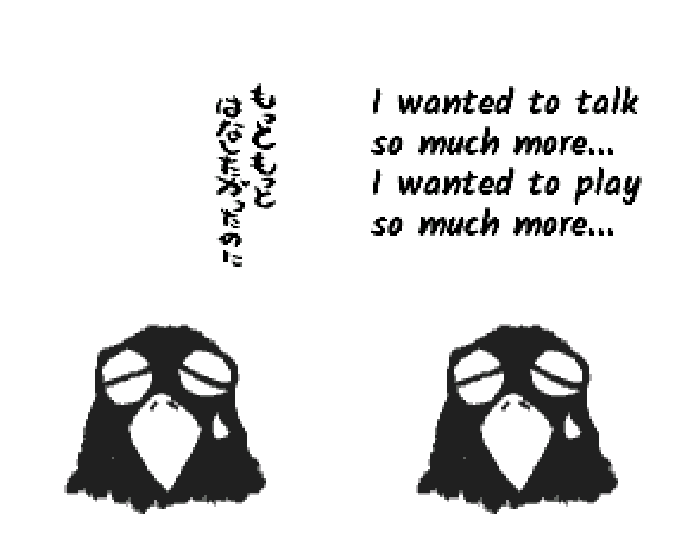
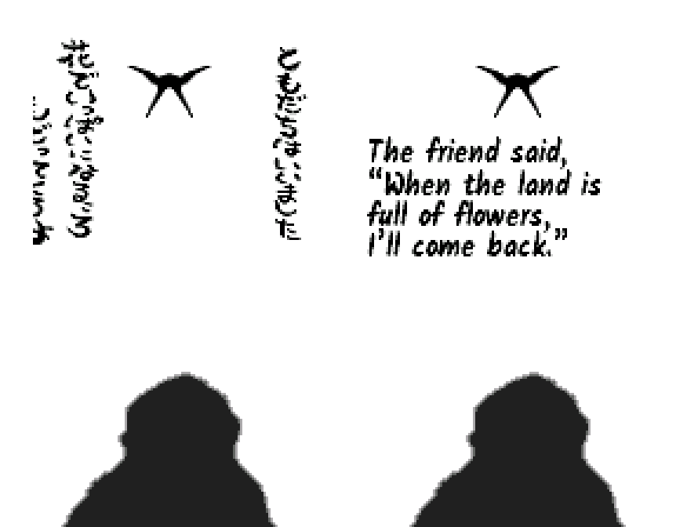
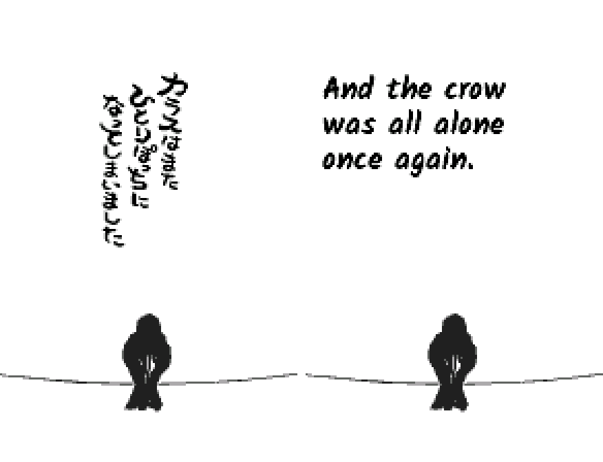

# Tane o Maku Tori: The Bird Who Sowed Seeds (WonderSwan) - AI English translation patch v1.0

**Tane o Maku Tori** is T. Suzuki's 1999 game from Bandai's D's Garage 21 contest, for the original WonderSwan held upright, released only in Japan. A hand-lettered picture book tells of a lonely crow, a friend who promises to return when the land is full of flowers, and a seed. Then you play the crow.

> **Please read:** this translation was made **with AI** (Claude), as a hobby project. A person (me) made every judgement call before release, but nobody on the project is a professional translator. I'm sharing it as it is for anyone who wants to play. Please **don't upload it to romhacking sites** (romhacking.net and the like). It may not be up to the standard of a real fan translation and it doesn't belong there.

**What's translated**

Every word is a picture, and all of them were redrawn:

* The story pages, hand-lettered in English.
* The title logo (Tane o Maku Tori / The Bird Who Sowed Seeds), menu, stage cards, results and score screens.
* Left in Japanese: the WonderGate status messages, which only appear with the long-dead mobile adapter.

**How it was made**

* Claude translated the hand lettering directly from the Japanese in the ROM and did all the hacking.
* Separate Claude reviewers checked everything against the Japanese, and every page and screen was checked in an emulator from power-on.
* I made the judgement calls by hand: the lettering, the English title, the story's tone and the logo.

**Changelog**

* **v1.0**: first release.

**Images** (original on the left, English on the right)

1. Title

   

2. The crow was always alone

   

3. A friend from the south

   

4. Every day was fun

   

5. The end of summer

   

6. "I wanted to talk so much more..."

   

7. The friend's promise

   

8. Alone once again

   

**How to patch**

Apply the BPS to "D's Garage 21 Koubo Game - Tane o Maku Tori (Japan)" (CRC32 B1CAEC06) with Floating IPS, beat or ROM Patcher JS. The result should be CRC32 40EC6A1D. Keep the .ws extension. You need your own copy of the Japanese game.

**Download:** `tane-o-maku-tori-en-1.0.bps` on the [release page](https://github.com/PokemonGoDB/wonderswan-english-patches/releases/tag/tane-o-maku-tori-v1.0).

**Known issues**

* Not played start to finish by a person. Please tell me where if you find leftover Japanese or a broken picture.

**Technical notes (for the curious)**

* Each screen is stored rotated and compressed; the patch redraws it upright and repacks it into free ROM space. Lettering: Kalam Bold (SIL OFL).

**A Note On My Justifications for AI Use**

I have been an avid fan of the Wonderswan system for a very long time now. It was actually a motivating factor for my various attempts to learn Japanese (which have all failed so far). I always wanted to explore the game catalog more, but the lack of English translations made it extremely difficult to do so. Here's the thing: There's a reason many of these games have not been translated yet. It's not just the fact that Japanese > English translation is difficult. There's also the fact that the original developers used all kinds of tricks and technical feats to make these games work. Most games do not have a searchable directory of text that you can just replace with English equivalents. While some are easier than others, translations for some of these would take not only an expert in Japanese > English translation, but also someone with vast game development and programming experience.

I say all that to say: I get why people are apprehensive about AI usage for this type of thing. However, these games have been around for a very long time now and most of them have still not received a translation. I (and others) have chosen to spend our time and money to utilize AI to translate the games and actually make them playable for the wider community. If you don't agree with that, that's completely fine. I am more than happy to remove any of my translations if better, human ran translations are released at a later date. We already decided to skip any games where someone is actively working on a manual translation. While nowhere near what a manual translation effort would be, I do spend a considerable amount of time trying to work through each game's translation. I stress over small details and try my best to make the right calls. And I've probably messed some stuff up, which is why I welcome feedback.

I'm just looking forward to digging through all of these games. It's a great time to be into Wonderswan games.
