# Tanjou Debut for WonderSwan (WonderSwan) - AI English translation patch v1.0 (誕生 〜Debut〜 for WonderSwan, Bandai Visual / Image Works 2000)

**Tanjou Debut for WonderSwan** (誕生 〜Debut〜 for WonderSwan) is an idol-raising simulation made by Bandai Visual / Image Works in 2000 for the original (monochrome) WonderSwan, based on a 1993 PC-98 game of the same name. You manage three young idols, Aki Ito (16), Saori Fujimura (17) and Kumi Tanaka (16), through a two-year schedule of lessons, jobs and talks, one week at a time, until the Idol Grand Prix decides how the story ends. The kanji in the title, 誕生, read "tanjou" and mean "birth". This patch translates all the text the game shows into English, in two editions that differ only in the quiz.

> **Please read:** this translation was made **with AI** (Claude), as a hobby project. A person (me) made every judgement call before release, but nobody on the project is a professional translator. I'm sharing it as it is for anyone who wants to play. Please **don't upload it to romhacking sites** (romhacking.net and the like). It may not be up to the standard of a real fan translation and it doesn't belong there.

**What's translated**

* **The script:** all 1,416 text units (dialogue, menus, messages, quiz questions, rival lines, news items, epilogues and the ending text), in the game's five text blocks plus the system strings. Names follow Western order: Aki Ito, Saori Fujimura, Kumi Tanaka.
* **Pictures with text,** redrawn by hand in the original lettering: the menu plates, the schedule and job tables, stat labels, result tables, rankings, the Album labels, the credits, the profile cards and the seven newspaper pages. In all, 259 of the game's 828 pictures (in 33 of 225 picture archives) were redrawn.
* **The title logo is the original picture on purpose.** The logo (誕生 〜Debut〜 for WonderSwan) stays in Japanese. The New Game / Load / Album Mode buttons under it are English in the original game.
* **Newspapers and labels** are redrawn by hand. Some headlines and labels are **smaller than the original kana** (the newspaper main headlines are 17 to 26 px tall against 24 to 34 px in the original, and the schedule tabs 7 px against 11 px), and two small kickers on the newspapers are kept as texture because they could not be read.
* **The English** is drawn with a proportional font built into the game by a small code patch, because the original draws fixed 12 px kana. A line holds about 40 letters.
* **The two editions:**
  * **Standard edition:** the quiz questions are rebuilt so that they work in English wherever the Japanese depends on how a word is read (for example the station-name question asks how to say the "Leicester" in Leicester Square).
  * **Original Quiz edition:** the questions are kept as literal as possible, and four of them draw the Japanese kanji they ask about on screen (小作, 下手, 台詞 and 殺陣), so you can see the word that is being asked about.
* **Choices that were a matter of taste** (names, the wording of the Rest prompt "Take a rest?", the Album tab "Actor", the lettering and so on) were listed with the Japanese and pictures, and I decided every one of them.
* **Sensitive content** (the scandal stories and a few adult-themed epilogues) is translated faithfully, not softened.

**How it was made: AI translation, independent checks, human decisions**

* Claude worked out the game's text format, translated everything directly from the Japanese in the ROM, redrew the picture text and added the English font and drawing code to the cartridge.
* The build went through an automated run of 9 checks, and all 9 passed:
  * every one of the 1,416 text units compares equal to the source and fits its box, and every text id the sweep could reach (1,411) was drawn by the game and none was flagged;
  * random-button walks of 717,276 frames from 63 start points drew no Japanese on the English build (the same check on the original ROM finds 2,753 cases, so it can see Japanese);
  * the attract loop, the bad ending (73 screens) and the good ending (85 screens, with the 10 credits pages) were captured;
  * 36 of the 38 rows of the screen inventory were captured in English on screen (the other 2 are listed with a reason), and 252 inventory pairs and 158 ending pairs were compared with the original;
  * 5,040,000 frames of soak tests from 28 start points raised no flags.
* Independent Claude reviewers read the English and the alignment of 410 captured screens beside the Japanese originals. Their findings were fixed and re-checked, and every screen passed on the final build. The Original Quiz edition got a smaller check (its 51 quiz strings, the kanji, the byte difference and three questions on screen), not the full run.
* Both patches were applied to the original ROM with the project's own BPS tool and the results were compared with the builds: identical byte for byte. No other patcher was tried.
* All 50 judgement calls were listed with the options and pictures, and I decided every one of them.

**What was not seen on screen** (please report anything odd)

* **The newspapers:** all seven were shown on screen only by forcing the random scandal event with a memory write. No natural route to them was found.
* **Endings:** the ending where Debut wins was reached by changing the popularity value in the emulator, not by play. The other ranks (2 to 7) and any further endings were not tested, and only 6 of about 114 epilogue strings were seen on screen; the rest were read in the script.
* **The Album:** every entry is locked on a fresh save, so what an unlocked entry looks like was not seen.
* **The Year Record** was only seen with test rows written into a save, never with a natural save; Years 3 and 4 were not seen at all.
* **Rival lines and the quiz:** three rival quiz lines (B4.k.1, B4.9.k and B4.10.0) and one text routine were never reached. In the Original Quiz edition only three questions were seen on screen; two more were checked only by a test drawing in another scene.
* **Longer text:** names and numbers longer than the captured ones, 3-digit popularity gains in the 2-character stat field, and about 100 strings that may need a third line were not seen on screen.
* **Other screens:** game over by failure, link screens and hidden title button combinations were not found. Idle timeouts were only checked on the title and the Sunday menu. Several talk and job results (for example the gift reaction and the musical result table) were not on screen.
* **Animation:** sparkles, cursor sprites, text typing and the logo animation were judged on still captures only.
* **Outside checks:** staff names in the credits and the facts in the quiz questions were not checked against outside sources.
* The game was not played from start to finish by a person, and not on real hardware.

**Changelog**

* **v1.0**: first public release, in two editions.

**Sources consulted**

* Japanese text: the WonderSwan ROM itself, which also shows "(c)2000 BANDAI VISUAL / IMAGE WORKS, LICENSED by BANDAI".
* Names: cast lists on Anime News Network and Japanese Wikipedia (readings for the rivals from Japanese Wikipedia).
* The 1993 PC-98 original and the release date come from Wikipedia and retail listings, not from the ROM.
* The project's own notes on the game's text format, terms and the QA run summaries.
* No other English translation was found as of 2026-11-14.

**Images** (original on the left, English on the right)

1. Title menu (the logo is the kept original; the New Game / Load / Album Mode buttons are English in the original too)

   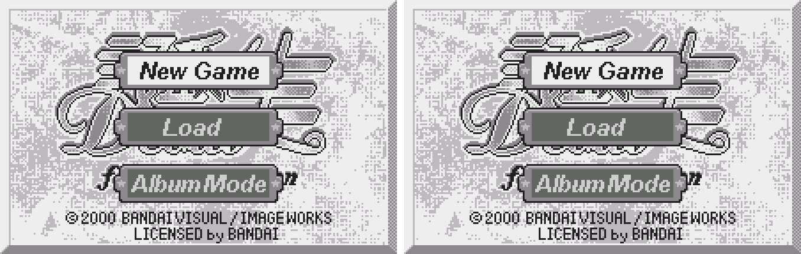

2. A character profile card

   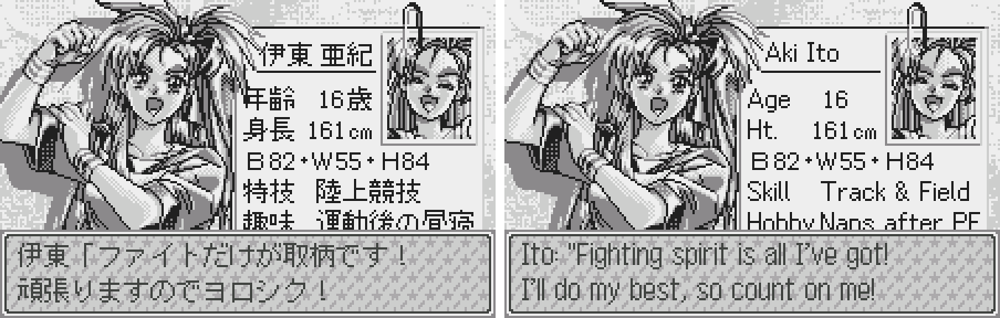

3. Talking to a girl: dialogue

   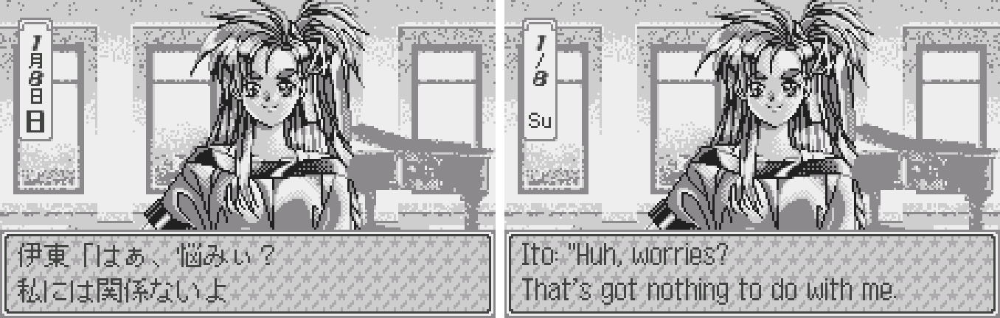

4. The weekly schedule

   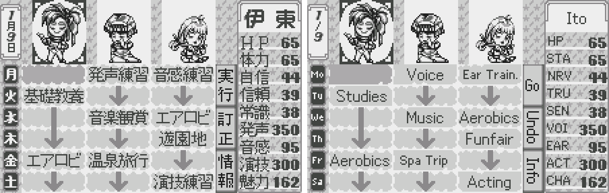

5. Choosing a job

   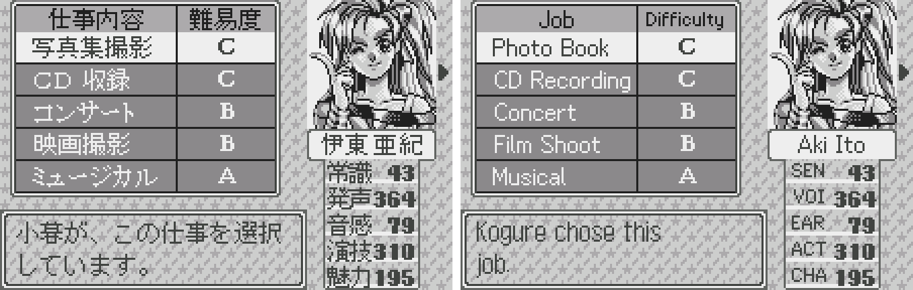

6. The quiz, standard edition ("How do you say the 'Leicester' in the London Tube station Leicester Square?")

   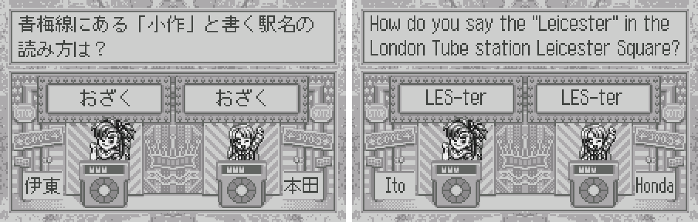

7. The quiz, Original Quiz edition ("On the Ome Line, how do you read the station name written 小作?", the kanji drawn on screen)

   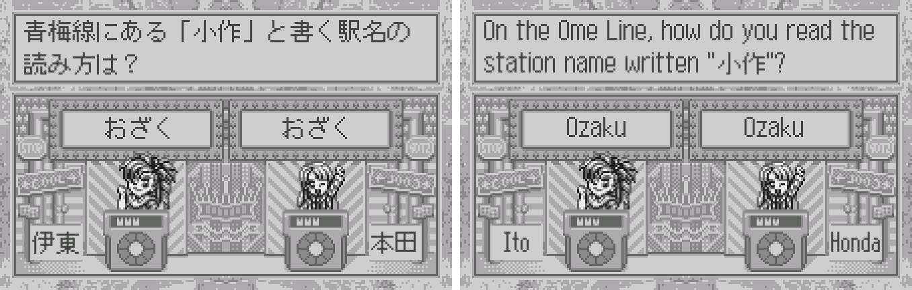

8. The ranking

   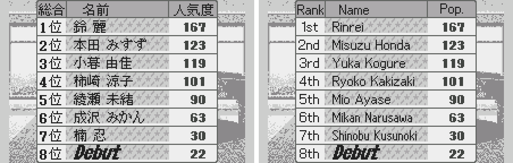

9. A scandal event (reached by forcing the random event)

   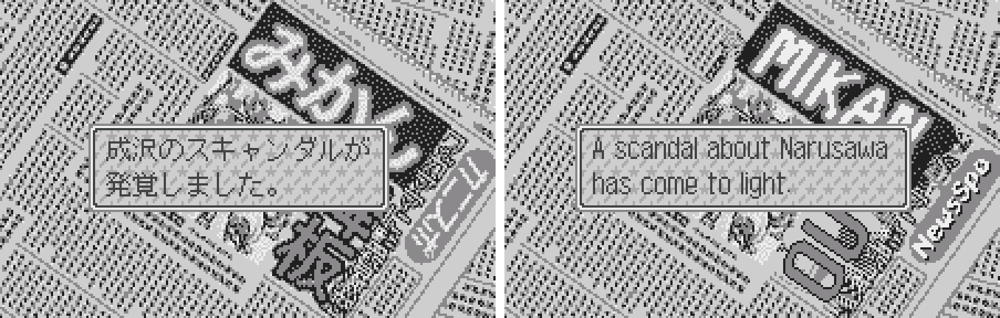

10. A redrawn newspaper page: Rinrei (shown by forcing the event)

   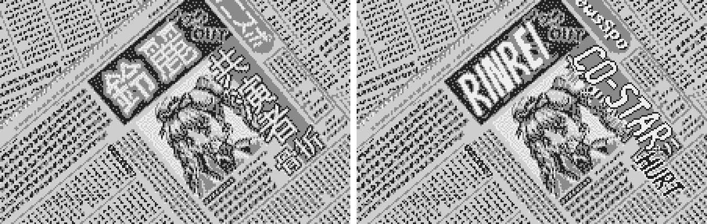

11. A redrawn newspaper page: Kusunoki (shown by forcing the event)

   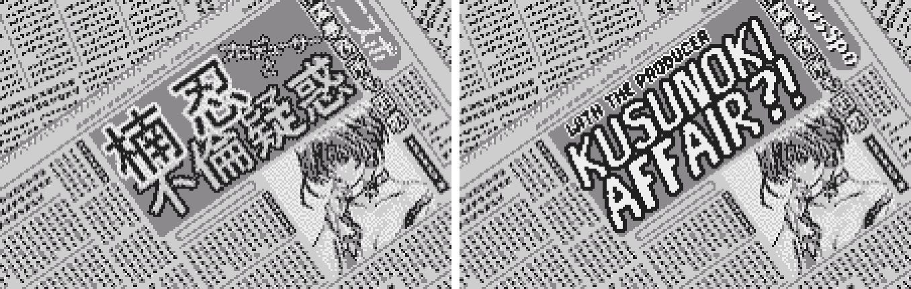

12. Album mode, the Actor tab

   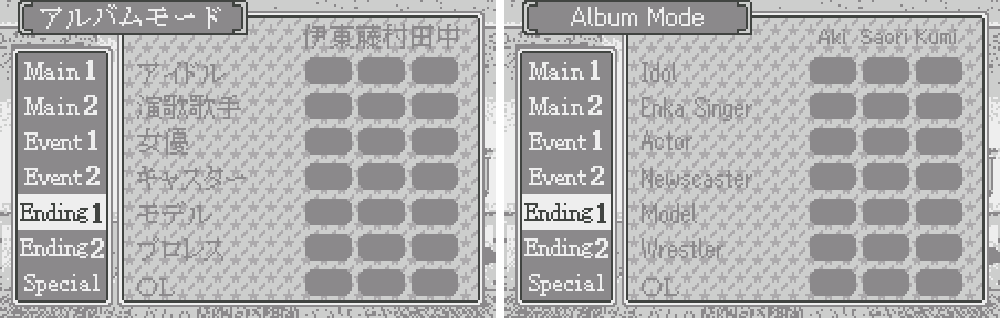

13. The Rest prompt, "Take a rest?"

   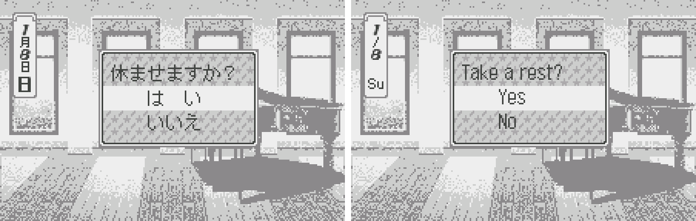

14. An ending

   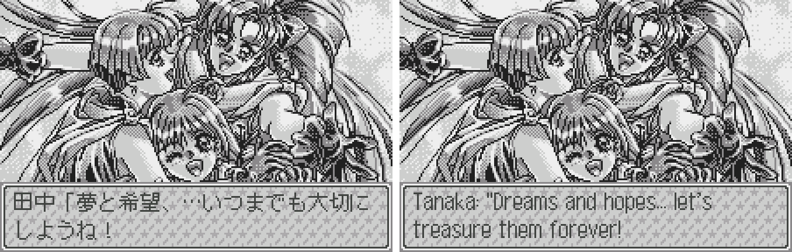

**How to patch**

Apply one of the two BPS files to the Japanese ROM **Tanjou Debut for WonderSwan (Japan).ws** (2,097,152 bytes, CRC32 `8B74F59A`, SHA-256 `47be2e0e51a960c1ade1bef4d990e084209d381c83dd2f612a4abe9af3bdf77e`) in your browser with the [Swan Revival patcher](https://swanrevival.com/patcher/), or with Floating IPS, beat or ROM Patcher JS. Both results are 2,097,152 bytes.

* `tanjou-debut-en-1.0.bps` (standard edition): the result should have CRC32 `E4034CDD` (SHA-256 `95e8cf36832d7652146859ac16888b724e5a77c671cfe27ad041fca149698f0a`). **Choose this one if you want the quiz to work in English.** It is the one I'd start with.
* `tanjou-debut-en-original-quiz-1.0.bps` (Original Quiz edition): the result should have CRC32 `4CB3DAEE` (SHA-256 `d0c870149cc424b2a599bcc7d2a2693a4c6b9699187cf173646f4c8b88dc7639`). **Choose this one if you want the questions as literal as possible, with the kanji drawn on screen.** It stays closer to the Japanese questions; the four questions about kanji show the kanji they ask about.

It's a monochrome WonderSwan game, so keep the .ws extension. You must provide your own copy of the original Japanese game to apply it.

**Download:** [v1.0](https://github.com/PokemonGoDB/wonderswan-english-patches/releases/tag/tanjou-debut-v1.0)

**Known issues**

* It hasn't been played start to finish by a person. If you find leftover Japanese or anything broken, please tell me where it happened.
* The screens listed above under "What was not seen on screen" were checked only in the text and the code, or by forcing the game into them.
* Newspaper headlines and some labels are smaller than the original kana, and two newspaper kickers are kept as texture. The English letters in the message window are 10 px capitals against 11 px kana.
* The title logo is Japanese (it is the original picture). The ending text still says "Actress" in places while the Album tab says "Actor".
* In a few pictures the rows with descenders (g, y, p) were not all changed; the Year Record row where Rinrei sits 1 px high is one.
* Emulator save states made on the Japanese ROM keep its picture tiles, so they show Japanese labels on the English ROM; a normal in-game save made on the Japanese ROM loaded on the English ROM in the one emulator test.
* No debug menu was found: a scan of the ROM text found none, but the keypad was not traced, so one may still exist.
* It was tested in an emulator only, not on a real WonderSwan. The patches were applied only with the project's own BPS tool, not with the other patchers named above.

**Technical notes (for the curious)**

* The text is Shift-JIS with 1,416 units in five blocks; most UI text is pictures in uncompressed WSP archives. There is one 12x11 font and a 26-clip voice archive (not changed).
* The patch adds 6,579 bytes of code in the free space at the end of bank 1F (0x1FC000 to 0x1FD9B2): a variable-width drawer for Latin letters, two measure hooks, a hook that moves the Info box rank digit, a hook that adds "st/nd/rd/th" to the Year Record ranks, and a 2 px thin space.
* The game measures text boxes in 4 px units and the unit count's parity decides whether the pen starts 1 px in; the patch rounds odd English counts up so text sits 5 px from the frame, as in Japanese.
* The two ROMs differ by 11,451 bytes (the quiz block, its header words and the checksum); all pictures are identical. The ROM stays 2 MB.

**A Note On My Justifications for AI Use**

I have been an avid fan of the Wonderswan system for a very long time now. It was actually a motivating factor for my various attempts to learn Japanese (which have all failed so far). I always wanted to explore the game catalog more, but the lack of English translations made it extremely difficult to do so. Here's the thing: There's a reason many of these games have not been translated yet. It's not just the fact that Japanese > English translation is difficult. There's also the fact that the original developers used all kinds of tricks and technical feats to make these games work. Most games do not have a searchable directory of text that you can just replace with English equivalents. While some are easier than others, translations for some of these would take not only an expert in Japanese > English translation, but also someone with vast game development and programming experience.

I say all that to say: I get why people are apprehensive about AI usage for this type of thing. However, these games have been around for a very long time now and most of them have still not received a translation. I (and others) have chosen to spend our time and money to utilize AI to translate the games and actually make them playable for the wider community. If you don't agree with that, that's completely fine. I am more than happy to remove any of my translations if better, human ran translations are released at a later date. We already decided to skip any games where someone is actively working on a manual translation. While nowhere near what a manual translation effort would be, I do spend a considerable amount of time trying to work through each game's translation. I stress over small details and try my best to make the right calls. And I've probably messed some stuff up, which is why I welcome feedback.

I'm just looking forward to digging through all of these games. It's a great time to be into Wonderswan games.
