# Tare Panda no GunPey (WonderSwan) - AI English translation patch v1.0 (+ debug edition)

**Tare Panda no GunPey** (たれぱんだのぐんぺい, "Tarepanda's GunPey") is Bandai's 1999 version of the puzzle game GunPey for the original (monochrome) WonderSwan, starring San-X's Tarepanda, the lazy, flattened panda. It is played with the console held upright and was released only in Japan. You swap panels up and down their columns to join their line pieces into a path from one side of the field to the other; a joined path disappears, and new rows keep pushing up from below. It has five single-player modes, served as dishes on a restaurant menu: an endless game, an observation mode, 100 set puzzles, a story mode in which a tarepanda rolls through nine stages of little scenes, and a game that never ends. There are also two-player link-cable battles and a hidden WonderGate mode that once sent scores to Bandai's national rankings.

This patch translates it into English.

> **Please read:** this translation was made **with AI** (Claude), as a hobby project. A person (me) made every judgement call before release, but nobody on the project is a professional translator. I'm sharing it as it is for anyone who wants to play. Please **don't upload it to romhacking sites** (romhacking.net and the like). It may not be up to the standard of a real fan translation and it doesn't belong there.

**What's translated**

* Every word in this game is a picture, and every one of them was redrawn: the title logo and menus, the mode menu, the round screens (labels, banners, the SP gauge, the portrait's moods), continue, results, high scores, the records pages and the observation report.
* The story mode: all 60 scene captions, the photo card counting the pandas you have met, and the ending, with its album of nine photographs.
* Two players: the panda select and handicap screens, the action words beside each panda's animation, the waiting screen and the results.
* The hidden WonderGate mode: its menu, the options with the pictured phone, the connecting and error screens, and the national ranking pages for all four modes.
* The Japanese was written vertically in many places (the mode menu, the captions, the action words). The English is set horizontally there, in the same spots.

Names: San-X spells the character **Tarepanda**, as one word. The mode menu's dishes are **Tarepanda, for starters.**, **observed.**, **puzzled.**, **stacked.** and **forever.**, and the two-player mode is **Tarepanda, for two.**.

**The debug edition**

The debug edition (`tare-panda-gunpey-en-debug-1.0.bps`) is the standard patch plus a **Debug** plate at the bottom of the title menu. It opens the developers' hidden menu, which is in English already: PATTERN (a graphics viewer), FACE (the portrait viewer), SOUND (a sound test) and DEMO, which starts the story at any of its nine stages. Nothing in the original reaches this menu. It is a leftover developer tool, plain and unpolished, with hexadecimal numbers and no instructions.

**How it was made: AI translation, independent checks, human decisions**

* Claude translated everything directly from the Japanese in the ROM and did all the hacking. The game's compressed tile sets were decoded and redrawn in English, and a few code changes were needed: the mode menu's highlight and cursor move across horizontal plates, the story's caption positions were moved, and the WonderGate rank line reads "rank of total".
* A separate, independent Claude reviewer checked the whole game against the Japanese, text and screenshots. Its findings were verified and fixed.
* On screen: scripted tours of every mode on the English build, with the original ROM as a control; every story caption photographed as the story draws it; a full linked match on two emulated consoles; 12 minutes of the attract loop; and side-by-side comparisons with the original for alignment. No Japanese was found.
* Online: the WonderGate session was played for real against a private copy of Swan Revival's server, on both the original and the English ROM, with the widest rankings the game can show (rank 9,876 of 9,999), plus a real connection error. The requests, the replies and the hang-up are the same on both. The live server was not used for testing.
* The judgement calls (names, terms, the logo, the caption font, the action words) were listed with the Japanese and the options, and I decided all 20 by hand over three rounds.

**Changelog**

* **v1.0**: first release.

**Sources consulted**

* Japanese text: the WonderSwan ROM itself.
* Spelling of Tarepanda: San-X's own romanization.
* WonderGate behaviour: the game's code and Swan Revival's notes on this game.

**Images** (original on the left, English on the right)

1. Title screen

   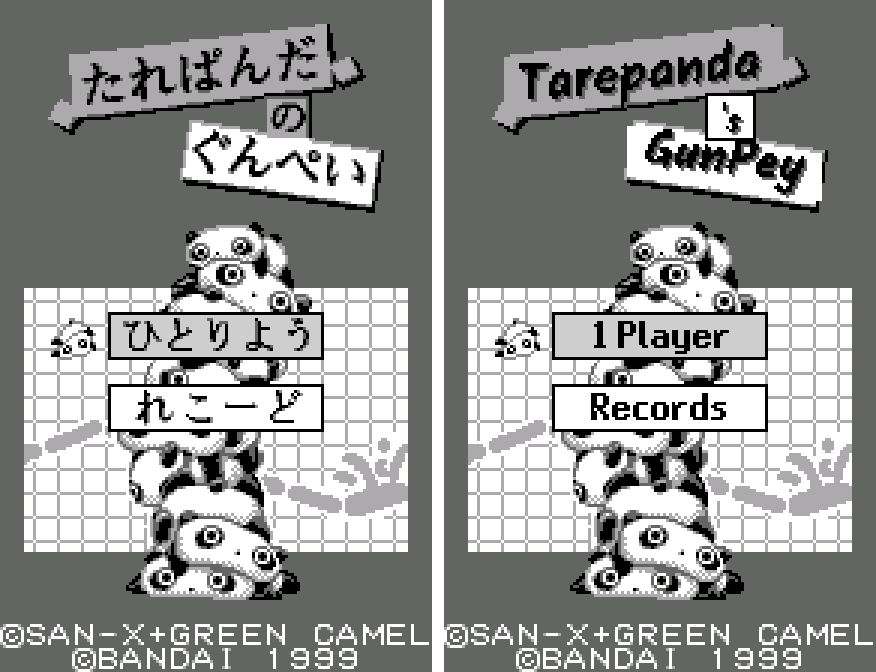

2. The mode menu

   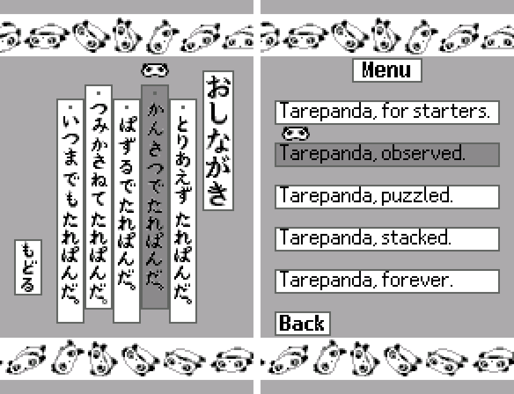

3. A story scene and its caption

   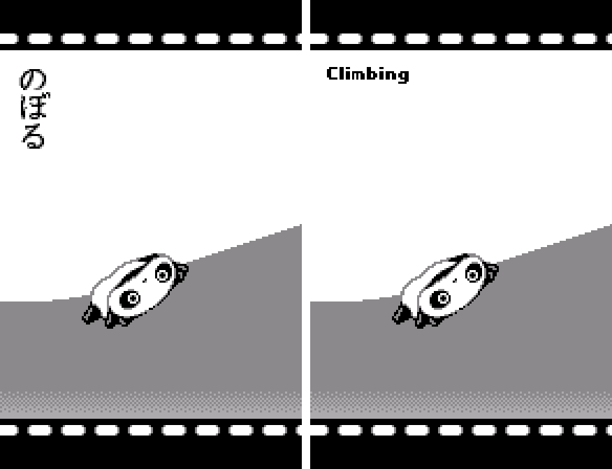

4. A round in progress

   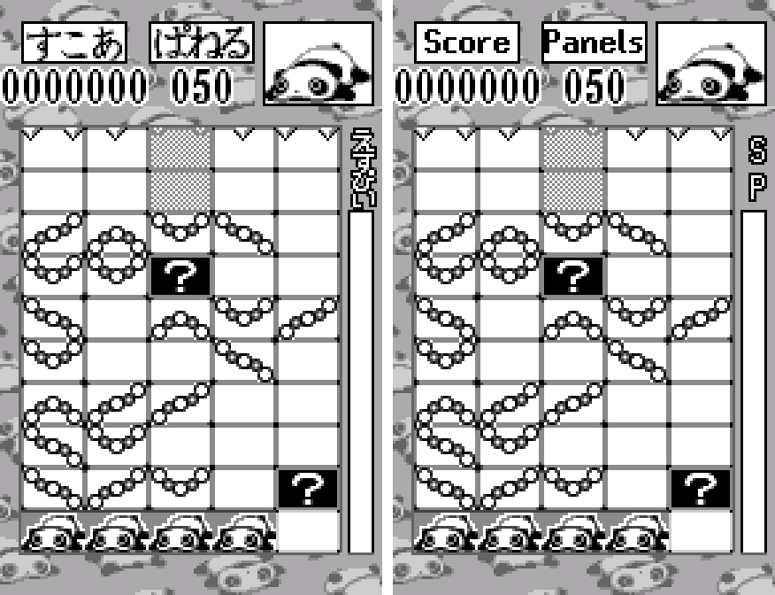

5. The story's photo card

   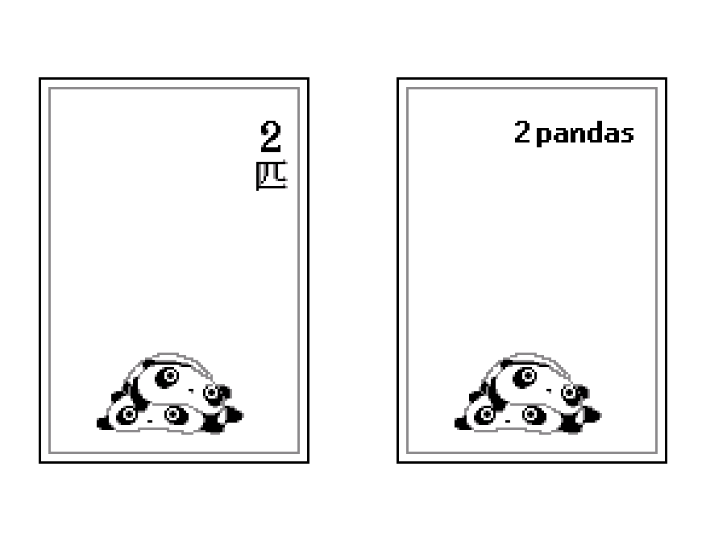

6. Riding the ball, ridden by the ball

   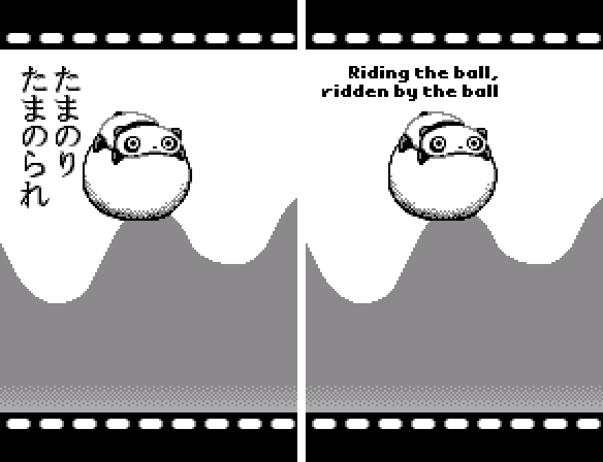

7. The ending

   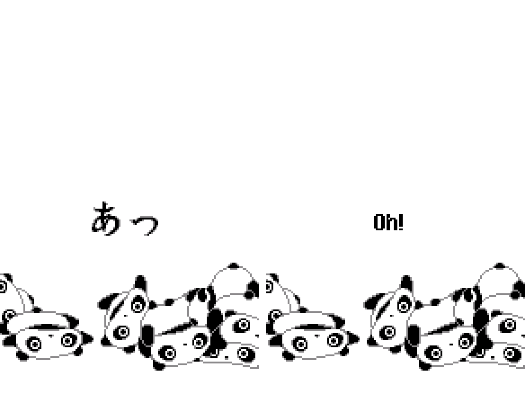

8. The observation report

   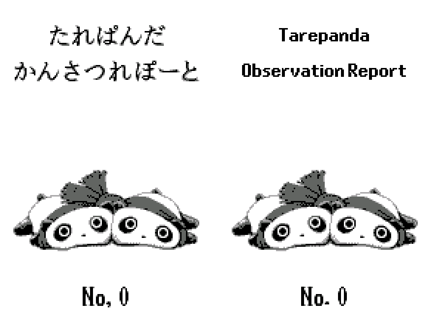

9. Results

   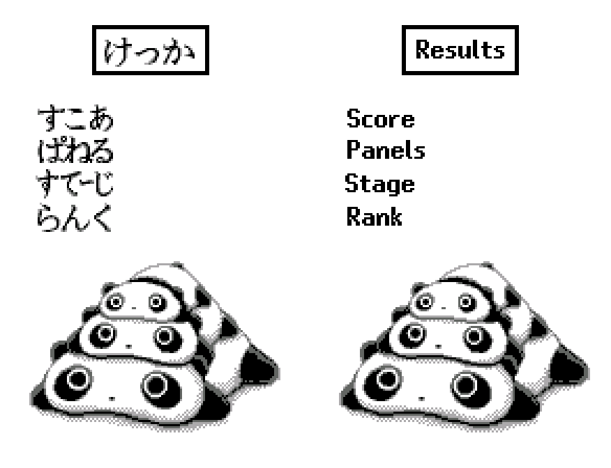

10. High scores

   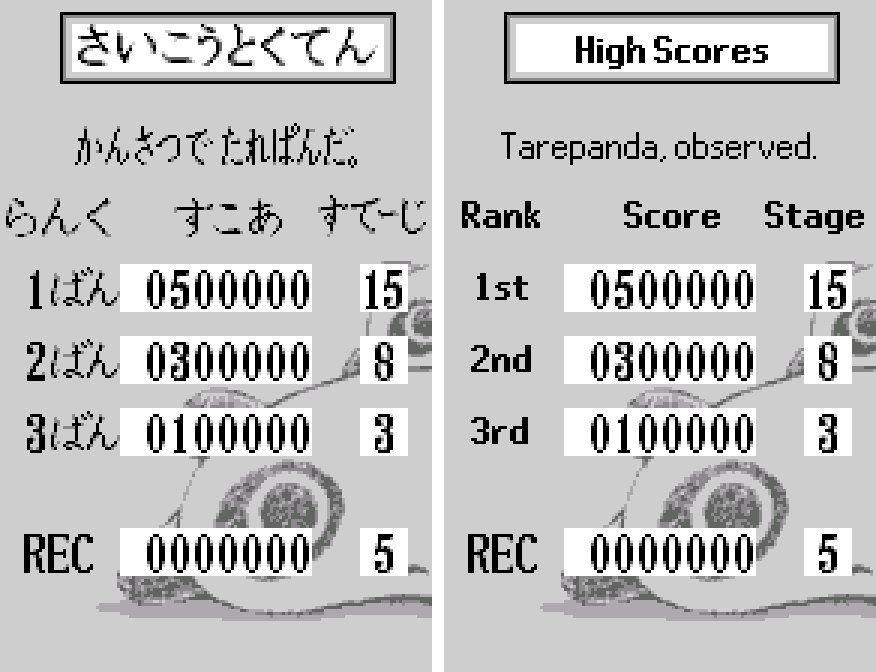

11. Two players: choosing your panda

   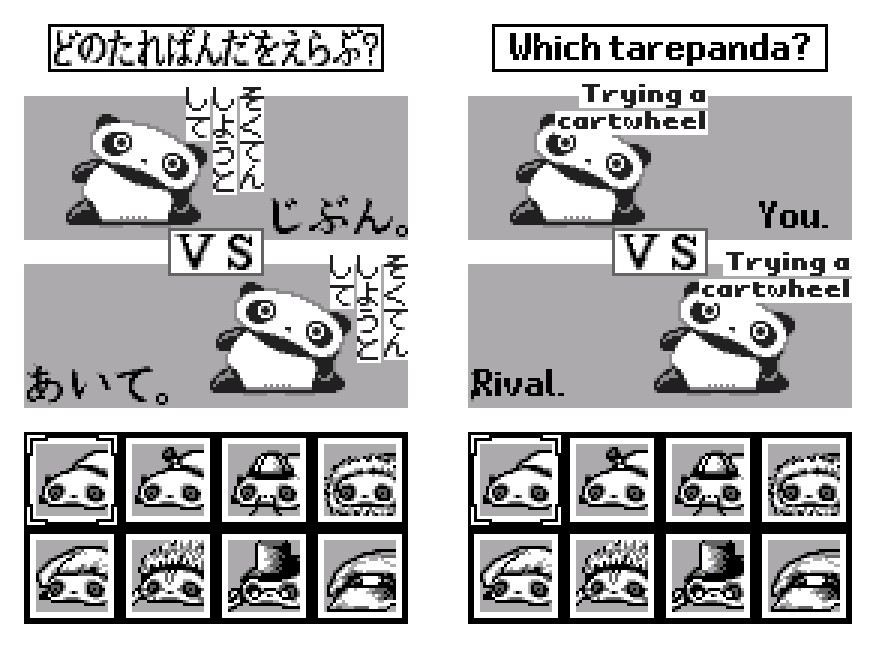

12. WonderGate: the national rankings (a real session)

   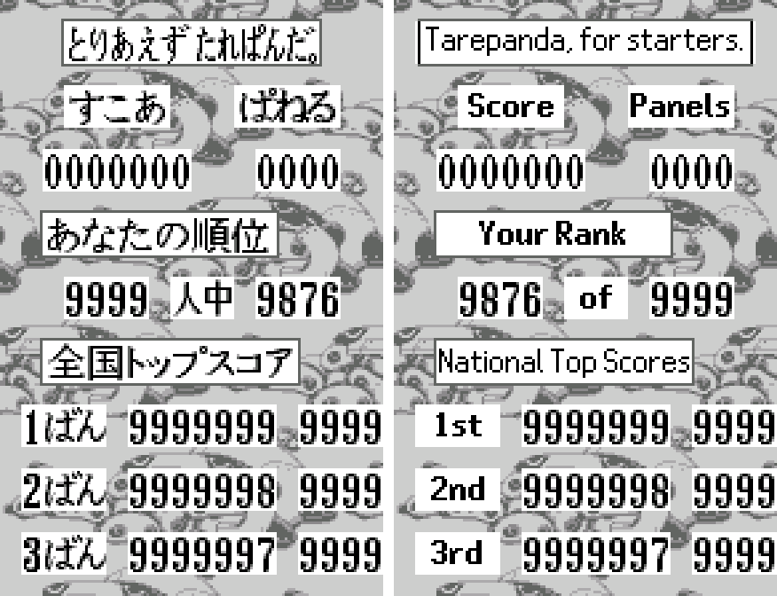

13. Debug edition: the Debug plate and the developers' menu (both English)

   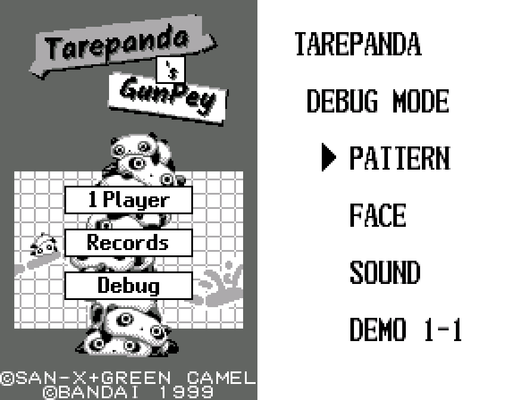

**How to patch**

Apply one of the BPS files to the Japanese ROM "Tare Panda no GunPey (Japan)" (CRC32 A5643AA3) in your browser with the [Swan Revival patcher](https://swanrevival.com/patcher/), or with Floating IPS, beat or ROM Patcher JS:

* Standard: `tare-panda-gunpey-en-1.0.bps`, the result should be CRC32 37A58671.
* Debug edition: `tare-panda-gunpey-en-debug-1.0.bps`, the result should be CRC32 B9B75EE5.

It's a WonderSwan (mono) game, so keep the .ws extension. You must provide your own copy of the original Japanese game to apply it.

**Download:** `tare-panda-gunpey-en-1.0.bps`, `tare-panda-gunpey-en-debug-1.0.bps` on the [release page](https://github.com/PokemonGoDB/wonderswan-english-patches/releases/tag/tare-panda-gunpey-v1.0).

**Known issues**

* It hasn't been played start to finish by a person. Wins, losses, the puzzles and the ending were reached in testing by forcing results, not by clearing every stage. If you find leftover Japanese or anything broken, please tell me where it happened.
* A few pictures appear only in rare random animations (some portrait moods and most two-player action words). They were checked by drawing them from the ROM in the game's own layout, not seen during play.
* The WonderGate mode is hidden, as in the original: hold A+B+Y1+Y4 while switching the console on. Bandai's server is long gone. Swan Revival's server supports this game's rankings.

**Technical notes (for the curious)**

* The game has no text engine: every word is a tile picture, either in a compressed screen or in sprite and tile blocks loaded at run time. Each English label is lettered to the pixel at build time and written into tiles only the Japanese used.
* The story captions are loaded just before the scene's own graphics, so each one had to fit in exactly as many tiles as its Japanese. That is why they use a small bold font.
* The two-player animations share their tile blocks with the story's animations, so the English action words were written into the words' own tiles, keeping every other tile where it was.
* The debug edition hooks the title menu's code so that every plate count is one larger and the last plate opens the developers' menu.

**A Note On My Justifications for AI Use**

I have been an avid fan of the Wonderswan system for a very long time now. It was actually a motivating factor for my various attempts to learn Japanese (which have all failed so far). I always wanted to explore the game catalog more, but the lack of English translations made it extremely difficult to do so. Here's the thing: There's a reason many of these games have not been translated yet. It's not just the fact that Japanese > English translation is difficult. There's also the fact that the original developers used all kinds of tricks and technical feats to make these games work. Most games do not have a searchable directory of text that you can just replace with English equivalents. While some are easier than others, translations for some of these would take not only an expert in Japanese > English translation, but also someone with vast game development and programming experience.

I say all that to say: I get why people are apprehensive about AI usage for this type of thing. However, these games have been around for a very long time now and most of them have still not received a translation. I (and others) have chosen to spend our time and money to utilize AI to translate the games and actually make them playable for the wider community. If you don't agree with that, that's completely fine. I am more than happy to remove any of my translations if better, human ran translations are released at a later date. We already decided to skip any games where someone is actively working on a manual translation. While nowhere near what a manual translation effort would be, I do spend a considerable amount of time trying to work through each game's translation. I stress over small details and try my best to make the right calls. And I've probably messed some stuff up, which is why I welcome feedback.

I'm just looking forward to digging through all of these games. It's a great time to be into Wonderswan games.
