# Tekken Card Challenge (WonderSwan) - AI English translation patch v1.0

**Tekken Card Challenge** (鉄拳 カードチャレンジ) is a card-fighting spin-off of Namco's Tekken for the WonderSwan (Bandai, 1998 on the title screen). In Adventure mode you pick a fighter and walk a map, collecting cards and meeting rivals; each meeting is a card duel in which both sides choose cards and the moves play out as a bout. Stage by stage your fighter levels up at the shrines, and defeated rivals can become selectable. The game also has a one-player battle, a two-player battle, a link-cable battle and the fighter bios of 21 fighters. It was released only in Japan. This patch translates all the text the game shows into English.

> **Please read:** this translation was made **with AI** (Claude), as a hobby project. A person (me) made every judgement call before release, but nobody on the project is a professional translator. I'm sharing it as it is for anyone who wants to play. Please **don't upload it to romhacking sites** (romhacking.net and the like). It may not be up to the standard of a real fan translation and it doesn't belong there.

**What's translated**

* **Everything the player reads:** the story intro, the bios of all 21 fighters, the reading and the description of every card (12 per fighter; 547 text strings in all), the effect labels, the special-card text and the menus.
* **Text drawn as pictures:** 228 distinct card-name pictures (the move names on the cards), the mode menu and its submenus, the link-wait heading, the stage-clear menu and the map-help diagram were redrawn in English in the original's style.
* **Names and terms:** names follow the official English of Namco's Tekken 3 where it exists (Ogre is used everywhere, including the story text where the Japanese says Toshin; Heihachi, Dr.Bosconovitch, Supercop and the fighting styles). Move names use the official English where one is known (Power Punch, Blonde Bomb, Crouch Dash, Suicide and others); the rest are literal renderings, listed on decision pages. All 21 decision items were put to the owner and approved.
* **Short forms forced by the boxes:** the card-name pictures hold 2 lines of 8 letters, so 34 of the 252 names are shortened (the full name still appears in the card's text line when it fits). The map-help labels read Deck Swap, Card Swap, Combo Swap and Card Info, because the boxes cannot grow. 22 two-line card names touch their frame by a pixel or so (accepted).
* **Letter size:** the game draws text one 8x8 tile per letter, so the English uses the same fixed cells with thin 1-pixel capitals and lowercase letters; descriptions are written short (a box holds about 75 letters against about 45 kana).
* **Saves:** the patch changes no save layout. Saves are interchangeable with the Japanese version.
* **Stays as it was:** the fighter names, HUD, WIN / LOSE captions and the staff credits were already Latin in the original; screens that look the same in the original and the patch (character select, the adventure map, the duel intro) are not in the image list.

**How it was made: AI translation, independent checks, human decisions**

* Claude worked out the game's text format (one printer, one tile per letter, 547 strings in containers), wrote the English, drew the picture text, and rebuilt the ROM, moving the text into unused ROM space so that lines fit the original boxes. The ROM stays 1 MiB, like the original.
* The final build (f7) went through the project's automated test run: 9 checks passed, 1 does not apply (the only ending is the already-Latin credits), 0 failed. It includes:
  * all 547 text strings drawn by the game's own printer in 339 scenes: 0 kana, 0 missing glyphs, 0 line-count flags; the same sweep on the original flags kana in all 547 strings, so the check can see Japanese;
  * 34 saved states x 3 seeds x 6,000 frames of random button presses (612,000 frames): no Japanese tile on screen; the same run on the original sees 136 distinct Japanese tiles;
  * a soak of 6,120,000 frames, with no flag, and a 60,000-frame attract loop on both ROMs;
  * 52 screens compared pair by pair for English and alignment, and the measured alignment audit's flagged rows looked at.
* The main game loop was played for real from power-on: Adventure with a fighter, card pickups, a duel won several ways, the stage-clear menu and the next stage, a shrine level-up, the map menus, a TIME UP, the one-player battle and the link-wait screen.
* The English was read against the Japanese by an independent read-only Claude reviewer; its mistranslations and picture problems (for example a near-white stage-clear menu and one leftover katakana label) were fixed in later builds.
* The mechanics were audited (name entry, link handshake, ROM reads): the text feeds no comparison and the save code is unchanged.

**What was not seen on screen** (please report anything odd)

* **A lost Adventure duel, game over and a draw (juggle)**: a lost duel and TIME UP return straight to the title in the original and the patch; the draw screen was never reached.
* **A link duel with a second console.** The link-wait screen and the link error were seen, but not a real match with a partner, so "Challenger Arrived" was not seen.
* **One card effect (number 17)**, and the widest name an owner can type.
* **The card pictures of 16 of the 21 fighters** were not each looked at by eye.
* **The game was not played from start to finish by a person**, and not on real hardware.

**Changelog**

* **v1.0**: first public release.

**Sources consulted**

* Japanese text: the WonderSwan ROM itself.
* English names and terms: official English of Namco's Tekken 3 for the fighters and moves, and the Tekken fan wikis (Tekkenpedia, StrategyWiki) for names that were not in the official release. The wikis could not be reached for some later checks, so the move names marked in the decision pages (items 19 and 20) are literal renderings, not confirmed official names.
* The project's own notes on the game's text format (`games/tekken-card-challenge/TEXT-FORMAT.md`) and the QA run summaries.
* I searched for another English translation of this game on 2026-11-20 and found none. If a human translation is released, that one should be preferred.

**Images** (original on the left, English on the right)

1. Title screen (the English logo replaces the kanji logo)

   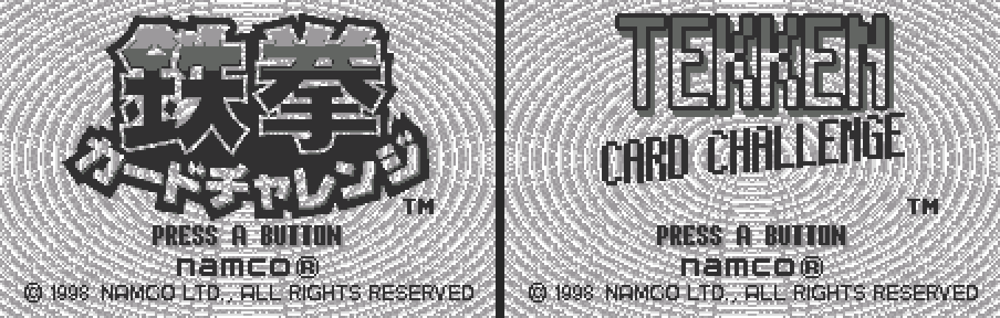

2. Mode menu: Adventure, 1P Battle, 2P Battle, Link Battle, Clear Data

   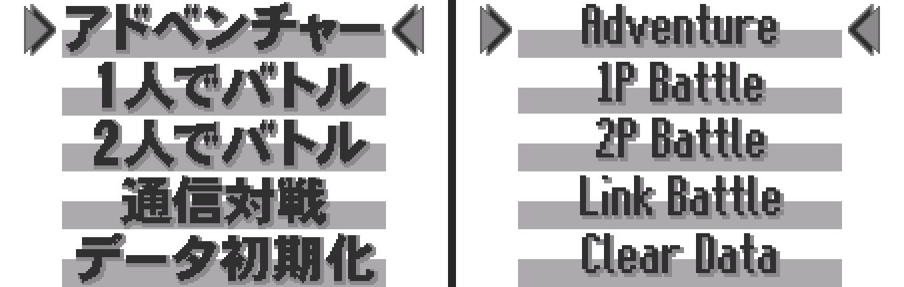

3. Story intro text in English

   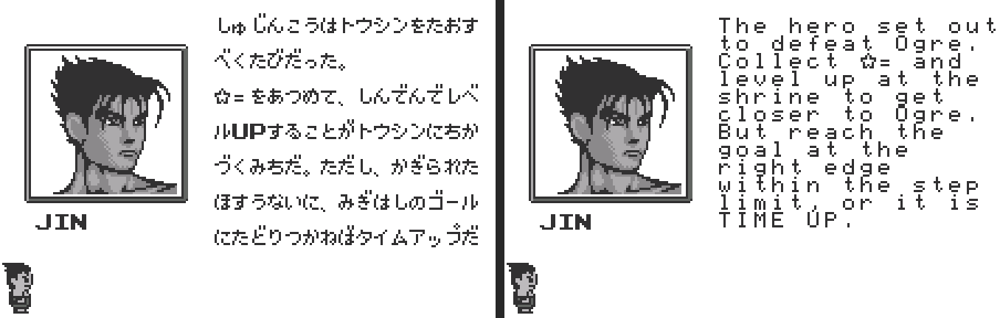

4. Card pickup box (3-Ring Circus)

   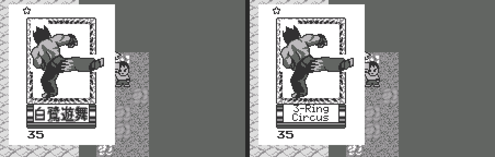

5. Map help: Deck Swap, Card Swap, Combo Swap and Card Info

   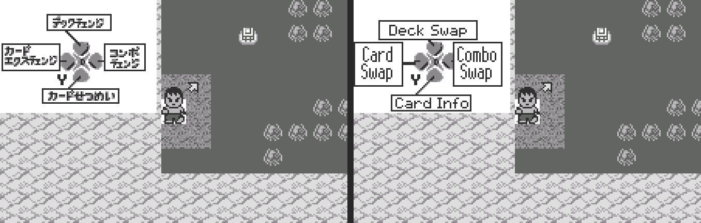

6. Duel card choice

   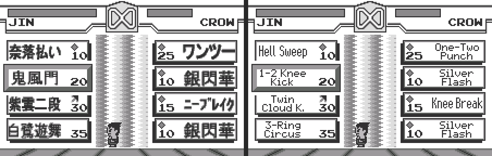

7. Stage-clear menu: Continue, New Fighter, Quit

   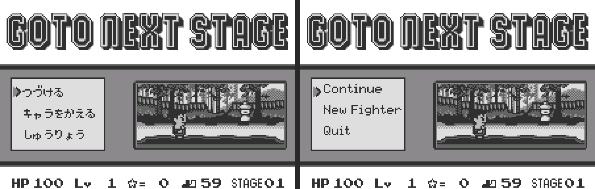

8. Level up at the shrine (Wind God Fist)

   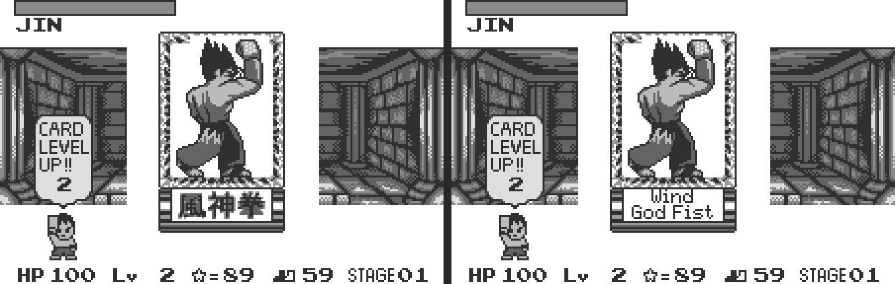

9. Fighter bio page (Jin Kazama)

   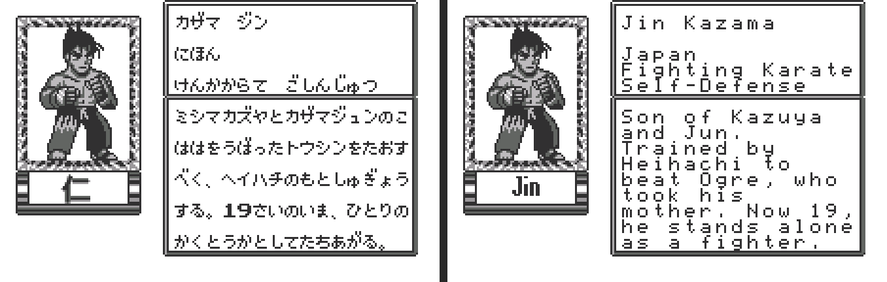

10. Card description (Hell Sweep)

   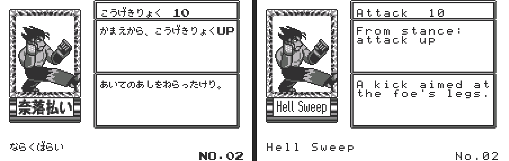

11. Link wait: 'Challenger Wanted'

   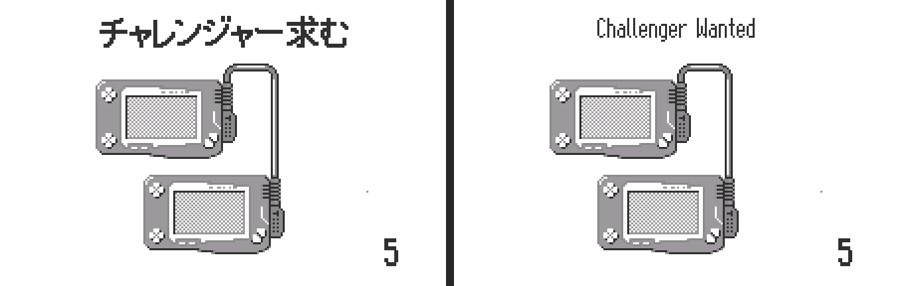

**How to patch**

Apply the BPS file to the Japanese ROM **Tekken Card Challenge (Japan).ws** (1,048,576 bytes, CRC32 `E7C608E5`) in your browser with the [Swan Revival patcher](https://swanrevival.com/patcher/), or with Floating IPS, beat or ROM Patcher JS.

* Standard: `tekken-card-challenge-en-1.0.bps`; the result should be CRC32 2FAA5139 (1,048,576 bytes).

It's a monochrome WonderSwan game, so keep the .ws extension. You must provide your own copy of the original Japanese game to apply it. The patch only fits this dump (CRC32 `E7C608E5`); another revision is refused or gives a wrong result.

**Download:** `tekken-card-challenge-en-1.0.bps` on the [release page](https://github.com/PokemonGoDB/wonderswan-english-patches/releases/tag/tekken-card-challenge-v1.0).

**Known issues**

* It hasn't been played start to finish by a person (see "What was not seen on screen"). If you find leftover Japanese or anything broken, please tell me where it happened.
* Some card names are shortened to two lines of eight letters, and 22 two-line names touch the frame of their card.
* The map-help labels read Deck Swap, Card Swap and Combo Swap, which is shorter than the game's own wording.
* Several move names are literal renderings, not official ones (see "Sources consulted").
* Save states made in an emulator on the Japanese ROM do not carry over to the patched ROM.
* It was tested in an emulator only, not on a real WonderSwan.

**Technical notes (for the curious)**

* The game draws all font text through one routine (`F000:97EA`), one tile per letter in an 8x8 2-bit font with only the kana, digits, A-Z and a few symbols; every kanji is picture text. The patch replaces the font tiles with thin English letters, moves 21 fighter containers and the intro and special-card text to free ROM, repoints the tables and rebuilds the 228 card-name pictures.
* The game has no debug menu or stage select (I searched for one).
* The BPS file is 88,793 bytes. Applying it to the original gives the tested build byte for byte (checked). The patch is for this one dump only.

**A Note On My Justifications for AI Use**

I have been an avid fan of the Wonderswan system for a very long time now. It was actually a motivating factor for my various attempts to learn Japanese (which have all failed so far). I always wanted to explore the game catalog more, but the lack of English translations made it extremely difficult to do so. Here's the thing: There's a reason many of these games have not been translated yet. It's not just the fact that Japanese > English translation is difficult. There's also the fact that the original developers used all kinds of tricks and technical feats to make these games work. Most games do not have a searchable directory of text that you can just replace with English equivalents. While some are easier than others, translations for some of these would take not only an expert in Japanese > English translation, but also someone with vast game development and programming experience.

I say all that to say: I get why people are apprehensive about AI usage for this type of thing. However, these games have been around for a very long time now and most of them have still not received a translation. I (and others) have chosen to spend our time and money to utilize AI to translate the games and actually make them playable for the wider community. If you don't agree with that, that's completely fine. I am more than happy to remove any of my translations if better, human ran translations are released at a later date. We already decided to skip any games where someone is actively working on a manual translation. While nowhere near what a manual translation effort would be, I do spend a considerable amount of time trying to work through each game's translation. I stress over small details and try my best to make the right calls. And I've probably messed some stuff up, which is why I welcome feedback.

I'm just looking forward to digging through all of these games. It's a great time to be into Wonderswan games.
