# Tokyo Majin Gakuen: Fuju Houroku (WonderSwan) - AI English translation patch v1.0

**Tokyo Majin Gakuen: Fuju Houroku** (東京魔人學園 符咒封録) is a story-driven spell-card battle game for the WonderSwan, made by Shout! Designworks and published by Asmik Ace Entertainment (12 October 2000), based on the *Tokyo Majin* series. You play a hero who is made the tutelary god of two teenagers, Shun Yamura and Isuzu Mizukane, and together you seal the evil (邪気) spreading across Tokyo by fighting with spell cards, over 13 chapters. The console is held on its side. This patch translates the text the game shows into English.

> **Please read:** this translation was made **with AI** (Claude), as a hobby project. A person (me) made every judgement call before release, but nobody on the project is a professional translator. I'm sharing it as it is for anyone who wants to play. Please **don't upload it to romhacking sites** (romhacking.net and the like). It may not be up to the standard of a real fan translation and it doesn't belong there.

**What's translated**

* **The story:** 18,130 text boxes across the 13 chapters, the 120 card-character conversations, narration and the ending with the staff roll. The villains' threats and the dark scenes are kept at full strength, as the Japanese has them (decision items 11-14).
* **Menus and systems:** the title and settings menus, name entry (Latin letters, 6 per part), birthplace, birthday and blood type, the deck editor, card lists and card details, the shops and trade lists, the battle screens and prompts, the rules help and the 27-page tutorial.
* **Names and terms:** the card, skill and place names, and the roughly 400 picture labels (title, chapter cards, place banners, card titles, the brush banners Switch / Victory / Defeat / Fight!!, the seal and emotion effects, the Koumyouin sin labels). Character names follow the licensed *Tokyo Majin* anime (ADV/Funimation) where it has the character (for example Tatsuma Hiyuu, and **Reiji Sagaya** as the owner chose); the rest use the game's own readings. Sources are in `official-names.md`; no English release of any game in the series exists.
* **Choices made on the decision pages (44 items in three rounds, all answered):** the default hero name is Hiyuu / Tatsu (Tatsuma does not fit 6 letters); the cast-roll name 嵯峨野麗司 is Reiji Sagaya; the card detail shows an English element word (Wood, Fire, Earth, Metal, Water) under each element circle while the kanji stay in the circle; the brush banners are redrawn in a brush style; the sin labels are whole words ("Greed" for 貪欲); the Versus screen is centred.
* **Letter size:** story, deck and list text use a slim 11-pixel-capital font, a little smaller than the original's 13-pixel kanji (owner item 4); numbers and the big banners are drawn at or above the original size. The project's font-size table (`qa/font-size.json`) lists every place that stays smaller.
* **Stays Japanese by decision:** the studio logo 魔人プロジェクト and the mottos around the title (items 24, 37), the element kanji in the card circles (item 25) and the small kanji icons of the emotion crosses (item 27).

**How it was made: AI translation, independent checks, human decisions**

* Claude worked out the game's text format (Shift-JIS runs in 128 banks, six interpreters, a tile-pair font), wrote the English, redrew the picture text, and rebuilt the ROM with a proportional-width renderer in free ROM space so that lines and names fit the original boxes. The ROM stays 8 MiB, like the original.
* The final build (f15) went through a full automated run of 9 checks. Results:
  * the coverage checker finds all 51,758 Japanese text runs of the original handled;
  * the rendering sweep ran 159 scenarios (every story entry and character conversation, with the widest player name) in the emulator with every font call logged: 10,073 boxes, 0 flags (nothing past the right edge, no box with too many lines), 0 Japanese glyphs;
  * the runtime Japanese detector walked 33 saved states (about 990,000 frames) and saw no Japanese on the English build; the same detector sees 268 Japanese glyphs on the original (control);
  * the attract loop (90,000 frames from power-on, both ROMs), the ending and staff roll (927 screens on the English build, 0 Japanese; the original shows 869), and 80 screen-inventory captures per ROM all passed;
  * a soak of 2,970,000 frames from 33 saved states with random button presses raised no flag (4 states do not react to buttons by design).
* Every captured screen was read beside the original for English and for alignment by a separate Claude reviewer; the 218 automatic alignment candidates were classified screen by screen (see "Known issues").
* The English was read against the Japanese by an independent read-only Claude reviewer: 19 errors, about 86 minor findings and about 111 preferences; 133 edits were applied, the rest rejected with reasons.
* Every decision that was mine to make was put on decision pages with options and pictures; I answered every one. Some answers changed the build (Sagaya, the Versus screen centring, the element words only under the circle).
* The mechanics were audited (lookups, widths, name comparisons, save limits, the card sort and the birthplace list) and the faults found were fixed.

**What was not seen on screen** (please report anything odd)

* **Link battle and link trading** need a second console on a cable: the refusal screens without a partner were seen, the link rows themselves were not.
* **Choices other than the first option**, kanji name entry, the discard prompt, the graveyard, the shops' later screens, game over beyond the return to the title, Koumyouin after its first lines, Fuuinkutsu floors beyond floor 1, any second ending or post-game.
* **Emotion crosses:** 1 of 172 prompts seen; **seal scenes:** 1 of 15 (same tiles). The ten sin labels were all seen; the selection bracket on two of them was not.
* **Element words:** 35 of the 36 card frames were checked as renders only, 1 on screen; the 8-pixel info-panel icon and the land-wheel badges keep the kanji (no room).
* **Picture and tile-map text outside the 80 inventory captures** is not covered by the Japanese detector (it sees font-blitter text); card title strips were seen on screen for 5 cards.
* **The game was not played from start to finish by a person**, and not on real hardware.

**Changelog**

* **v1.0**: first public release.

**Sources consulted**

* Japanese text: the WonderSwan ROM itself.
* English names and terms: the licensed *Tokyo Majin* anime releases (ADV/Funimation), with Wikipedia and MyAnimeList as secondary sources; details in `games/tokyo-majin-gakuen/official-names.md`. The remaining names are my choices (decision pages).
* The project's own notes on the game's text format (`games/tokyo-majin-gakuen/TEXT-FORMAT.md`) and the QA run summaries.
* I searched for another English translation of this game on 2026-10-25 (the claims board, web searches; romhacking.net, GBAtemp and Reddit could not be read by the tool): none found. If a human translation is released, that one should be preferred.

**Images** (original on the left, English on the right)

1. Title screen: the English title is drawn over the original's ring art; the studio mottos around it stay Japanese

   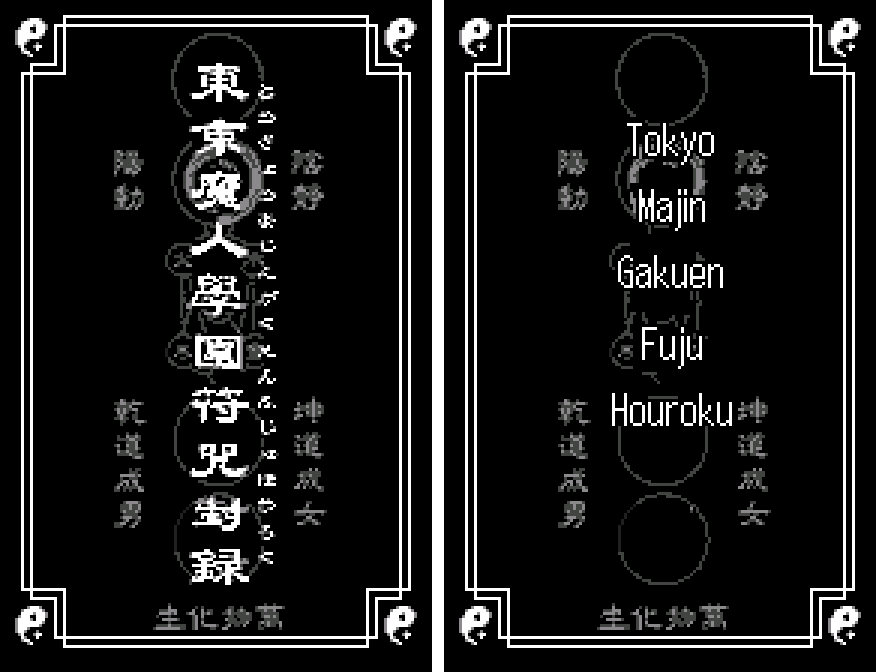

2. Title menu in English

   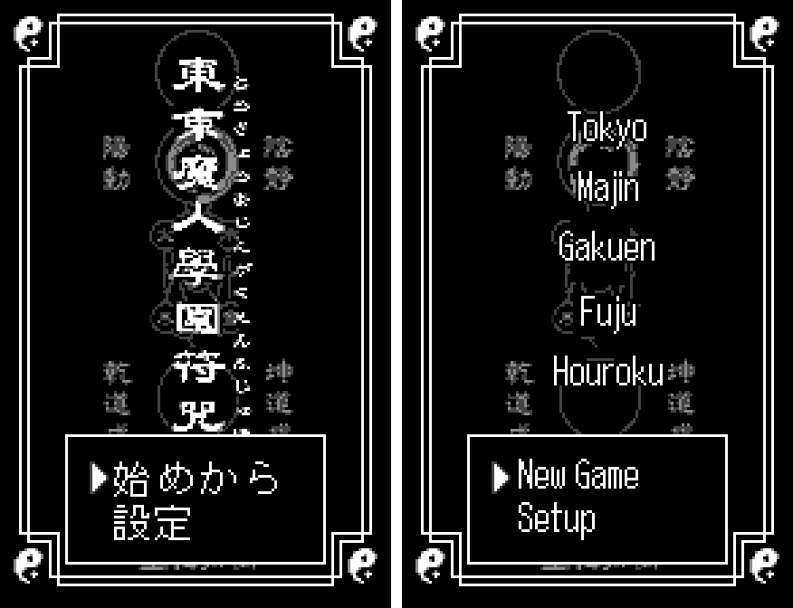

3. Story dialogue: speaker tag and text box in English

   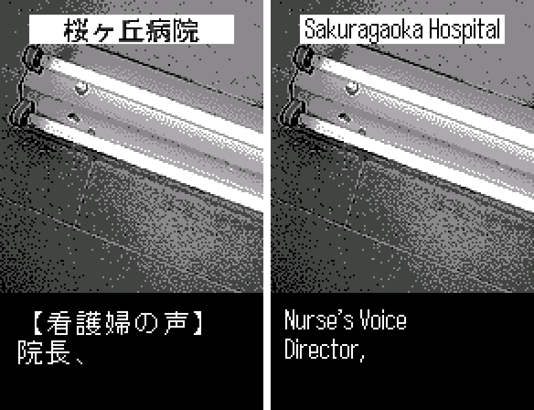

4. Chapter card

   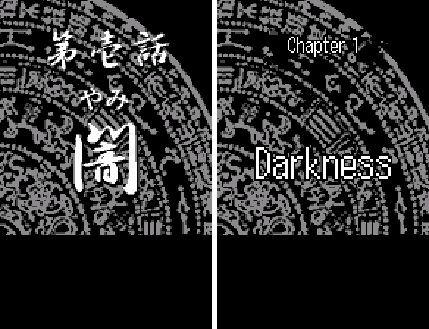

5. Deck editor main menu

   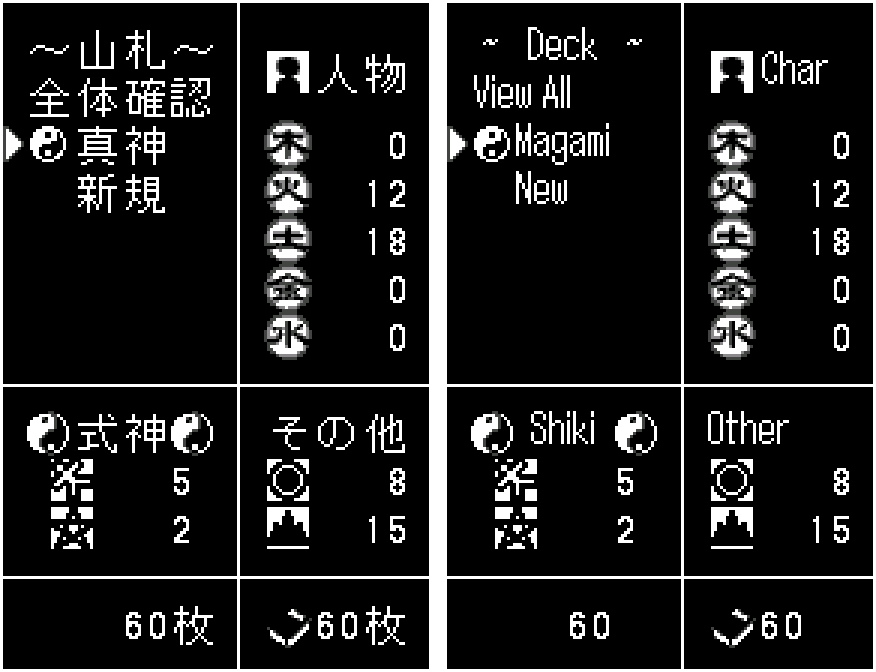

6. Card list, names in English

   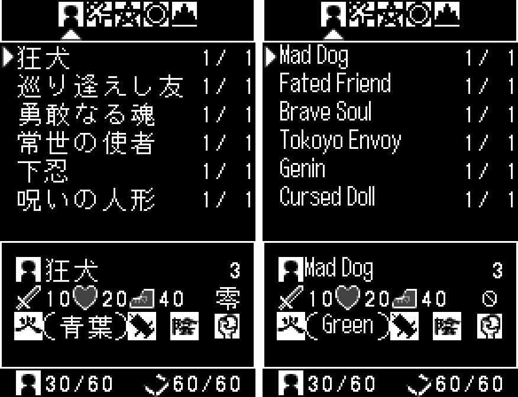

7. Card detail: the element word (Wood, Fire, Earth, Metal, Water) is written under the element circle; the kanji stay in the circle

   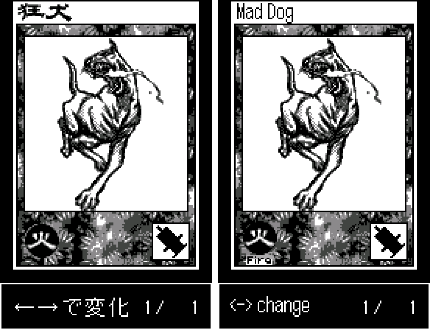

8. Versus screen: enemy name, vs and player name centred

   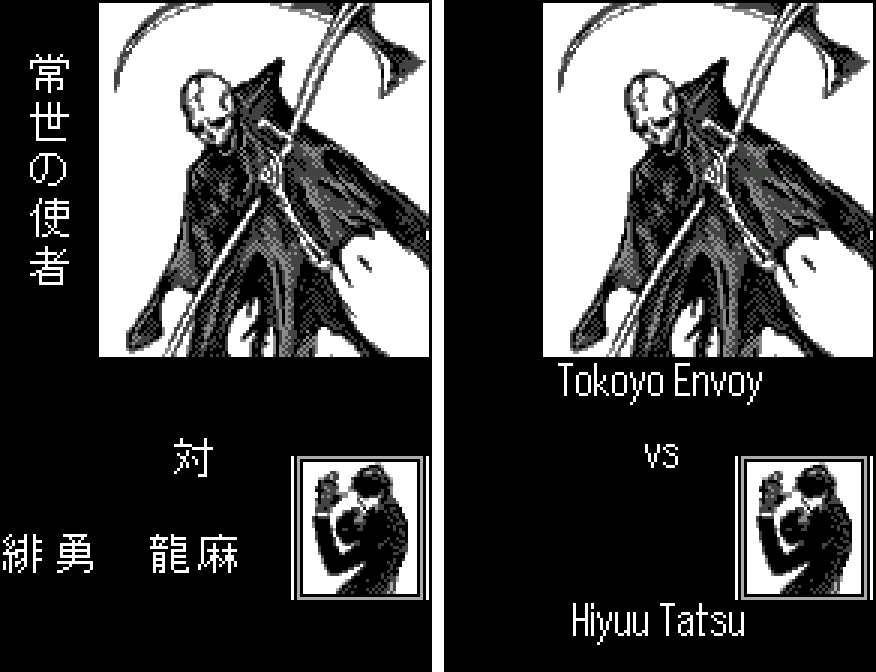

9. Battle screen in English

   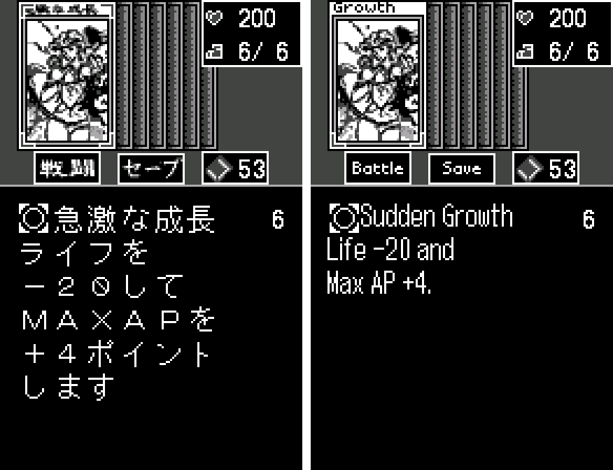

10. Switch banner, redrawn in a brush style

   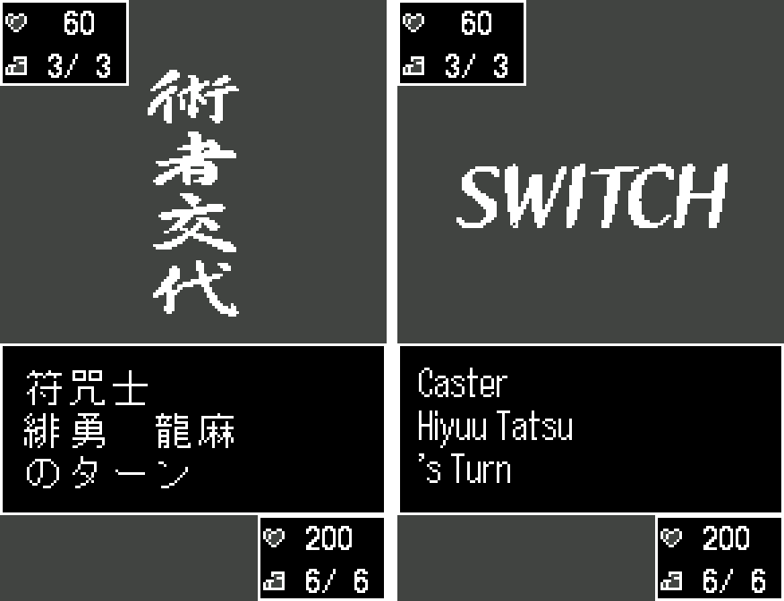

11. Victory banner, redrawn in a brush style

   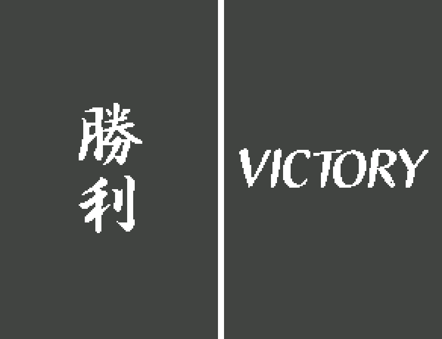

12. Ending scene

   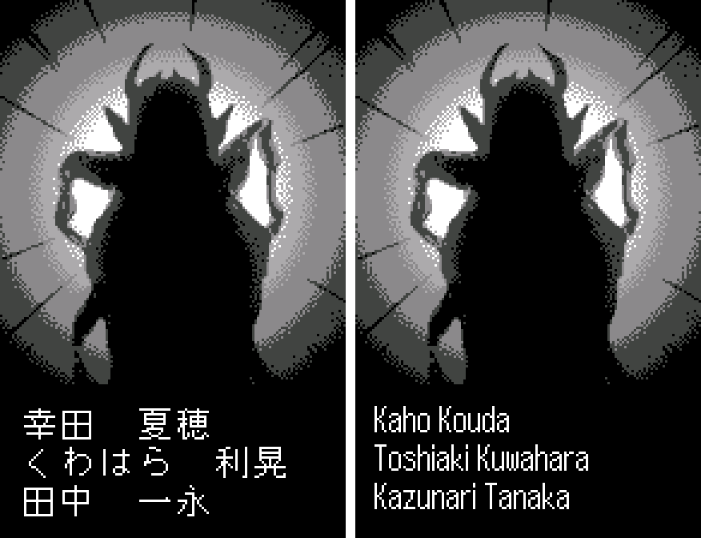

**How to patch**

Apply the BPS file to the Japanese ROM **Tokyo Majin Gakuen - Fuju Houroku (Japan).ws** (8,388,608 bytes, CRC32 `91117D1B`) in your browser with the [Swan Revival patcher](https://swanrevival.com/patcher/), or with Floating IPS, beat or ROM Patcher JS. The result is 8,388,608 bytes:

* Standard: `tokyo-majin-gakuen-en-1.0.bps`; the result should be CRC32 7850C84C (8,388,608 bytes).

It's a monochrome WonderSwan game, so keep the .ws extension. You must provide your own copy of the original Japanese game to apply it. The patch only fits this dump (CRC32 `91117D1B`); another revision is refused or gives a wrong result. Start a new save: a save made on the Japanese version stores kanji names that the English name entry does not show.

**Download:** `tokyo-majin-gakuen-en-1.0.bps` on the [release page](https://github.com/PokemonGoDB/wonderswan-english-patches/releases/tag/tokyo-majin-gakuen-v1.0).

**Known issues**

* It hasn't been played start to finish by a person (see "What was not seen on screen"). If you find leftover Japanese or anything broken, please tell me where it happened.
* The card title in the info panel is clipped for 14 long names (about 100 px of room); the deck editor and shop menus use short labels (All, Char, Poss, Shiki) because of the tile budget (decision items 30, 33).
* The staff-roll name Kazunari Tanaka (田中 一永) is a guess: the game gives no reading.

**A Note On My Justifications for AI Use**

I have been an avid fan of the Wonderswan system for a very long time now. It was actually a motivating factor for my various attempts to learn Japanese (which have all failed so far). I always wanted to explore the game catalog more, but the lack of English translations made it extremely difficult to do so. Here's the thing: There's a reason many of these games have not been translated yet. It's not just the fact that Japanese > English translation is difficult. There's also the fact that the original developers used all kinds of tricks and technical feats to make these games work. Most games do not have a searchable directory of text that you can just replace with English equivalents. While some are easier than others, translations for some of these would take not only an expert in Japanese > English translation, but also someone with vast game development and programming experience.

I say all that to say: I get why people are apprehensive about AI usage for this type of thing. However, these games have been around for a very long time now and most of them have still not received a translation. I (and others) have chosen to spend our time and money to utilize AI to translate the games and actually make them playable for the wider community. If you don't agree with that, that's completely fine. I am more than happy to remove any of my translations if better, human ran translations are released at a later date. We already decided to skip any games where someone is actively working on a manual translation. While nowhere near what a manual translation effort would be, I do spend a considerable amount of time trying to work through each game's translation. I stress over small details and try my best to make the right calls. And I've probably messed some stuff up, which is why I welcome feedback.

I'm just looking forward to digging through all of these games. It's a great time to be into Wonderswan games.
