# Umizuri ni Ikou! (WonderSwan) - AI English translation patch v1.0

**Umizuri ni Ikou!** (海釣りに行こう!, "Let's Go Sea Fishing!") is a fishing game for the monochrome WonderSwan, made by Coconuts Japan Entertainment and licensed by Bandai (1999). A boy goes fishing for a day at four spots (a breakwater, a sandy beach, a rocky shore and the open sea) and has to catch a set number of kinds of fish at each one, choosing bait and tackle and reading the hints he gets. After the four stages a special stage on a boat has eight cartoon "monster fish". There is no save RAM: progress is a password, and fish and items can be given or swapped with another WonderSwan over the link cable. It was released only in Japan. The English version is a patch with two editions: the standard one, and a Debug edition that opens the developers' hidden scene selector and sound test.

> **Please read:** this translation was made **with AI** (Claude), as a hobby project. A person (me) made every judgement call before release, but nobody on the project is a professional translator. I'm sharing it as it is for anyone who wants to play. Please **don't upload it to romhacking sites** (romhacking.net and the like). It may not be up to the standard of a real fan translation and it doesn't belong there.

**What's translated**

* **All the text the game draws:** 111 strings: the dialogue (stage intros by weather, catch and miss comments, goal counts), the fishing tips and hints, the item descriptions, the menus and the data-exchange (link) messages. The game's own font has capitals only, no lower case, comma, period or apostrophe, so the patch adds a new proportional English font and its own text printer.
* **Every word that is drawn as a picture,** redrawn in the original lettering: the title logo ("Let's Go Sea Fishing!") and the title menu (New Game, Continue, Trade Data), the stage cards, the menu titles, the End Game box, the result screens, the plates for bait, items and lures, and the fish-name box that appears when you catch a fish.
* **The game's own English stays:** the Coconuts Japan logo, PUSH START BUTTON, the copyright lines and the ending picture CONGRATULATION.
* **Names:** fish, bait and tackle use standard English names (sources: FishBase and English and Japanese Wikipedia; the list is in the project notes). Choices that were mine to make and that I approved: Scorpionfish and Rockfish for カサゴ and メバル, Jack Mackerel for アジ, short group names for four species (Grunt, Croaker, Sardinella, Blackfish), invented names for the eight monster fish (Gyorosuke and Pukupan keep their sound; Sharchilus, Twin Scissors, Skullfish, Metal Marlin, Aqua Dragon and Mermaid), "Let's Go Sea Fishing!" for the title (the game has no official English title) and "Trade Data" for the third title-menu entry.
* **Passwords:** the password code, its grid positions and its order are the original's, so passwords are interchangeable with the Japanese cartridge (checked with a decoder written for this project). The grid shows letters, digits and a few symbols in the places of the 46 hiragana.
* **Link play:** data exchange (give a fish or an item, swap fish) was walked on two linked emulators: English with English, English with Japanese and Japanese with English. Passwords are the fallback when no cable is used.

**Two patches: Standard and Debug Edition**

* **Standard** (`umizuri-ni-ikou-en-1.0`): the translation above, and nothing else. Play this one.
* **Debug Edition** (`umizuri-ni-ikou-en-debug-1.0`): the same translation, plus the developers' hidden scene selector and sound test, which are on the cartridge but cannot be reached in the original game. On the **PUSH START BUTTON screen, press B** to open it (UP and DOWN move the hand, A starts the entry). The 14 entries, with English labels in this edition, are: Breakwater T, Beach, Rocks, Sea (stage intros, then the fishing field), Monster (the special-stage intro), Title (back to PUSH START, where B opens the menu again), Fish 3, Ending (the CONGRATULATION screen), Character 2, BGM (17 songs), SE (20 sound effects), Greenling, Flounder and Stage Start. It is for the curious, not for a first playthrough. Some entries look unfinished: the BGM and SE lists leave stray cells next to the names, as the original does; Greenling and Flounder show a bare field (Flounder an empty beach background) and Stage Start shows an empty dialogue box, which were not compared with the original.

**How it was made: AI translation, independent checks, human decisions**

* Claude worked out how the cartridge stores its text and graphics, wrote the English, built the font and printer, redrew the lettering and rebuilt the ROM. The ROM stays 512 KiB, like the original.
* The final build went through a full automated run of 11 checks, all 11 passed: the static check of every string, a sweep of every string with the widest names, a runtime detector over 72 runs and 649,152 frames that found no Japanese on the English build (the same detector finds kana in 26 of the runs on the original, so it can see them), the attract loop, the endings, 155 captured screen pairs, an alignment audit, and a soak of 2,160,000 frames from saved states with random button presses that raised no flag. The Debug edition's 14 entries were each run with random button presses (67,424 frames, no Japanese).
* Two separate read-only Claude reviewers compared an earlier build with the original, one the English text and one the screens; their findings (a few wordings, a plural, the backdrop of one box, label alignment) were fixed or put to me, and the screens that carried a finding were looked at again.
* Every decision that was mine to make was put on a decision page with options and pictures; I approved all 15 items as recommended.

**What was not seen on screen** (please report anything odd)

* **Link-cable errors:** the communication-error box and the waiting-for-password box of the data exchange were seen only with the screen state set by a memory write, not through a real fault. It was not tried with a real cable or on real consoles. A cut cable leaves "Communicating" on the screen for ever, as in the original.
* **Debug edition's Flounder entry** shows an empty beach background; I did not compare it with the original.
* **The developer menu in the standard patch:** its three strings stay Japanese there on purpose, because no route reaches the menu; they are translated in the Debug edition.
* **There is no staff roll** in the game; the ending picture is the last screen.
* **The game was not played from start to finish by a person**, and not on real hardware or a flash cartridge; everything was checked on an emulator.

**Changelog**

* **v1.0**: first public release (standard and Debug Edition).

**Sources consulted**

* Japanese text: the WonderSwan ROM itself.
* Fish, bait and tackle names: FishBase, English Wikipedia, Japanese Wikipedia and a Japanese shore-fishing guide (fetched 2026-11-25); a few names are my choice where no source gives an English name (the notes mark them).
* I searched for another English translation of this game on 2026-11-25 (the claims board, English and Japanese web searches, the cdromance and retrogametalk lists): none found. If a human translation is released, that one should be preferred.

**Images** (original on the left, English on the right)

1. Title screen: the "Let's Go Sea Fishing!" logo replaces the Japanese one; PUSH START BUTTON and the copyright lines are the game's own English

   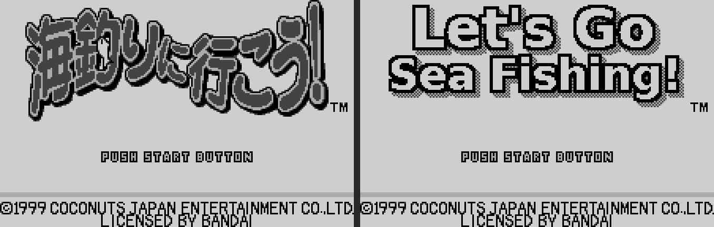

2. Title menu: New Game, Continue, Trade Data

   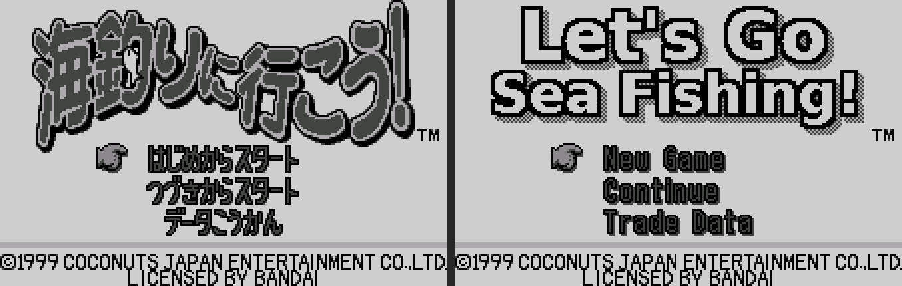

3. Stage card: STAGE 1, BREAKWATER

   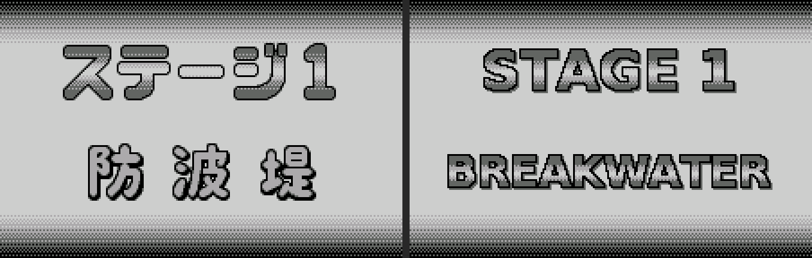

4. A catch: the fish, its name (Wrasse) and its length

   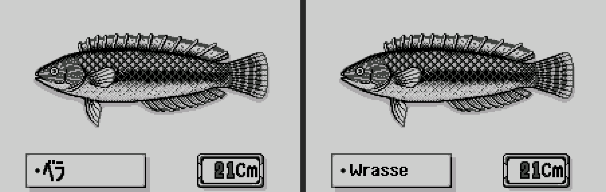

5. A fish got away: "That fish just now must have been a big one... What a shame."

   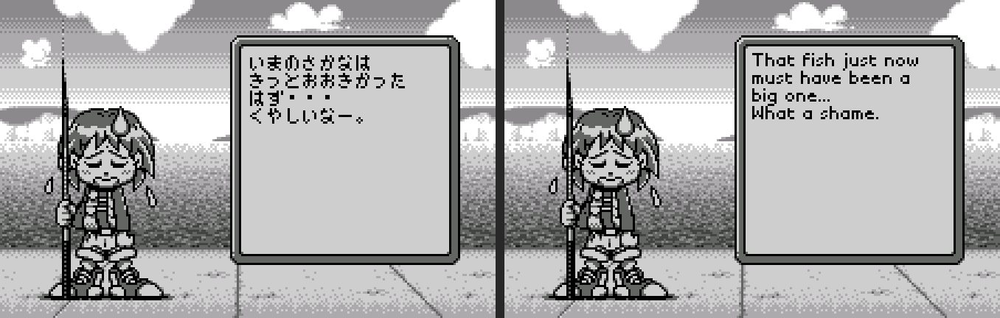

6. Select menu: Bait & Lure, Items, Info, End Game

   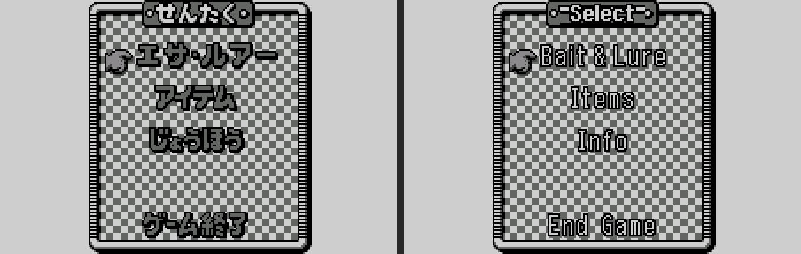

7. Bait picker with the Bait plate (Earthworm)

   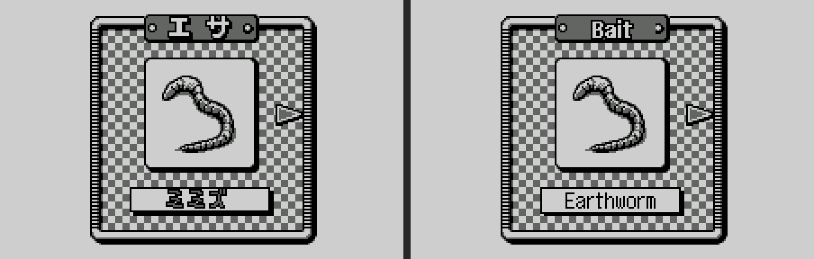

8. Info screen: Special Items and Fish Caught

   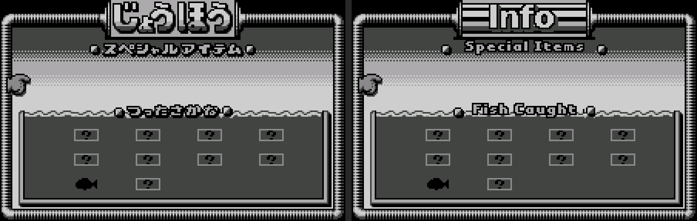

9. End Game box: Password, Save, Back, End (the password string is the original's code)

   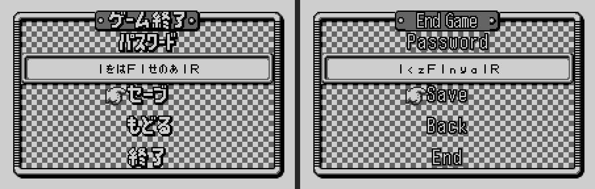

10. Password grid: letters, digits and symbols in the places of the hiragana; Back, Next, OK

   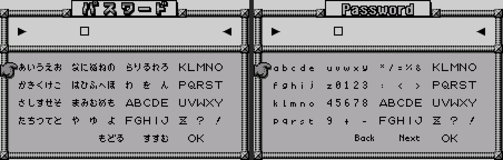

11. Wrong password message

   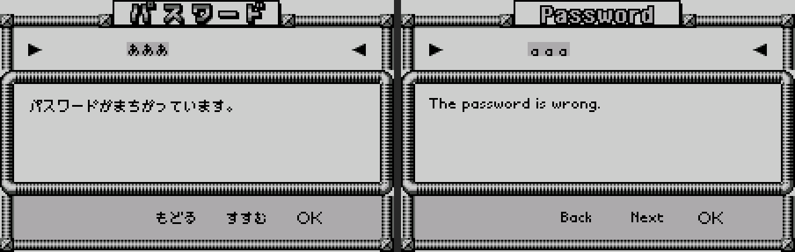

12. Stage clear: Next Stage or Fish some more

   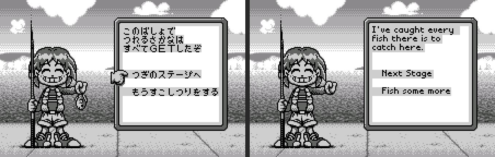

13. Item description: Master's Rod

   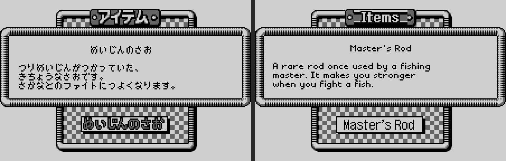

14. Monster fish caught: Gyorosuke

   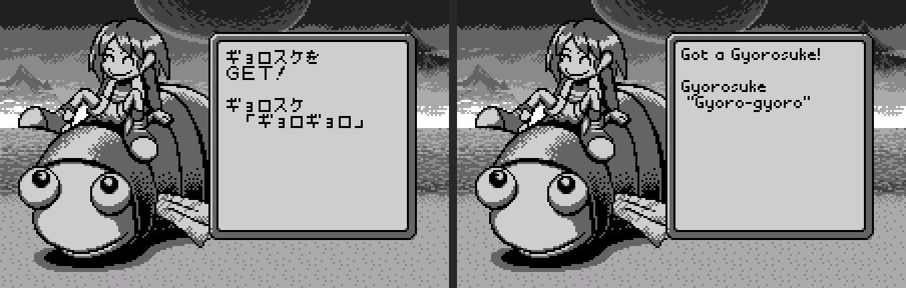

15. A hint: "To catch Conger Eel, use Cut Bait."

   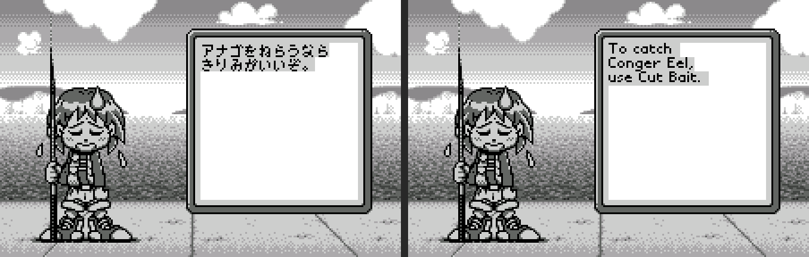

16. Link play: waiting for the other player

   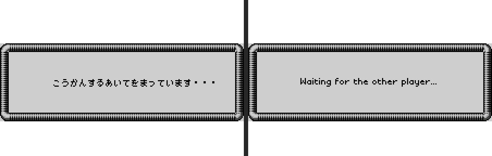

**How to patch**

Apply the BPS file to the Japanese ROM **Umizuri ni Ikou! (Japan).ws** (524,288 bytes, CRC32 `86B56511`) in your browser with the [Swan Revival patcher](https://swanrevival.com/patcher/), or with Floating IPS, beat or ROM Patcher JS. The result is 524,288 bytes:

* Standard: `umizuri-ni-ikou-en-1.0.bps`; the result should be CRC32 97EBB09F.
* Debug Edition: `umizuri-ni-ikou-en-debug-1.0.bps`; the result should be CRC32 9DA0EC2E.

It's a monochrome WonderSwan game, so keep the .ws extension. You must provide your own copy of the original Japanese game to apply it. The patch only fits this dump (CRC32 `86B56511`); another revision is refused or gives a wrong result. The password system is the original's, so an English password works on the Japanese cartridge and the reverse.

**Download:** `umizuri-ni-ikou-en-1.0.bps`, `umizuri-ni-ikou-en-debug-1.0.bps` on the [release page](https://github.com/PokemonGoDB/wonderswan-english-patches/releases/tag/umizuri-ni-ikou-v1.0).

**Known issues**

* It hasn't been played start to finish by a person (see "What was not seen on screen"). If you find leftover Japanese or anything broken, please tell me where it happened.
* Dialogue lines are 8 px apart, as in the original, so the tail of a g, p, q or y can touch a tall letter on the line below.
* English letters are smaller than the Japanese ones in the dialogue boxes (capitals 6 px and lower case 4 px, against 7 px for kana); the font-size record is in the project notes.
* One long fish name in the catch box ("Black Sea Bream") uses smaller lettering to fit; four other long names use a slimmer cut of the same lettering.
* The standard patch's hidden developer menu (not reachable in play) would show noise if forced by a memory write; use the Debug edition to see it in English.

**Credits:** Translation and hacking: Claude (Anthropic) for the WonderSwan Translation Project.

**A Note On My Justifications for AI Use**

I have been an avid fan of the Wonderswan system for a very long time now. It was actually a motivating factor for my various attempts to learn Japanese (which have all failed so far). I always wanted to explore the game catalog more, but the lack of English translations made it extremely difficult to do so. Here's the thing: There's a reason many of these games have not been translated yet. It's not just the fact that Japanese > English translation is difficult. There's also the fact that the original developers used all kinds of tricks and technical feats to make these games work. Most games do not have a searchable directory of text that you can just replace with English equivalents. While some are easier than others, translations for some of these would take not only an expert in Japanese > English translation, but also someone with vast game development and programming experience.

I say all that to say: I get why people are apprehensive about AI usage for this type of thing. However, these games have been around for a very long time now and most of them have still not received a translation. I (and others) have chosen to spend our time and money to utilize AI to translate the games and actually make them playable for the wider community. If you don't agree with that, that's completely fine. I am more than happy to remove any of my translations if better, human ran translations are released at a later date. We already decided to skip any games where someone is actively working on a manual translation. While nowhere near what a manual translation effort would be, I do spend a considerable amount of time trying to work through each game's translation. I stress over small details and try my best to make the right calls. And I've probably messed some stuff up, which is why I welcome feedback.

I'm just looking forward to digging through all of these games. It's a great time to be into Wonderswan games.
