# Uzumaki: Denshi Kaiki Hen (WonderSwan) - AI English translation patch v1.0

**Uzumaki: Denshi Kaiki Hen** (うずまき 〜電視怪奇篇〜) is a WonderSwan branching picture novel (a text adventure) made by Omega Micott in 2000 from Junji Ito's horror manga *Uzumaki*. You read the story of Kirie Goshima and her town, Kurouzu-cho, which is cursed with spirals, and at 35 points you choose what Kirie does. Three routes I played all end at a Bad End. This patch translates all the text the game shows into English.

> **Please read:** this translation was made **with AI** (Claude), as a hobby project. A person (me) made every judgement call before release, but nobody on the project is a professional translator. I'm sharing it as it is for anyone who wants to play. Please **don't upload it to romhacking sites** (romhacking.net and the like). It may not be up to the standard of a real fan translation and it doesn't belong there.

**What's translated**

* **The story:** all 135 scripts, 3,825 text runs, 35 choices and 35 speaker labels. Names and terms follow the VIZ English edition of the manga (Kirie Goshima, Shuichi Saito, Azami Kurotani, Kurouzu-cho and so on); honorifics are dropped.
* **Menus and system text:** the title menu, settings, in-game menu, power-off and data-wipe prompts, the attract-mode intro (Kirie's narration) and the credits.
* **The Uzumaki quiz:** all 50 questions with their answers, the headers and the retry prompt. A few questions depend on Japanese wordplay and were adapted (for example a megabit question, which gives the ROM size, and a number-reading joke in a barcode question), and one kanji joke is lost; the adaptations are listed in the project notes.
* **Pictures with text,** redrawn by hand in a matching style: the title and logo card, copyright card, the Staff, The End and Bad End cards, menu labels, quiz headers, the staff credits, the shop sign, the parcel plate, the handwritten note, 30 place and time cards and the four bonus pictures.
* **How it looks:** the cartridge is a vertical-orientation one, so **the game is played with the console held upright.** The Japanese text runs in vertical columns; the English is set as normal horizontal lines in the same area of the screen with a variable-width font, because vertical English would be unreadable. Speaker names sit on their own top line in square brackets, as the original's 【 】.
* **Text speed:** English text appears at the original's speed: each page takes about as long as its Japanese page at Fast, Normal and Slow (computed from the script for all 2,814 pages, within one frame of the Japanese page, and measured on screen on 15 page and speed combinations; the median page is 12, 48 and 96 frames at the three settings, in both versions).
* **Names that needed a choice:** the staff-credit name readings are best guesses where the kanji can be read more than one way (11 readings are uncertain, among them 秀剛, 康貴, 昌二, 一陽 and 美都), and the parcel plate reads "Mitsuru / with love!" because the full line does not fit the plate. A few menu labels and quiz headers are smaller than the original kana.
* **Sensitive content** is translated faithfully, not softened.
* **Saves:** the save format is unchanged. Save and Continue were tested on the final build on a plain page and on two pages the patch splits in two.

**How it was made: AI translation, independent checks, human decisions**

* Claude worked out the game's text format (its own 2-byte glyph codes, not Shift-JIS), wrote the English, and rebuilt the ROM with a variable-width font and a text renderer added to the cartridge, so that lines fit the original area and the picture behind it.
* The final build went through a full automated test run of 9 checks and all 9 passed:
  * every text run the sweep could reach (3,842 of 3,842 English runs in 2,917 screens) was drawn by the game, and 76,087 letters were seen drawn in 3,824 of those runs (the other 18 were not checked for letters); nothing was past the right edge (widest ink at pixel 134 of 135) or over 12 lines;
  * random-button walks of about 1.04 million frames from 43 start points drew no Japanese on the English build (the same walks on the original draw Japanese 15,114 times, so the check can see it);
  * the attract loop, three routes to the Bad End card and the credits were captured on both ROMs; all 24 rows of the screen inventory were captured in English by play, and nine more screens (the quiz, the The End card, the shop sign, the parcel plate, the handwritten note and the four bonus pictures) were forced with a memory or ROM write;
  * 3.87 million frames of soak tests from 43 start points raised no flags (6 of the 43 cannot show a hang, because the original also stalls there);
  * a program compared 35 screen pairs (34 measured, 5 identical); 40 flagged regions were read enlarged beside the original and none is a defect;
  * three read-only Claude reviewers read the whole English text against the Japanese (35 findings: 31 applied, 2 rejected, the rest kept with a reason), and a reviewer re-read every screen whose pixels changed in later rounds, enlarged and beside the original, including the widest speaker labels.
* All 14 decisions that were mine to make (the layout, speaker names, card words, picture wording, typing speed and so on) were listed with options (12 of them with pictures), and I decided every one of them.

**What was not seen on screen** (please report anything odd)

* **The quiz** was reached by forcing it with a memory write, because the route that unlocks it was not found; 10 of the 50 questions were played on the English build and all 50 were checked in the text only.
* **Forced, not played:** the 完 (The End) card, four bonus pictures, the shop sign, the parcel plate and the handwritten note. No good ending was found on any route I tried, so the endings seen are the Bad End.
* **Staff credits and the endings** were played but captured only every 160 frames, not frame by frame. 415 script pages are empty and two scripts have no pages, so nothing there was seen.
* **Text over artwork:** the final sweep flagged 389 pages (medium) where English text sits over the picture and 38 for line count (low); they were judged on contact sheets (an earlier run's 45 closest cases enlarged), not every one beside the original.
* **Typing speed** was measured on screen on a sample of pages and computed from the script for every page; the random walks only find freezes and Japanese text.
* The game was not played from start to finish by a person, and not on real hardware.

**Changelog**

* **v1.0**: first public release.

**Sources consulted**

* Japanese text: the WonderSwan ROM itself.
* English names and terms: the VIZ English edition of *Uzumaki* (as shown on [Wikipedia](https://en.wikipedia.org/wiki/Uzumaki) and [MyAnimeList](https://myanimelist.net/manga/436/Uzumaki/characters); the book itself was not available).
* The project's own notes on the game's text format, story and terms, and the QA run summaries.
* I searched for another English translation of this game on 2026-11-13 (GitHub, two ROM catalogues, the web; romhacking.net could not be read) and found none released. A GitHub repository by another fan (`BiPolarScientist/Uzumaki-Wonderswan-Translation`) holds two screenshots and no patch; its author announced a translation effort in April 2025. If a human translation is released, that one should be preferred.

**Images** (original on the left, English on the right; the console held upright)

1. Title screen

   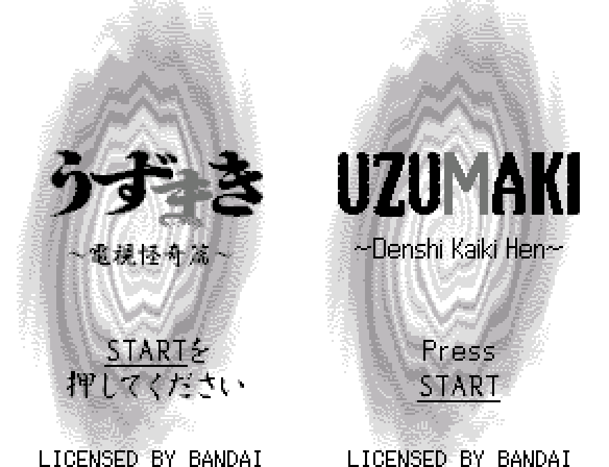

2. Title menu

   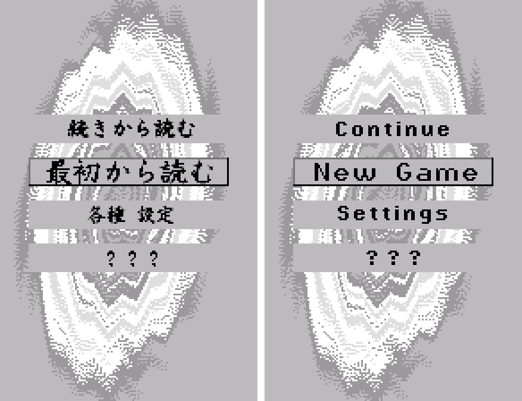

3. Intro text (attract mode)

   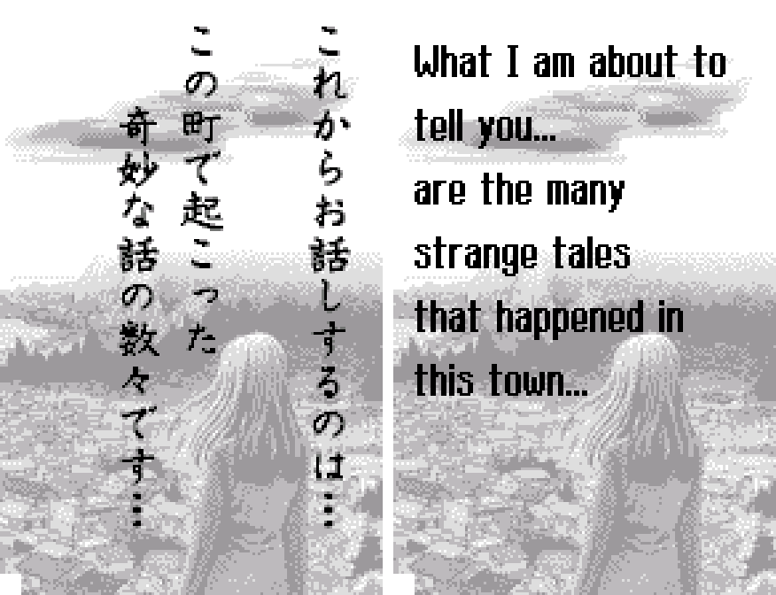

4. Narration over a picture

   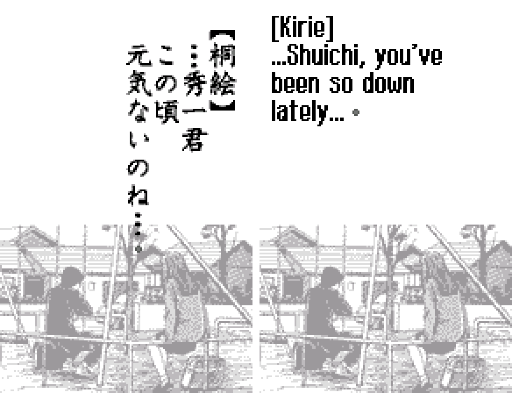

5. Dialogue with a speaker label and portrait

   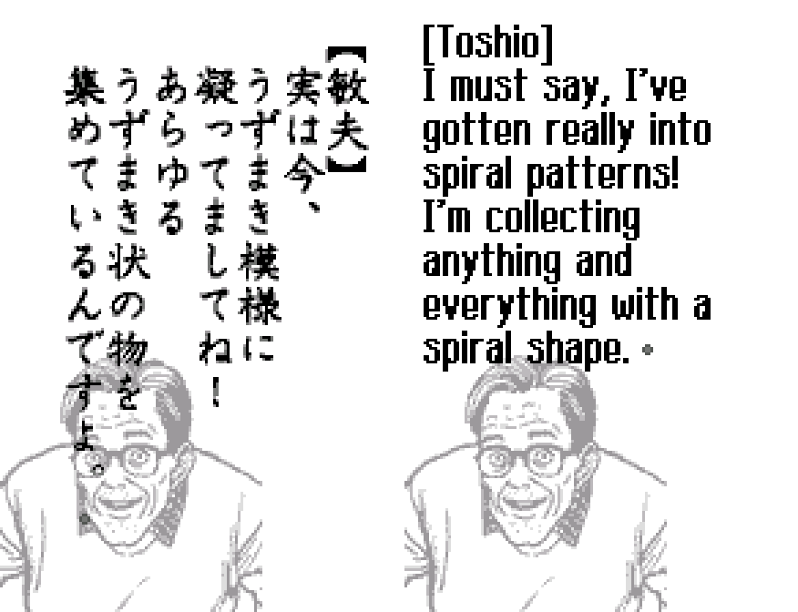

6. Dialogue over a face picture

   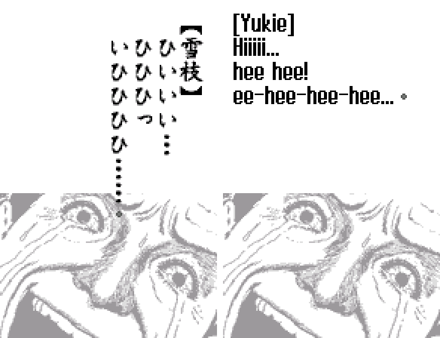

7. A choice

   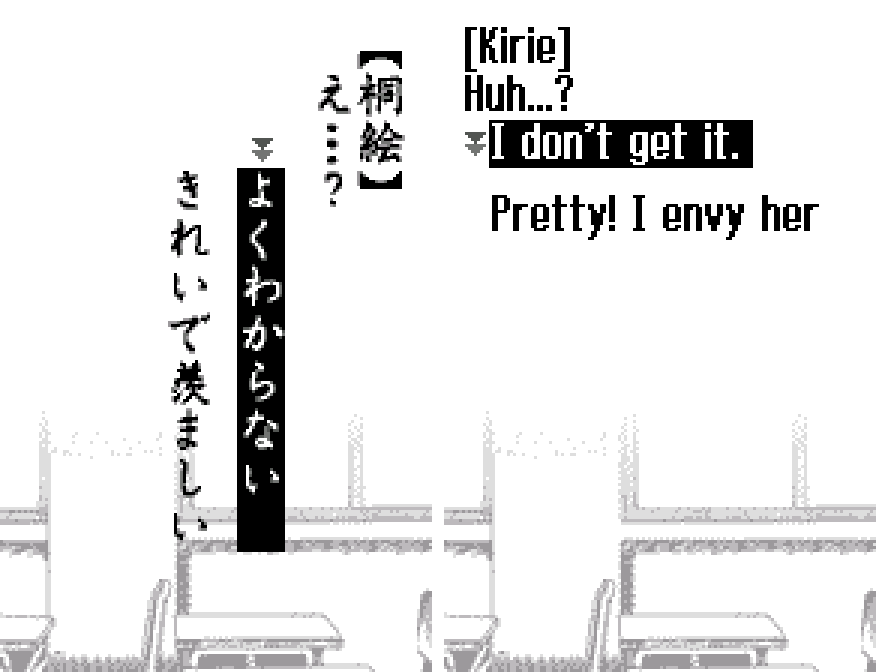

8. In-game menu

   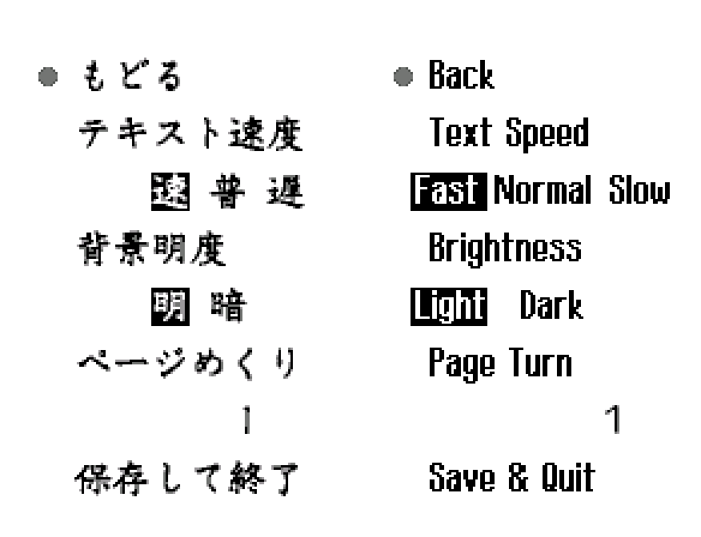

9. Settings

   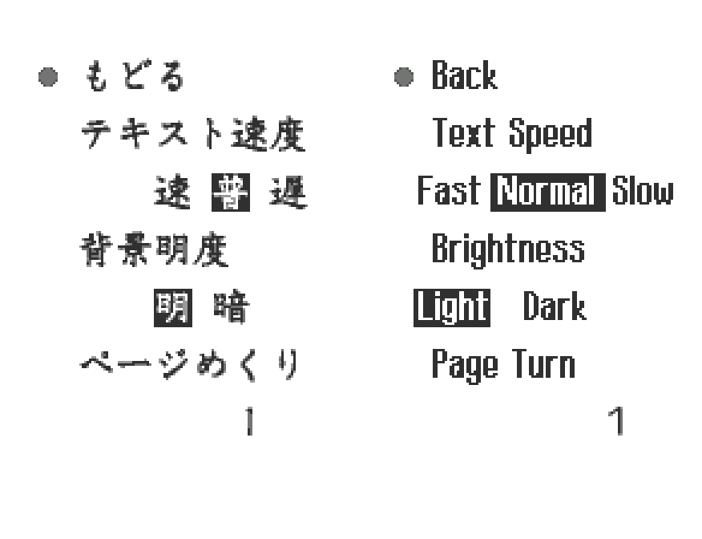

10. The quiz (reached by forcing it; see below)

   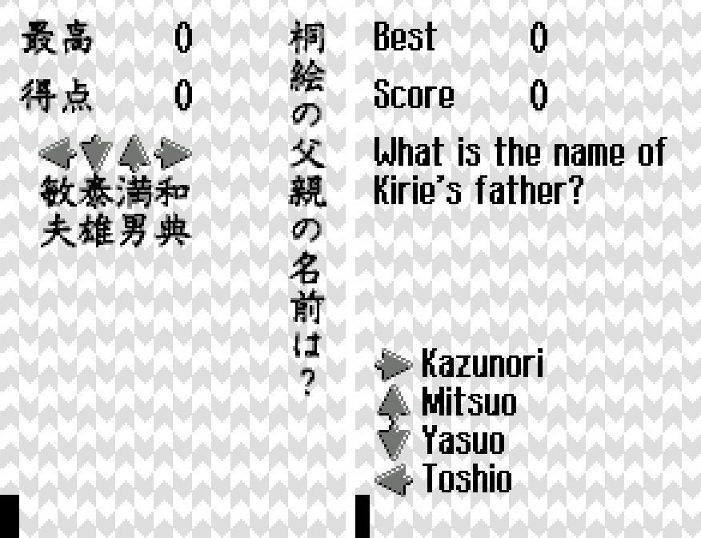

11. A place card

   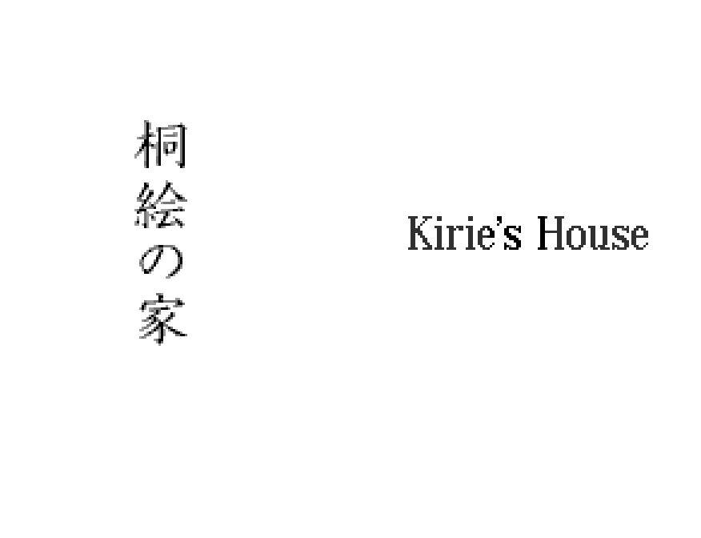

12. An ending card (Bad End)

   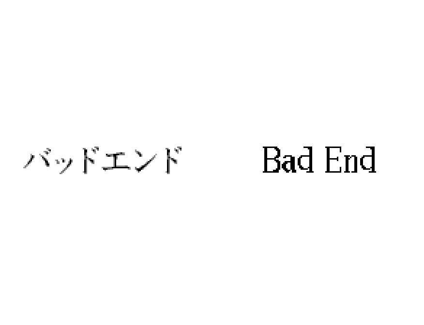

13. Staff credits

   

**How to patch**

Apply the BPS file to the Japanese ROM **Uzumaki - Denshi Kaiki Hen (Japan).ws** (2,097,152 bytes, CRC32 `812020EF`) in your browser with the [Swan Revival patcher](https://swanrevival.com/patcher/), or with Floating IPS, beat or ROM Patcher JS. The result should be 2,097,152 bytes with CRC32 `9B24E923`. It's a monochrome WonderSwan game, so keep the .ws extension. You must provide your own copy of the original Japanese game to apply it.

**Download:** `uzumaki-denshi-kaiki-hen-en-1.0.bps` on the [release page](https://github.com/PokemonGoDB/wonderswan-english-patches/releases/tag/uzumaki-denshi-kaiki-hen-v1.0).

**Known issues**

* It hasn't been played start to finish by a person. If you find leftover Japanese or anything broken, please tell me where it happened.
* The screens listed above under "What was not seen on screen" were checked only in the text and the code.
* A few pages keep an 8 px left margin over the artwork; 61 pages are split in two by the patch where the English is longer than the area free of the picture allows, which adds a pause the original does not have; on 11 of them the pause falls in the middle of a sentence (for example "...You are the first person who", then the rest after the next button press).
* The parcel plate reads "Mitsuru / with love!". The title logo is blockier than the original's brush lettering, and menu labels and quiz headers are smaller than the original kana.
* 11 staff-credit name readings are best guesses.
* Save states made in an emulator on the Japanese ROM do not carry over to the patched ROM.
* The credits play for 4,358 frames with no input, the same on the original. An automated soak run that reaches them a second time counts them as dead windows (seen once, in an earlier build; the final run had no flag).
* It was tested in an emulator only, not on a real WonderSwan.
* No developer or debug menu was found.

**Technical notes (for the curious)**

* The text is stored as 2-byte glyph codes (80xx-87xx) that index a 16x16 2-bit font at ROM offset 0x100000, in uncompressed scripts in banks 16h-17h. The English uses a renderer added to unused ROM space that draws proportional letters sideways-in-tiles for the upright screen.
* Each English text run carries a typing rate so that a page appears in the time the Japanese page takes at every text-speed setting.
* The patch changes text, a lot of picture tiles and some code; the ROM stays 2 MB.

**A Note On My Justifications for AI Use**

I have been an avid fan of the Wonderswan system for a very long time now. It was actually a motivating factor for my various attempts to learn Japanese (which have all failed so far). I always wanted to explore the game catalog more, but the lack of English translations made it extremely difficult to do so. Here's the thing: There's a reason many of these games have not been translated yet. It's not just the fact that Japanese > English translation is difficult. There's also the fact that the original developers used all kinds of tricks and technical feats to make these games work. Most games do not have a searchable directory of text that you can just replace with English equivalents. While some are easier than others, translations for some of these would take not only an expert in Japanese > English translation, but also someone with vast game development and programming experience.

I say all that to say: I get why people are apprehensive about AI usage for this type of thing. However, these games have been around for a very long time now and most of them have still not received a translation. I (and others) have chosen to spend our time and money to utilize AI to translate the games and actually make them playable for the wider community. If you don't agree with that, that's completely fine. I am more than happy to remove any of my translations if better, human ran translations are released at a later date. We already decided to skip any games where someone is actively working on a manual translation. While nowhere near what a manual translation effort would be, I do spend a considerable amount of time trying to work through each game's translation. I stress over small details and try my best to make the right calls. And I've probably messed some stuff up, which is why I welcome feedback.

I'm just looking forward to digging through all of these games. It's a great time to be into Wonderswan games.
