# Vaitz Blade (WonderSwan) - AI English translation patch v1.0

**Vaitz Blade** (ヴァイツブレイド) is a role-playing game from Bandai for the WonderSwan (1999). You play a young soldier of the Randor Empire (the hero's name is yours to enter) who is given a platoon of Vaitz, the beasts of the continent of Farland. You walk through castles, towns and the world map, fight turn-based battles, capture weakened Vaitz, and fuse them into new ones at the farm and the smithy, with an arena, an item shop, an auction and a Trade Center along the way. This patch translates all the text the game shows into English.

> **Please read:** this translation was made **with AI** (Claude), as a hobby project. A person (me) made every judgement call before release, but nobody on the project is a professional translator. I'm sharing it as it is for anyone who wants to play. Please **don't upload it to romhacking sites** (romhacking.net and the like). It may not be up to the standard of a real fan translation and it doesn't belong there.

**What's translated**

* **Everything the player reads in the normal game:** the dialogue (3,151 messages), every menu, item, ability and monster name and description, the battle messages, the room-name plates, the name-entry screen, the arena menus and the end card. The game's text catalog holds 4,530 text units and all of them are covered.
* **Names and terms:** the game has no official English, so the spellings are my choices (Randor, Farland, Vaitz, Zeribel, Polon and so on), made with the project's termbase and confirmed in the decision pages described below. *Vaitz* stays *Vaitz* in the singular and the plural.
* **Short fixed forms where text had to fit:** monster names are at most 5 letters, item and ability names at most 8 (for example `Abil.`, `Equip`, `Helmr`), because the game draws them in fixed-width tile fields. A few labels were shortened to fit: `1:` and `2:` in the fuse boxes, `Atk.`, `Spd.` and `Mag.` on the stats and equipment panels.
* **Speaker names** above the dialogue box are drawn proportionally: 88 of the 126 speakers show their full name, and the other 38 show a short form that keeps the meaning (for example `Officer`, `Guard A`, `Mr.Black`).
* **Pictures with text** (title logo area, name-entry grid, menu art) were redrawn in English in the original lettering's style. The hero's name is entered with Latin letters, up to 5.
* **Choices made on the decision pages:** the speaker Dark is **Dirk**; Dimitri's scythe joke is kept without the slur (the item is `Sharp Wit` and he says "Call it a cutting remark!"); the ability-fusion command is **Combo**; battle messages read "[name]'s Attack rose!"; the currency stays **Luk** with no plural; the monster-book list is headed **Roster**; the katakana line under the title logo is kept.
* **Credits:** the 44 staff-name lines in the end credits stay in Japanese script, as in the original; the role headings are English.
* **Stays Japanese:** the developers' debug-only screens (MAP SELECT, CAB TEST, BATTLE DEBUG, ITEM DEBUG and the rest), which the retail game never opens. (The Debug Edition below puts English labels on most of them.)

**Two patches: Standard and Debug Edition**

* **Standard** (`vaitz-blade-en-1.0`): the game as described above. This is the one to play.
* **Debug Edition** (`vaitz-blade-en-debug-1.0`): the same translation, plus a way into the developers' menu that is still on the cartridge. **Hold Y2 + A + B together on the title screen** (Y2 is the right button of the Y pad) and the menu opens; LEFT and RIGHT choose among 22 entries, A starts one. Entries: MAP SELECT (a map, event, flag and position editor), TRADE CENTER, GAME START, SHOOTING (an aerial shooter mini-game), AUCTION, ITEM DEBUG (item viewer), several cutscene demos (BABEL TOWER, CLIFF, BABEL MAP, WAR), CHR LIST CHECK and ITEM LIST CHECK (data sheets), FACE TEST, END ROLL (the epilogue and credits), FILE SELECT, TITLE, CAB TEST (battle effects) and BATTLE DEBUG (formation setup and a test battle). It is a tool for the curious, not a way to play: **ENDING and ARENA crash** (they do in the Japanese game too), ITEM SHOP and INN draw garbage because they need a town loaded, and most entries have no way back to the menu, so you reset the console. The labels of MAP SELECT, ITEM LIST CHECK, CAB TEST and the BATTLE DEBUG menu are in English (short developer-style abbreviations, some of them guesses); **the labels of CHR LIST CHECK and of the sub-screens reached with A from CAB TEST and from "To Battle" stay unreadable** (English letters drawn over the Japanese letters' codes). Apart from this menu, the two patches are the same game. It was tested in an emulator only, and every entry was only tried briefly (about 25 seconds of emulated time each, with random button presses), not played through.

**How it was made: AI translation, independent checks, human decisions**

* Claude worked out the game's text format, wrote the English, and rebuilt the ROM with a proportional-letter text renderer added to the cartridge, so that lines and names fit the original boxes. The ROM stays 4 MiB, like the original.
* The final build (vb11a) went through a full automated test run, vb12a, of 9 checks, and all 9 passed:
  * every one of the 4,530 catalogued text units is covered, 0 are uncovered, 152 runs of kana in the tile maps are covered, and the ROM size is right;
  * 3,011 dialogue messages were restarted in the emulator and drawn by the game: every one drew English letters, none was flagged (no Japanese, nothing past the right edge, no box with too many lines); one more was flagged but the original does exactly the same. The same run on the original drew Japanese in 151 of 151 control messages, so the check can see it;
  * random-button walks from 54 saved states (972,000 frames) found Japanese on the English build only in the test-only end-roll route, where the credits staff names stay Japanese on purpose; the same walks on the original saw 507 distinct Japanese codes (954,000 frames), so the check can see it;
  * 25 rows of the screen inventory were checked, 17 of them captured on both ROMs (202 screens) and the other 8 carry a written reason why no screen exists;
  * a measured alignment audit flagged 112 rows, all of them already looked at, 0 new; a soak test of 4,860,000 frames from 54 saved states raised no flag (7 of the 54 states react little to random presses, so they prove less);
  * the attract loop and the end roll were captured on both ROMs (the end roll through a test-only route, 123 screens).
* The English was read against the Japanese by ten read-only Claude reviewers (all 3,011 dialogue messages with text, 554 descriptions and data screens, 756 names and tile labels, 178 battle messages). They counted 45 errors and 88 preferences, which went into one fix batch; where a finding was not applied, the reason is written down. Reviewers also read the captured screens beside the originals.
* Every decision that was mine to make was put on decision pages, 35 items in all (name spellings, wording, the title logo, the speaker labels, the credits and so on), with options and pictures, and I answered every one of them. Some of my answers changed the text; they are listed above.

**What was not seen on screen** (please report anything odd)

* **Real play stopped at the departure of the train from Randor.** I played the castle, the town of Randall (farm, smithy, item shop, bar, auction, Trade Center), the world map, the harbour, a village inn, the reef and Pesca, battles with every command, capture, level-up, fusion at the farm, saving and CONTINUE, and a game over by battle message. **The story after the train leaves Randor was not played:** the Stanga attack, the remote village, Ayan Mine, Jade and the marsh. Those lines are covered by the static catalog and the dialogue sweep, not by a screenshot, and nobody has read them on screen.
* **Test-only help:** some screens were reached by writing values into a saved-state file, not by real play: the win over the boss Krakn and the text after it, abilities on the party and the ability recipe book, big numbers on the Stats, File and equipment screens, the smithy Forge and Fuse lists with real materials, and Pesca after the event.
* **The ending was not reached by play.** The end roll and the ending were run through a test-only debug entry. Of the hero endings, only the El branch was read on screen; six other hero branches ran without any Japanese code but their text was not read. The real ending trigger and the last boss win were not seen.
* **Not seen at all:** the labels `Pts.`, `Undo`, `Fuse` and `Sure?` on the full-party screen (they exist only as off-screen copies and are never visible in either ROM); the game-over script "[HERO]'s party has fallen" (a random-battle wipe shows "The party was wiped out..." instead); the link messages "Canceled." and "No reply"; the auction "not enough money" case (a silent beep, the same in the original); the katakana name page (the English grid has no page switch); options or a sound test (none found).
* **Speaker labels:** the new proportional label was seen on screen for 12 speakers and four real messages. A few screens that read the speaker table by another route (`5000:43A5` and `D000:7170` in the code) were not identified and may still show the old abbreviations.
* **Room-name plates:** the 46 centred plate titles were seen one by one for the throne-room plate and the intro captions only; the others were looked at on contact sheets.
* **Attract loop:** captured on both ROMs and passed in the project's ledger, but not read screen by screen by a person.
* **Catalog re-import:** a re-import of the text catalog changed 191 units, 88 of them dialogue units; those were not re-read line by line (the build itself comes from the reviewed packets).
* **What the checks cannot see:** text drawn as pictures outside the pictures that were listed, and screens the saved states and random presses do not reach.
* The game was not played from start to finish by a person, and not on real hardware.

**Changelog**

* **v1.0**: first public release, in two patches (Standard and Debug Edition).

**Sources consulted**

* Japanese text: the WonderSwan ROM itself.
* English names and terms: there is no official English release of this game. The project's termbase of 965 entries was built from the game's own name tables (monsters, items, abilities, speakers), from reading notes made while working through the Japanese text, and from a story bible written for the project; I found no outside English source for the names, so they are my choices (see above).
* The ROM revision: the dump is the one the Data Crystal wiki lists as "Japan (Rev 1)" (same CRC32); the release date and serial come from wsx.wiki.
* The project's own notes on the game's text format and the QA run summaries.
* I searched for another English translation of this game on 2026-11-19: a web search, the WonderSwan claims board and the gametranslate.us translations page found no other English patch, and Data Crystal lists none known. If a human translation is released, that one should be preferred.

**Images** (original on the left, English on the right)

1. Title screen (the katakana line under the logo is kept, as in the original)

   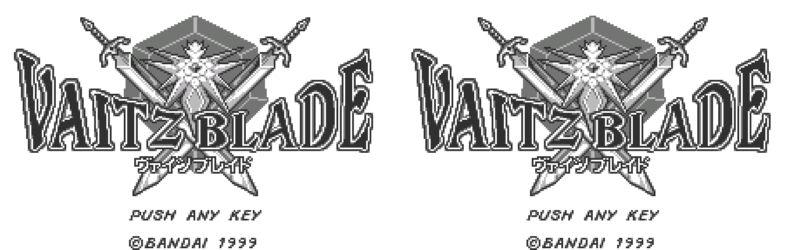

2. Name entry (Latin letters in place of the kana grid; the default hero name is Will)

   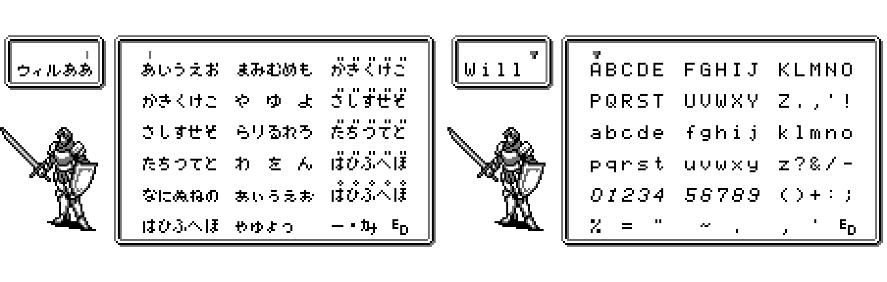

3. Battle start ("Ape A appeared!")

   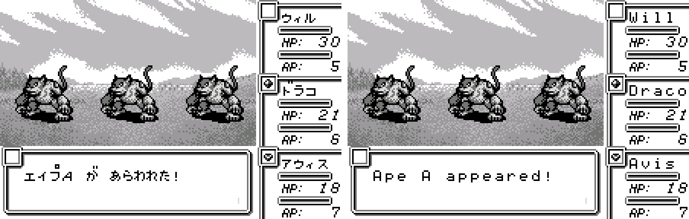

4. Item list (Use / Sort, License, FileBook)

   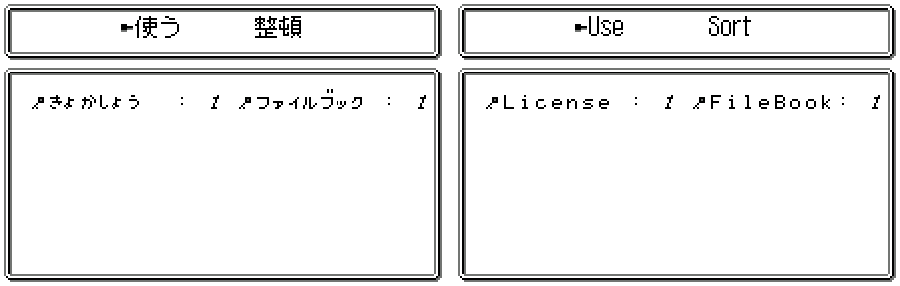

5. Monster-book list headed Roster

   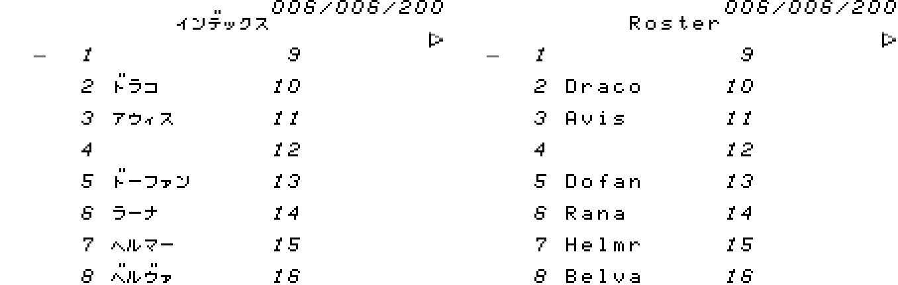

6. Main menu with the party panel (Items, Abil., Equip, Order, File, Stats, Save)

   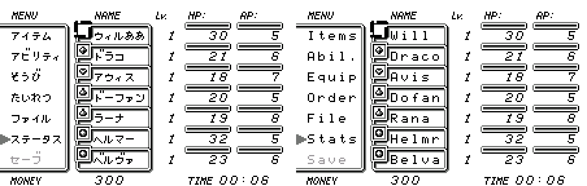

7. Story dialogue with the speaker label (Gerard, at the start of the game)

   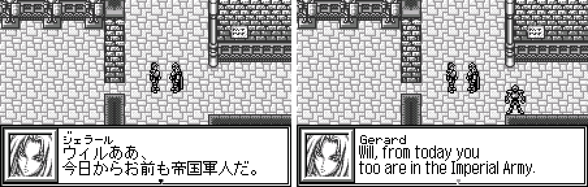

Debug Edition only (the original's developer screen, opened by the test route, on the left):

8. The developer menu (it draws the console's owner name and the build stamp 99/05/22)

   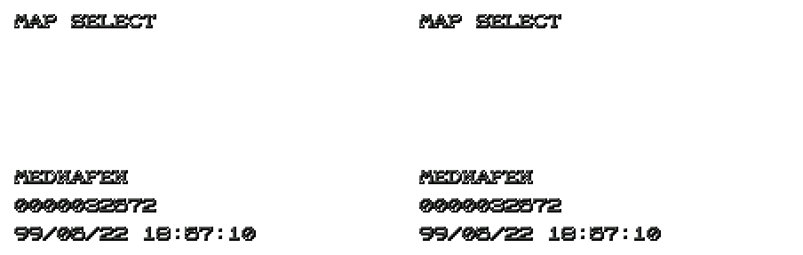

9. MAP SELECT

   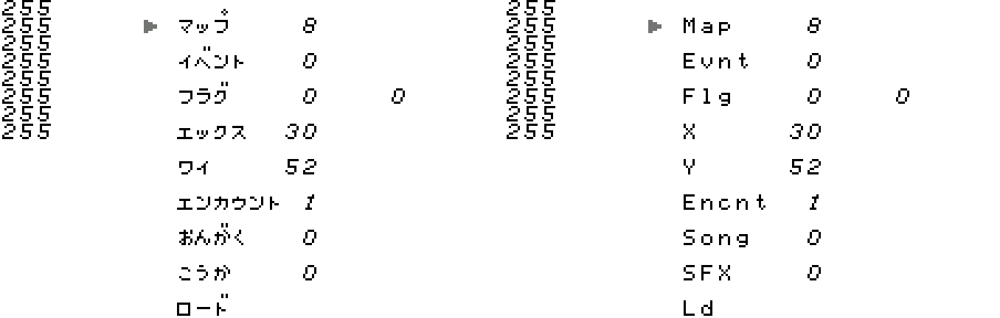

10. ITEM LIST CHECK

   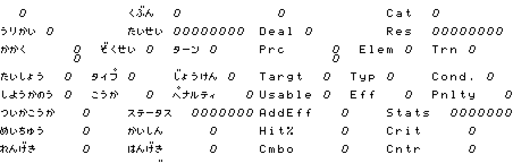

11. CAB TEST

   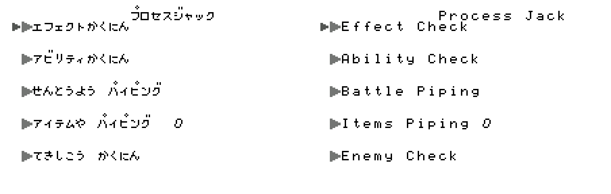

12. BATTLE DEBUG

   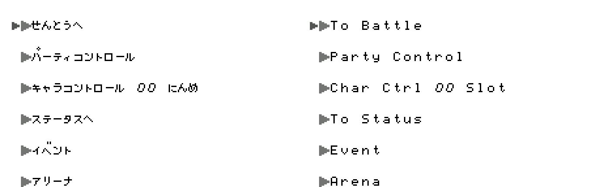

**How to patch**

Apply the BPS file to the Japanese ROM **Vaitz Blade (Japan).ws** (4,194,304 bytes, CRC32 `8FC9E145`) in your browser with the [Swan Revival patcher](https://swanrevival.com/patcher/), or with Floating IPS, beat or ROM Patcher JS. The result is 4,194,304 bytes:

* Standard: `vaitz-blade-en-1.0.bps`; the result should be CRC32 EEA440C8.
* Debug Edition: `vaitz-blade-en-debug-1.0.bps`; the result should be CRC32 E4E38BF6 (also 4,194,304 bytes).

It's a WonderSwan game (mono), so keep the .ws extension. You must provide your own copy of the original Japanese game to apply it. The patch only fits this dump (CRC32 `8FC9E145`); another revision is refused or gives a wrong result.

**Download:** `vaitz-blade-en-1.0.bps`, `vaitz-blade-en-debug-1.0.bps` on the [release page](https://github.com/PokemonGoDB/wonderswan-english-patches/releases/tag/vaitz-blade-v1.0).

**Known issues**

* It hasn't been played start to finish by a person, and the story after the train leaves Randor was not played (see "What was not seen on screen"). If you find leftover Japanese or anything broken, please tell me where it happened.
* Forced abbreviations in tight fields: `Sacrifce` (a letter dropped), `Resurr 1`, `Atk.`, `Spd.`, `Mag.`, and `1:` / `2:` in the fuse boxes.
* The capture command is `Catch` (5 tiles) while messages say "Capture"; enemy letters read "Ape A".
* The YES/NO popups overlap the panels behind them (farm fusion, forge confirm). I believe this is the original layout but did not compare it screen by screen.
* For a few frames a battle message box can show a mix of the old and new line while the new line is typed over it; the original engine seems to do the same.
* The word `Money` on the forge panel sits directly above the number, as I believe it does in the original; the money unit in messages is Luk.
* Some screens may still show the old abbreviated speaker names (see above).
* Japanese saves are not compatible with the patched ROM.
* For link trading, both consoles need the patch (names cross the cable as raw character codes). The link battle itself is dormant in the retail game.
* It was tested in an emulator only, not on a real WonderSwan.
* Debug Edition: ENDING and ARENA crash, ITEM SHOP and INN show garbage, CHR LIST CHECK and two sub-screens have unreadable labels, and most entries cannot return to the menu (reset the console). The standard patch has none of this because it has no way into the menu.

**Technical notes (for the curious)**

* The game keeps 4,530 catalogued text units, mostly Shift-JIS, in several ROM segments, plus text built from tile maps and pictures. The patch repacks all 3,151 dialogue messages with relocation, replaces the text and the fonts, and adds a proportional Latin renderer and a speaker-label routine in unused ROM space; the ROM stays 4 MiB.
* The dump is the footer version 01 ("Rev 1") ROM, Bandai, 1999-06-24, serial SWJ-BAN00C, mono WonderSwan, 256 Kbit SRAM save.
* The cartridge holds a developer debug menu with 22 entries and no retail route to it. The standard patch leaves it alone and adds no way into it. The Debug Edition adds one 5-byte hook in the main loop (the last call of the frame loop, at `4000:4554`, now calls a 64-byte routine placed in unused ROM) that opens the menu when Y2, A and B are held on the title screen, English text for 84 labels of the developer screens, and nothing else; every other byte equals the standard patch's result (checked). The Debug Edition patch file is 403,149 bytes.
* The patch was checked by applying it to the original ROM and comparing with the tested build byte for byte; applying it to a different ROM is refused (source CRC mismatch). The patch file is 401,634 bytes.

**A Note On My Justifications for AI Use**

I have been an avid fan of the Wonderswan system for a very long time now. It was actually a motivating factor for my various attempts to learn Japanese (which have all failed so far). I always wanted to explore the game catalog more, but the lack of English translations made it extremely difficult to do so. Here's the thing: There's a reason many of these games have not been translated yet. It's not just the fact that Japanese > English translation is difficult. There's also the fact that the original developers used all kinds of tricks and technical feats to make these games work. Most games do not have a searchable directory of text that you can just replace with English equivalents. While some are easier than others, translations for some of these would take not only an expert in Japanese > English translation, but also someone with vast game development and programming experience.

I say all that to say: I get why people are apprehensive about AI usage for this type of thing. However, these games have been around for a very long time now and most of them have still not received a translation. I (and others) have chosen to spend our time and money to utilize AI to translate the games and actually make them playable for the wider community. If you don't agree with that, that's completely fine. I am more than happy to remove any of my translations if better, human ran translations are released at a later date. We already decided to skip any games where someone is actively working on a manual translation. While nowhere near what a manual translation effort would be, I do spend a considerable amount of time trying to work through each game's translation. I stress over small details and try my best to make the right calls. And I've probably messed some stuff up, which is why I welcome feedback.

I'm just looking forward to digging through all of these games. It's a great time to be into Wonderswan games.
