# Wild Card (WonderSwan Color) - AI English translation patch v1.0 (+ Debug Edition)

**Wild Card** (ワイルドカード) is a card-driven adventure game from Square, released in Japan on 29 March 2001 for the WonderSwan Color. Characters, scenarios, terrain, monsters, spells, items and events are all cards, and the field screen is also the battle screen. A comet appears over the Kingdom of Alan and everyone starts hunting the Star Fragments. An opening quiz picks one of nine heroes, and the game has seven stages made of short scenarios.

This patch translates it into English.

> **Please read:** this translation was made **with AI** (Claude), as a hobby project. A person (me) made every judgement call before release, but nobody on the project is a professional translator. I'm sharing it as it is for anyone who wants to play. Please **don't upload it to romhacking sites** (romhacking.net and the like). It may not be up to the standard of a real fan translation and it doesn't belong there.

**What's translated**

* **Everything the player reads:** the opening quiz and each hero's opening, the title and file menus, name entry, the towns and taverns, all seven stages with their events, the card battles (menus, HUD, results, status messages), the shops, the Album, the link-cable card trade, both endings, the staff roll and the game-over screens. The game stores 4,820 text units and all of them are covered.
* **Card names:** all 930 are translated. A name has to fit 16 letters in the game's own label, so 51 are shortened (for example "Salamander Breath" is shown as "SalamanderBreath", "Heaven and Earth Reversed" as "World Upended", "Holy Sword of Justice" as "Sword of Justice"). The card description keeps the full name where there is room.
* **Quiz jokes:** the opening quiz is translated by meaning. Most jokes carry over. The muscle / gag rhyme became "be a stud" / "be a dud". Two lose their wordplay: a bra / love reversal and a "go around" proverb.
* **Number letters:** the game's own stylized number letters are kept, so the columns in results, save and load, the Album and the shops look as in the original.
* **Redrawn pictures:** six pictures with Japanese text were redrawn in English: Poison, Paralysis, Sleep, Deck Finished, Wiped Out and the warning shown on a monochrome WonderSwan.
* **Names with no English precedent** were chosen by me, for example Oskar Mayer, Prince Cherubim and Thoth Valley.
* **Saves:** normal save files are unchanged and move freely between the Japanese and the English version. **The suspend save (made by quitting in the middle of a stage) does not survive a patch update.** The game accepts it only from the exact ROM that wrote it. Please finish a suspended game before you update to a newer version of the patch.

**Debug Edition (optional)**

The cartridge contains the developers' own test menu, which a player cannot reach. A second patch switches it on from the title screen: a card viewer, an event test, an event game and the check for the monochrome-console warning, all in English. It is the same translation otherwise. It is for the curious; play the standard patch.

**How it was made: AI translation, independent checks, human decisions**

* Claude worked out the game's text format, wrote the English for the game's text, and rebuilt the ROM with a variable-width font and a text renderer added to the cartridge, so that lines and names fit the original boxes.
* The final build was put through a full automated test run of 17 checks, and all 17 passed:
  * the 659 dialogue and quiz units that the drawing sweep can reach were each drawn by the game and checked, with no Japanese, nothing past the right edge and no box with too many lines (card descriptions, names and the HUD are covered by the other checks, not by this one);
  * random-button walks drew 341,046 glyphs on the English build without a Japanese one (the same walks on the original find 584 runs with Japanese, so the check does detect it);
  * 3,420,000 frames of soak tests over 38 saved states raised no flags (13 of those states barely react to random presses, so they prove less);
  * 7 two-console link-cable trade runs did not fail;
  * 70 routes through the menus and stages and 28 routes to endings and outcomes were played on both the original and the English build with nothing wrong found, and 325 flagged regions of the captured screens were reviewed, with none left open.
* Screens were also read by separate read-only Claude reviewers, who judged them against the original side by side; their findings were fixed or written down.
* All 30 decision items (names, style, the redrawn pictures, card-name length, saves, number letters and more) were listed with options and pictures, and I decided every one of them.

**Changelog**

* **v1.0**: first public release.

**Sources consulted**

* Japanese text: the WonderSwan ROM itself.
* The project's own notes on the game's text format, story, voices and terms, and the QA run summary.

**Images** (original on the left, English on the right)

1. Title screen

   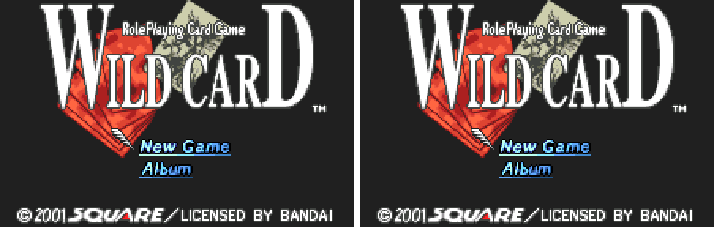

2. Opening quiz

   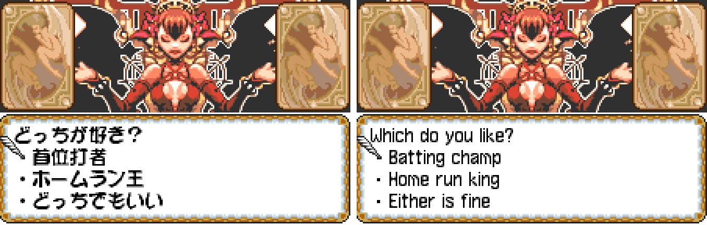

3. Dialogue in a tavern (the two captures show different lines)

   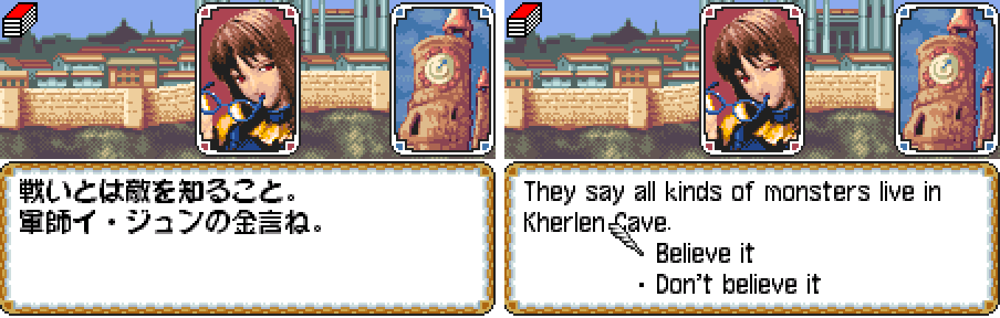

4. Scenario select

   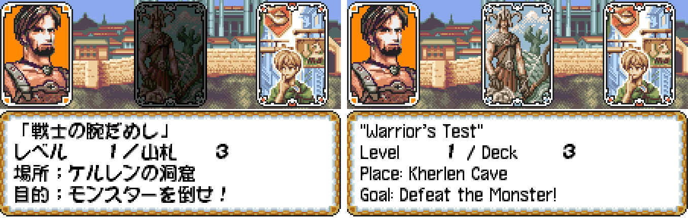

5. A card battle

   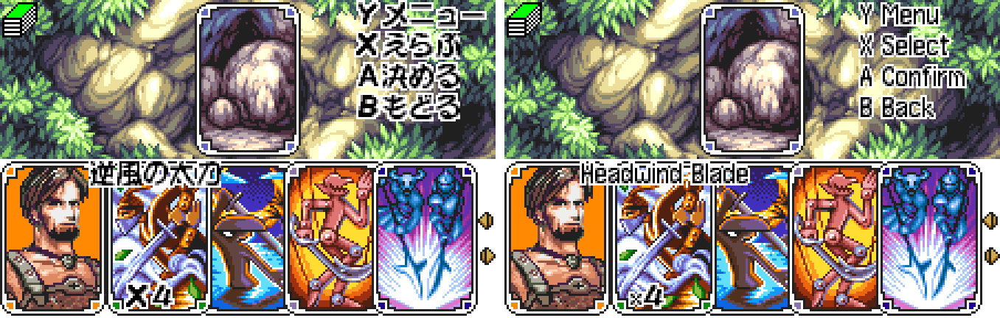

6. A card description in the shop

   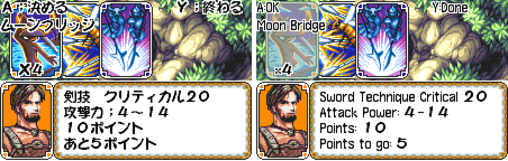

7. Results panel, with the original's own number letters

   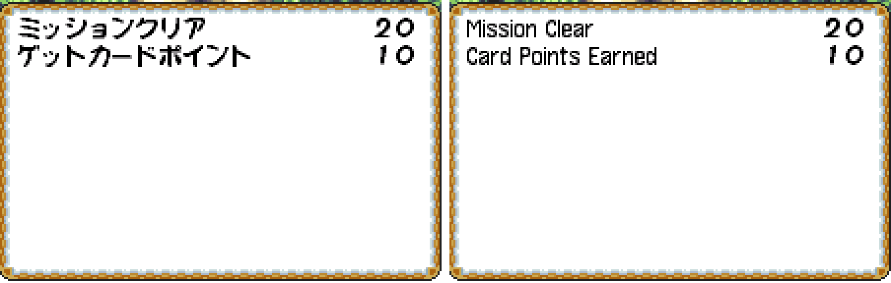

8. The Album

   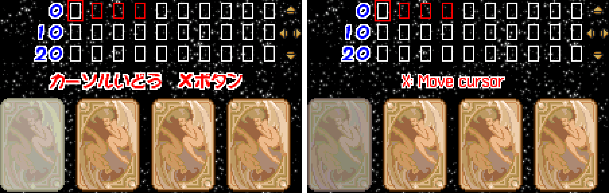

9. Save screen (the two captures hold different save files)

   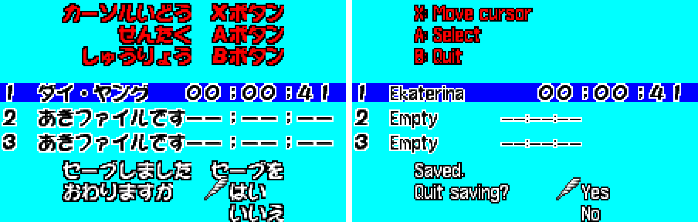

10. Name entry

   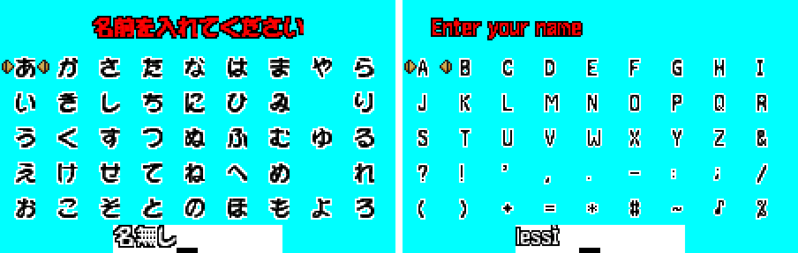

11. The redrawn Wiped Out banner

   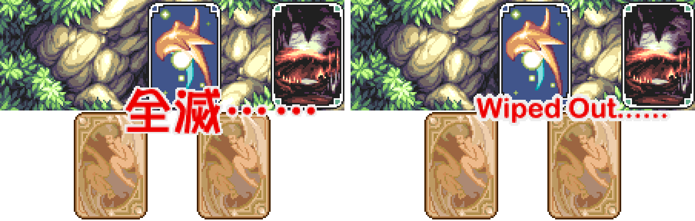

**How to patch**

Apply one of the BPS files to the Japanese ROM "Wild Card (Japan, WonderSwan Color)" (CRC32 D9401F0A) in your browser with the [Swan Revival patcher](https://swanrevival.com/patcher/), or with Floating IPS, beat or ROM Patcher JS:

* Standard: `wild-card-en-1.0.bps`, the result should be CRC32 DCB75E51.
* Debug Edition: `wild-card-en-debug-1.0.bps`, the result should be CRC32 34766ABA.

The patched ROM is 2 MB, the same size as the original. It's a WonderSwan Color game, so keep the .wsc extension.

You must provide your own copy of the original Japanese game to apply it.

**Download:** `wild-card-en-1.0.bps` and `wild-card-en-debug-1.0.bps` on the [release page](https://github.com/PokemonGoDB/wonderswan-english-patches/releases/tag/wild-card-v1.0).

**Known issues**

* It hasn't been played start to finish by a person. If you find leftover Japanese or anything broken, please tell me where it happened.
* The English letters are smaller than the original's: capitals are 9 px tall where the original's kana are 11 px. The game has one 12-dot font for all running text, and a taller font would need every box fitted again. The original's number letters and the "Mission Complete!!" banner are the same size as before. I decided to release it as it is.
* An empty save slot shows its "no time" dashes in a thin font, starting a little left of where the original's wide dashes sit.
* Some screens were never reached in testing, so they were checked only in the code and on neighbouring screens: the status labels, the ALERT and TRAP screens, the "scenario failed" panel, the armour shop and markets, the epilogues of heroes other than the ones played, stages 3 to 5, the save-error screens, the warning shown on a monochrome console and its exit, and the English text of the knocked-out panel.
* Link-cable trades were tested only between two emulated consoles, and not with the cable pulled mid-trade or with both players pressing A on the same frame.
* The Debug Edition was tested on 5 routes through its menus, not exhaustively.
* Random button presses reach only part of the game, so the soak and Japanese-detection runs cover only what they reach.

**Technical notes (for the curious)**

* The game keeps its text as Japanese kana in tables that its own script engine draws into boxes. The English uses a variable-width font and a renderer added to the cartridge.
* The patch changes text, some picture tiles and code, and keeps the ROM size of 2 MB.

**A Note On My Justifications for AI Use**

I have been an avid fan of the Wonderswan system for a very long time now. It was actually a motivating factor for my various attempts to learn Japanese (which have all failed so far). I always wanted to explore the game catalog more, but the lack of English translations made it extremely difficult to do so. Here's the thing: There's a reason many of these games have not been translated yet. It's not just the fact that Japanese > English translation is difficult. There's also the fact that the original developers used all kinds of tricks and technical feats to make these games work. Most games do not have a searchable directory of text that you can just replace with English equivalents. While some are easier than others, translations for some of these would take not only an expert in Japanese > English translation, but also someone with vast game development and programming experience.

I say all that to say: I get why people are apprehensive about AI usage for this type of thing. However, these games have been around for a very long time now and most of them have still not received a translation. I (and others) have chosen to spend our time and money to utilize AI to translate the games and actually make them playable for the wider community. If you don't agree with that, that's completely fine. I am more than happy to remove any of my translations if better, human ran translations are released at a later date. We already decided to skip any games where someone is actively working on a manual translation. While nowhere near what a manual translation effort would be, I do spend a considerable amount of time trying to work through each game's translation. I stress over small details and try my best to make the right calls. And I've probably messed some stuff up, which is why I welcome feedback.

I'm just looking forward to digging through all of these games. It's a great time to be into Wonderswan games.
