# Wonder Classic (WonderSwan Color) - AI English translation patch v1.0

**Wonder Classic** (ナムコワンダークラシック, "Namco Wonder Classic") is a golf game for the WonderSwan Color, made by Namco and published by Bandai on 18 January 2001, played with the console held upright. It has no story. You pick one of 12 golfers and play training, stroke play, match play, mini battles, a mini course or a tour on the Wonder Golf Course, choosing club, ball, glove and shoes, reading the wind and lie and timing a three-stage swing meter. Opponents and caddies comment in short lines in boxes with a portrait, and many of the 124 rival golfers are Namco characters or in-jokes. The game also has Mobile WonderGate online screens (net tour, ranking, downloads), which no longer have a server. It was released only in Japan. The English version is a patch with two editions: the standard one, and a Debug Edition that opens the developers' hidden DEBUG_MENU.

> **Please read:** this translation was made **with AI** (Claude), as a hobby project. A person (me) made every judgement call before release, but nobody on the project is a professional translator. I'm sharing it as it is for anyone who wants to play. Please **don't upload it to romhacking sites** (romhacking.net and the like). It may not be up to the standard of a real fan translation and it doesn't belong there.

**What's translated**

* **All the text the game draws:** 490 distinct strings: the menus, the Data and Link menus, the item and profile text, the caddie and rival lines, the scorecards and records, the in-hole messages and the WonderGate online screens (the screens a player can reach offline; see below). The English uses the letters the game already has, at the same size as the kana, in the same 8-pixel cells; text that does not fit a box is split into pages or worded shorter.
* **Over a hundred picture labels redrawn** in the original style: the menu plates, the title ovals, the in-hole banners (HOLE IN ONE!, ALBATROSS! and the other lies and scores), CHAMPION and CADDIE SELECT, the pause and yes/no windows, the WonderGate menus and entry-form plates and the Tour Records labels.
* **The game's own English stays:** the WONDER CLASSIC title logo, PUSH START BUTTON, the Namco and Bandai copyright lines, and PAR, REST and the yardage on the hole screen. The small katakana subtitle under the logo is gone in the English title.
* **Names:** the golfers and rivals use Western order, given name first, and foreign names stay as written. The wording choices (names, banner letters, plate wording, item and error text, forced short forms) were put to me on a decision page with pictures; I approved all 28 items.
* **Saves:** the save format is unchanged, so saves are expected to work with the Japanese version in both directions. One thing was not checked on screen: the prefecture text after loading a Japanese save with a registered member card (no member card can be registered offline).

**Two patches: Standard and Debug Edition**

* **Standard** (`wonder-classic-en-1.0`): the translation above, and nothing else. Play this one.
* **Debug Edition** (`wonder-classic-en-debug-1.0`): the same translation, with the developers' hidden DEBUG_MENU switched on. It is on the cartridge but switched off by a constant in the original game. In this edition, **press START on the title screen** to open it, instead of going to the main menu. The menu is a plain white screen of English labels: RAND, COLOR, SRAM_INIT, CHARA, COURSE, NEO, CLUB, BALL, GLOBE and SHOES, and the version line VER 10_01. I saw it open on screen and leave to the main menu; I did not change any of its fields, so I do not know exactly what each one does (SRAM_INIT presumably clears the save, so be careful). It is for the curious, not for normal play. The ROM also contains a TEST_MODE and a hidden WonderGate test menu; I found no way to open them, so they are not in either edition.

**How it was made: AI translation, independent checks, human decisions**

* Claude worked out how the cartridge stores its text and graphics, wrote the English, redrew the picture labels and rebuilt the ROM. The ROM stays 4 MiB, like the original.
* The final build went through a full automated run of 11 checks, all 11 passed: the static check of all 725 text units, sweeps of every string in its real box, a runtime detector over 102 runs and 1,754,400 frames that found no Japanese on the English build (the same detector finds kana on the original, so it can see them), the attract loop (240 screens), 152 inventory screens, the endings, an alignment audit and a soak of 2.3 million frames with random button presses that raised no flag. The WonderGate screens were checked offline (see below).
* Two separate read-only Claude reviewers compared earlier builds with the original, one the English text and one the screens; their findings were fixed or put to me.
* The Debug Edition differs from the standard ROM in one switch byte and the footer checksum; I ran the same route from power-on on both ROMs: the standard one goes to the main menu, the Debug Edition opens the menu.

**What was not seen on screen** (please report anything odd)

* **No human playtest.** The main loop was checked by scripted routes and forced states, on an emulator only, not on real hardware or a flash cartridge.
* **WonderGate:** the service is gone. Offline, registering a member card ends at error 001 (shown in image 10), and the other online screens were seen only as short captures; pages with data (rankings, later bulletin pages, most other errors) were not seen with real content, and the net tour Cup unit was not drawn.
* **The ending and credits** were seen only by setting the game's scene directly; I found no route to them by play. No reward or unlock screen was found after a won tour round.
* **Some in-round hint lines** (MISS IT AND LOSE!, SINK IT TO WIN!, SINK IT TO TIE!) were never seen whole, because they slide in and are cut at the screen edge, as in the original; NICE APPROACH!, DORMIE HOLE and SUDDEN DEATH were not seen in a real round.
* **The Neo characters, extra courses, equipment and caddies** are in the ROM; I did not check how they are unlocked, since the downloads came from the WonderGate server.

**Changelog**

* **v1.0**: first public release (standard and Debug Edition).

**Sources consulted**

* Japanese text: the WonderSwan Color ROM itself.
* Names and terms: the game's own English and the project's notes. I searched for another English translation of this game on 2026-11-25 (the claims board, English and Japanese web searches, the cdromance and retrogametalk lists): none found. If a human translation is released, that one should be preferred.

**Images** (original on the left, English on the right)

1. Title screen: the logo and PUSH START BUTTON are the game's own; the English title has no small katakana line under the logo

   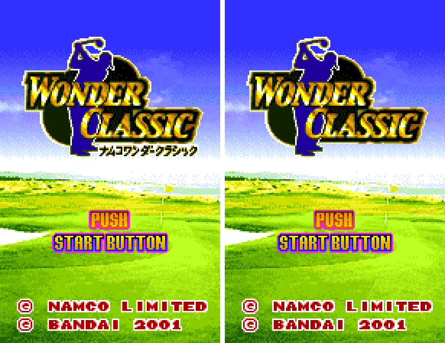

2. Main menu: Game, Data, Link

   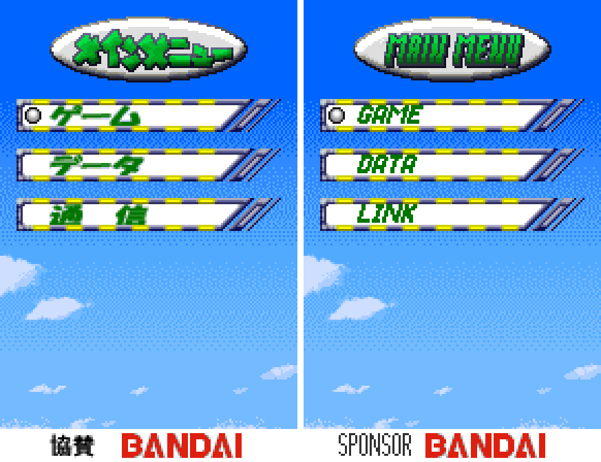

3. Game menu: Training, Chara Get, Stroke Play, Match Play, Mini Battle, Mini Course, Tour

   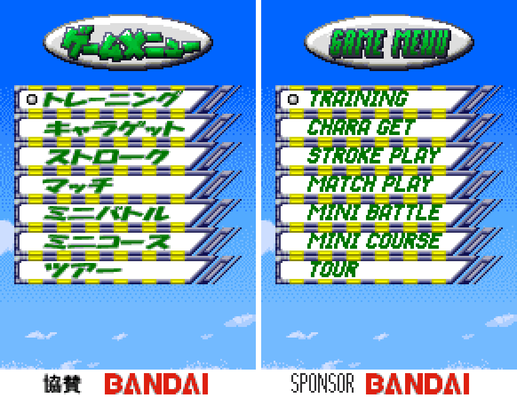

4. The option window on the hole screen: Weather, Wind Dir., Wind Spd., Quit

   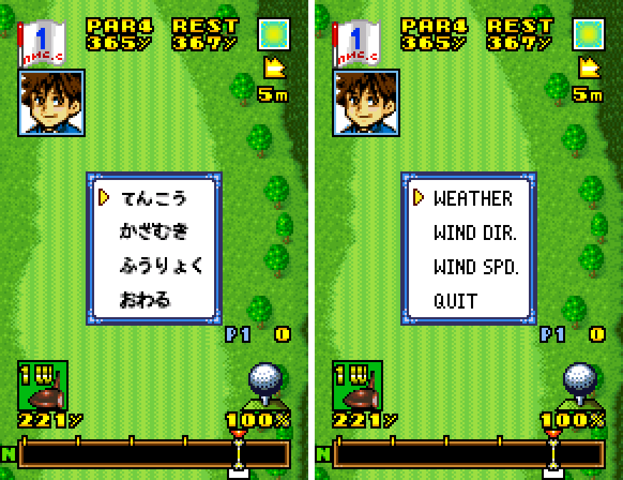

5. Scorecard with the hole, par, player and putt columns

   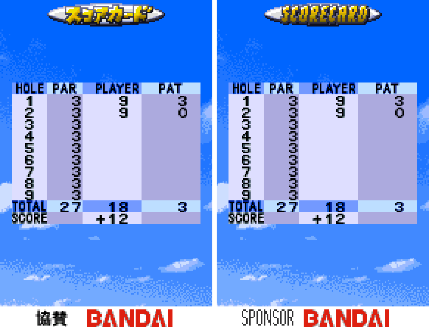

6. Tour Records: rounds, low score, average, putts, drives, fairways, greens, par saves

   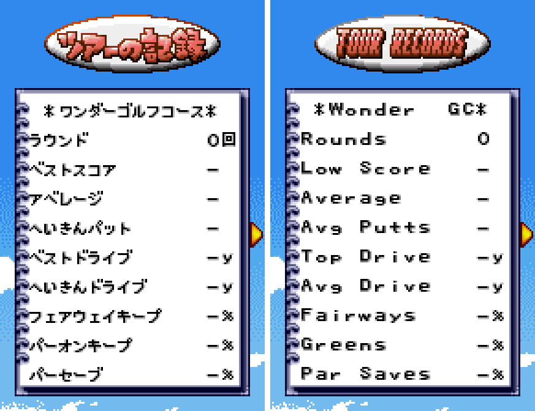

7. Item Select: club, ball, glove and shoes, with the stat bars (curve, power, height, control, sweet spot, backspin)

   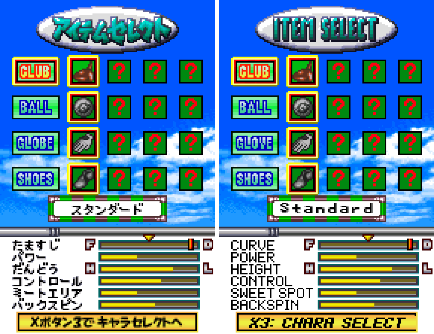

8. The HOLE IN ONE! banner over the hole screen (the hole-out was forced by a test script, not played)

   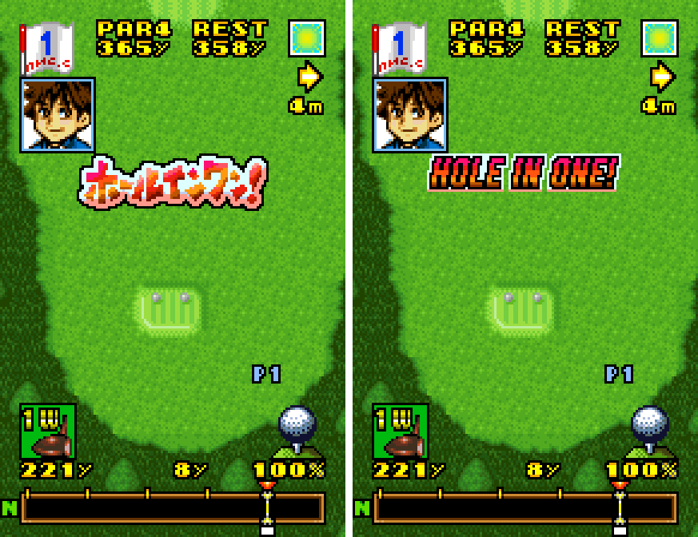

9. Link Menu: Net Tour Ranking, Super Super Shot, New Product Info, Hot News, Last Winners, Edit Member Card

   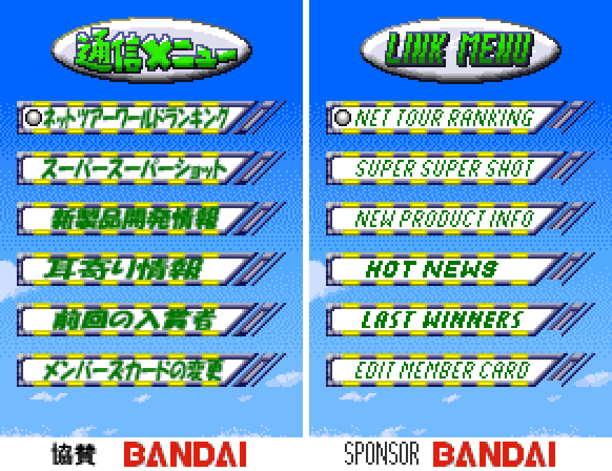

10. WonderGate error 001 box (the English text runs over two boxes; this is the first one)

   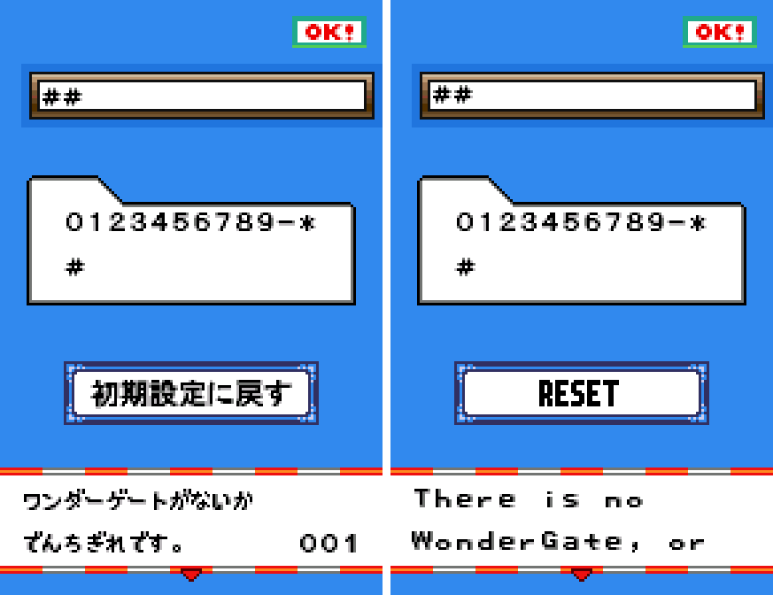

11. Tour victory screen: CHAMPION, with the caddie's line

   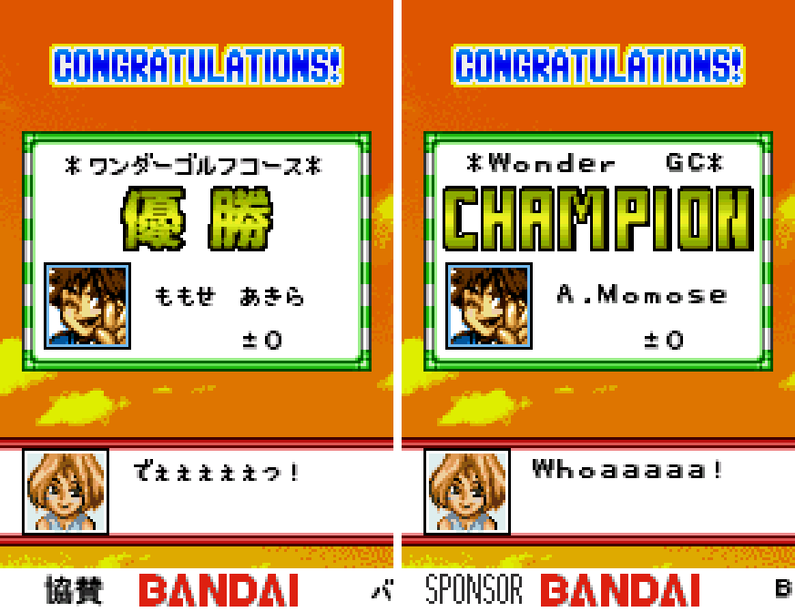

12. Pause window on the hole screen: Continue, Retry, Quit

   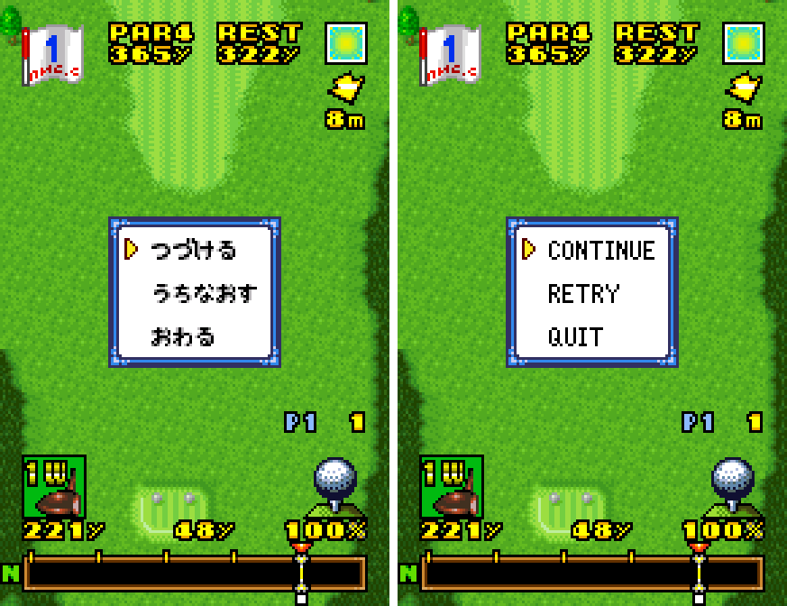

**How to patch**

Apply the BPS file to the Japanese ROM **Wonder Classic (Japan).wsc** (4,194,304 bytes, CRC32 `12F10B27`) in your browser with the [Swan Revival patcher](https://swanrevival.com/patcher/), or with Floating IPS, beat or ROM Patcher JS. The result is 4,194,304 bytes:

* Standard: `wonder-classic-en-1.0.bps`; the result should be CRC32 F12666B9.
* Debug Edition: `wonder-classic-en-debug-1.0.bps`; the result should be CRC32 B45C8939.

It's a WonderSwan Color game, so keep the .wsc extension. You must provide your own copy of the original Japanese game to apply it. The patch only fits this dump (CRC32 `12F10B27`); another revision is refused or gives a wrong result. Saves are expected to work with the Japanese version.

**Download:** `wonder-classic-en-1.0.bps`, `wonder-classic-en-debug-1.0.bps` on the [release page](https://github.com/PokemonGoDB/wonderswan-english-patches/releases/tag/wonder-classic-v1.0).

**Known issues**

* It hasn't been played start to finish by a person (see "What was not seen on screen"). If you find leftover Japanese or anything broken, please tell me where it happened.
* The kana keyboard grids of the member-card form stay Japanese on purpose.
* Some picture labels are smaller than the original's (the banners are 12 to 17 pixel rows against about 18); the table is in the project notes. The YES/NO block of the WonderGate form sits about 4 pixels left of centre, and the sponsor strip clips a little at the edge.
* The English letters are the game's 8x8 cells, so text boxes hold the same number of letters as the Japanese ones, and some lines are split into more pages or worded short.

**Credits:** Translation and hacking: Claude (Anthropic) for the WonderSwan Translation Project.

**A Note On My Justifications for AI Use**

I have been an avid fan of the Wonderswan system for a very long time now. It was actually a motivating factor for my various attempts to learn Japanese (which have all failed so far). I always wanted to explore the game catalog more, but the lack of English translations made it extremely difficult to do so. Here's the thing: There's a reason many of these games have not been translated yet. It's not just the fact that Japanese > English translation is difficult. There's also the fact that the original developers used all kinds of tricks and technical feats to make these games work. Most games do not have a searchable directory of text that you can just replace with English equivalents. While some are easier than others, translations for some of these would take not only an expert in Japanese > English translation, but also someone with vast game development and programming experience.

I say all that to say: I get why people are apprehensive about AI usage for this type of thing. However, these games have been around for a very long time now and most of them have still not received a translation. I (and others) have chosen to spend our time and money to utilize AI to translate the games and actually make them playable for the wider community. If you don't agree with that, that's completely fine. I am more than happy to remove any of my translations if better, human ran translations are released at a later date. We already decided to skip any games where someone is actively working on a manual translation. While nowhere near what a manual translation effort would be, I do spend a considerable amount of time trying to work through each game's translation. I stress over small details and try my best to make the right calls. And I've probably messed some stuff up, which is why I welcome feedback.

I'm just looking forward to digging through all of these games. It's a great time to be into Wonderswan games.
