# Chou Denki Card Battle: Youfu Makai (WonderSwan) - AI English translation patch v1.2

**Chou Denki Card Battle: Youfu Makai** (超伝奇カードバトル 妖符魔界) is a 1999 card battle game from Kobunsha and Kappa Games for the original (monochrome) WonderSwan, released only in Japan. The scenario is by Hideyuki Kikuchi (*Vampire Hunter D*, *Demon City Shinjuku*) and the art by Ayami Kojima. It's set in Kikuchi's Demon City Shinjuku, and its story runs in three parts, told as illustrated pages of prose between battles with Demon Cards. You build a 30-card deck, lay cards on a field where each card's arrows set the direction it attacks, and win by covering the field with your own cards.

> **Please read:** this translation was made **with AI** (Claude), as a hobby project. A person (me) made every judgement call before release, but nobody on the project is a professional translator. I'm sharing it as it is for anyone who wants to play. Please **don't upload it to romhacking sites** (romhacking.net and the like). It may not be up to the standard of a real fan translation and it doesn't belong there.

**What's translated**

* The whole story, all three parts (Crimson Lotus, Cursed Cards, Fusion), as horizontal English prose in place of the vertical Japanese.
* Every card name, and the descriptions of all 200 cards in the Card Craft card view (press the Y pad left or right on the deck screen).
* The menus (Scenario, Those in the Way, Worthy Rival, Card Craft...), the deck rules, the battle screens, and the save and erase prompts.
* Graphics: the title logo becomes YOUFU MAKAI with the subtitle "Realm of Demon Cards"; the chapter cards; the result screens (VICTORY and DEFEAT hand-lettered into the art in the original's style, OUT OF CARDS, DRAW...); and the attribute emblems as letter badges.
* The staff credits, romanized.

Names: the hero of part 1 is never named, so he's "the Bodyguard". The two characters who are both read Masami become Masami (the boy) and Lady Masami (the woman in white). Kikuchi's own characters, such as Gyoshiro Shikabane and Setsura Aki, follow his official English editions. The cards are Demon Cards, the binder is the Demon Book, and a duel is a Demon Duel.

**How it was made: AI translation, independent checks, human decisions**

* Claude translated the story and cards directly from the Japanese in the ROM, and did all the hacking: the story is stored as pre-drawn text pictures, so every English page was typeset and rendered into the game's format, along with a new card-name font and the redrawn graphics.
* A second, independent Claude reviewer checked the text against the Japanese, and a final separate review read the whole patch again; the names and story lines it questioned were corrected.
* Every story page was rebuilt from the finished ROM and compared on screen, and a random walk through menus, story, decks and battles found no Japanese reaching the screen.
* For 1.1, two independent Claude reviewers checked every card description against the Japanese, and all 200 card views were opened in the game and compared with the built pictures; a scan of the whole ROM for any other untranslated picture found the victory screen.
* For 1.2, the crash a player filmed was reproduced on the patch and on the original Japanese game, traced to the game's start-up save check, and the fix was checked with the same button presses, a 2,000-step random walk on the deck screen, and blank, written and older saves.
* The judgement calls were listed with the Japanese, a literal reading and the options, and I decided each one by hand: the logo, names and terms from Kikuchi's world, the menu titles, uncertain card readings, and a few deliberately ambiguous lines.

**Changelog**

* **v1.2**: fixes a crash in Card Craft. On a new game, taking a second card out of the deck turned the screen to garbage and restarted the game (thanks to the player who sent a video). The cause is in the original game: it accepts save memory that has never been written as a valid save, so on emulators and flash carts a new game started without its starter deck (the deck showed 30 Clay Dolls), and the Japanese game crashes the same way. The patch now writes the game's own default save when the save memory is blank, so a new game starts with the real starter deck: 30 cards, 15 different ones, two of each. The deck screen's list has a row for every card in the game, so on a new game it opens on empty rows; scroll down to reach your cards. Nothing else changes from 1.1, and existing saves are not touched (see Known issues). Apply the 1.2 patch to the original Japanese ROM, not to an English ROM.
* **v1.1**: the 200 card descriptions in the Card Craft card view are translated (1.0 left them in Japanese; thanks to the player who reported it), and the card view's text sits a little further left. The victory screen, which 1.0 also missed, now reads VICTORY, and both result screens are hand-lettered into the art in the original's style instead of a black band. Nothing else changes, and 1.0 saves keep working. Apply the 1.1 patch to the original Japanese ROM, not to the 1.0 English ROM.
* **v1.0**: first release.

**Sources consulted**

* Japanese text: the WonderSwan ROM itself.
* Names and terms: the official English editions of Kikuchi's *Demon City Shinjuku* (Digital Manga, 2011) and *Yashakiden* (Digital Manga, tr. Eugene Woodbury).

**Images** (original on the left, English on the right)

1. Title screen

   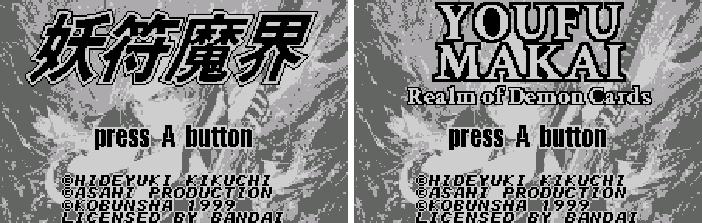

2. Main menu

   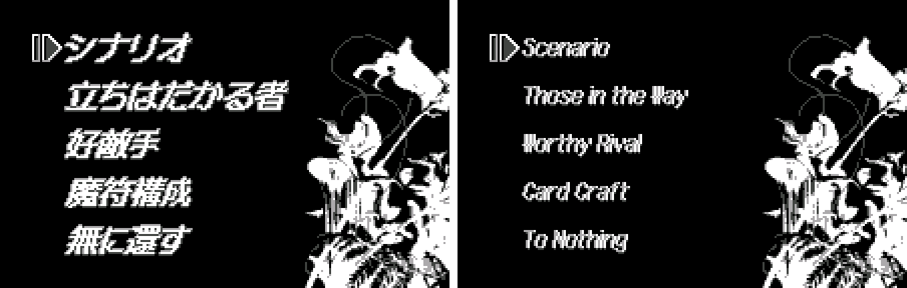

3. A story page

   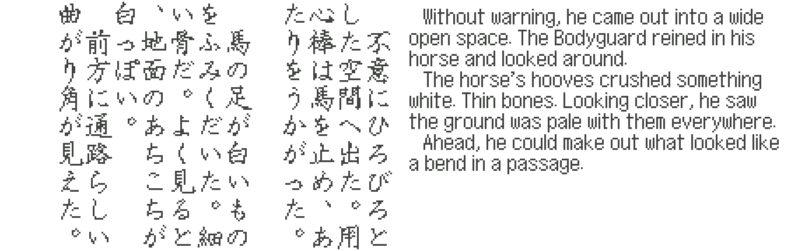

4. Deck screen

   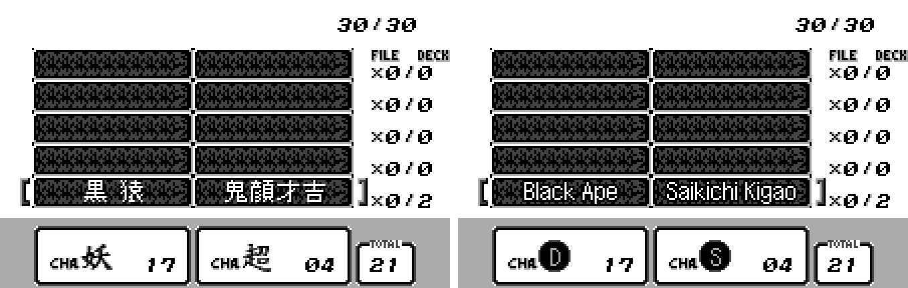

5. In battle

   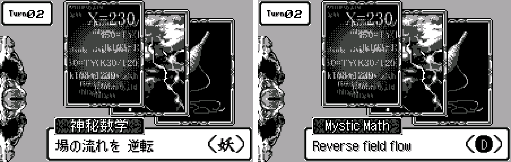

6. Erase save data?

   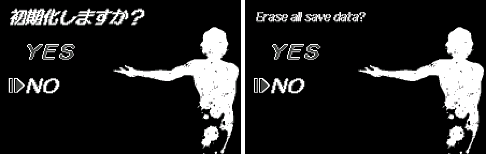

7. A card's description (Card Craft, Y pad)

   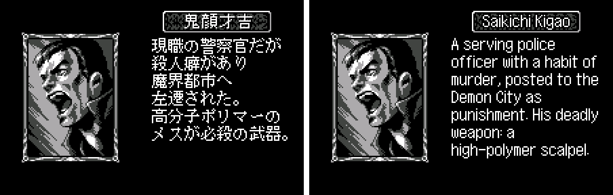

8. Victory

   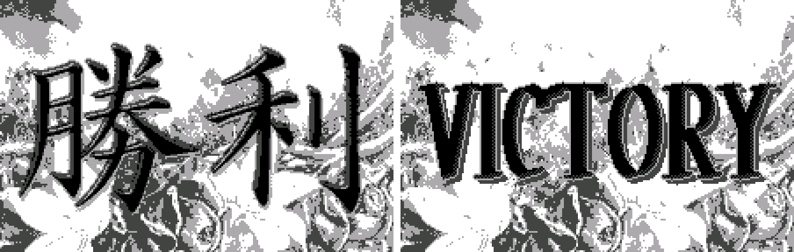

9. Defeat

   

10. The disclaimer shown at power-on

   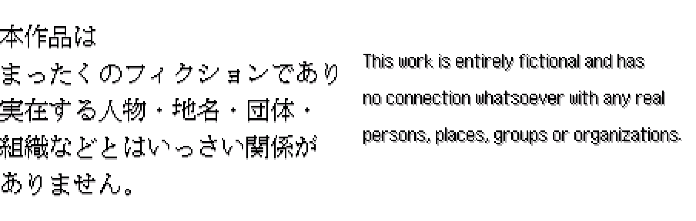

11. Scenario: choosing a part of the story

   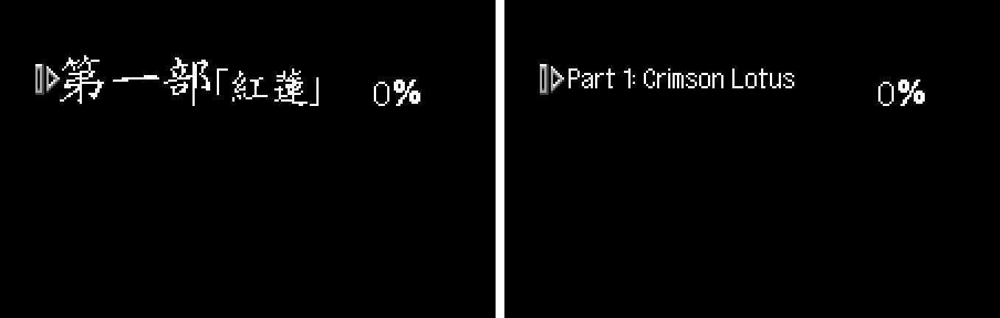

12. New Game or Continue

   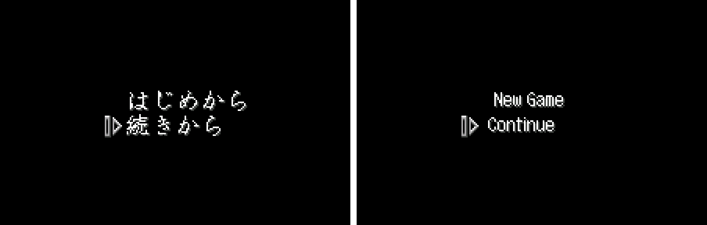

13. Chapter title card: Part One

   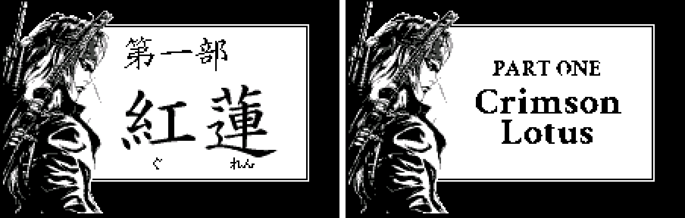

14. A story page

   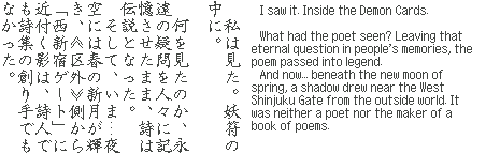

15. A story page

   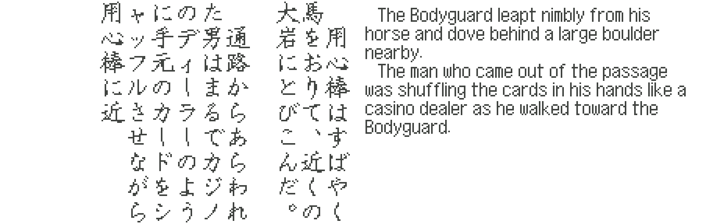

16. A story page

   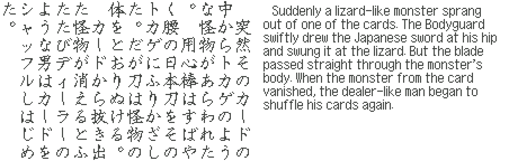

17. A story page

   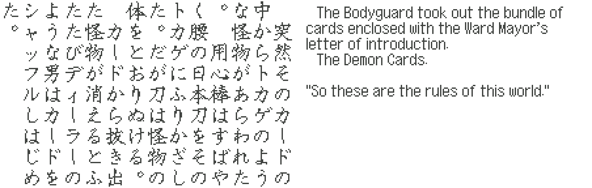

18. Versus screen: Bodyguard against the Gate Keeper

   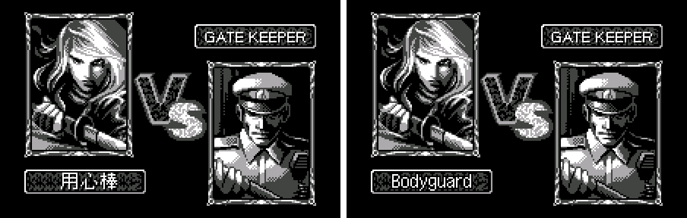

19. The battle rules shown before the deck screen

   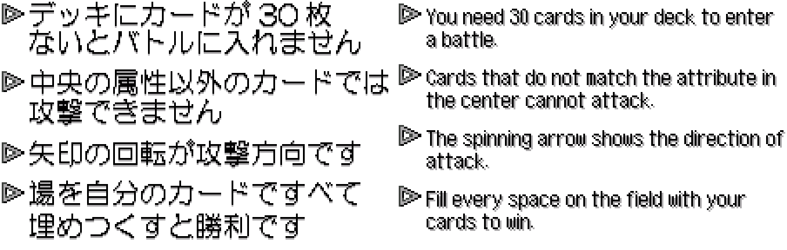

20. A card's description: Black Ape

   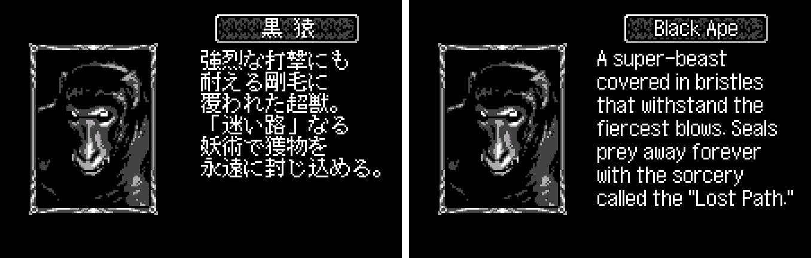

21. Those in the Way (opponent list)

   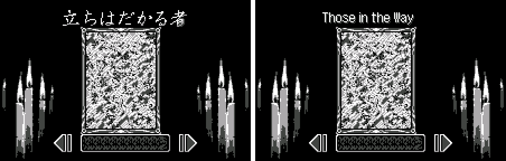

22. Worthy Rival: whoever presses A first takes the first move

   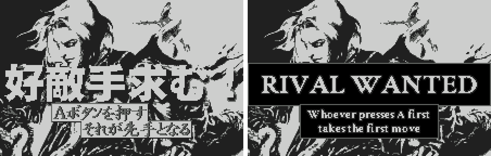

23. Save data erased

   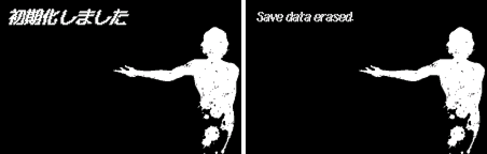

24. In battle: choosing a card (Ichi-no-Ji)

   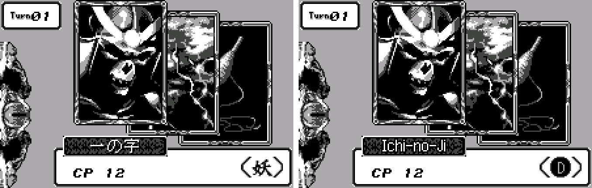

**How to patch**

Apply `youfu-makai-en-1.2.bps` to the Japanese ROM "Chou Denki Card Game - Youfu Makai - Kikuchi Shuukou (Japan)" (CRC32 56E2C069) in your browser with the [Swan Revival patcher](https://swanrevival.com/patcher/), or with Floating IPS, beat or ROM Patcher JS. The result should be CRC32 AD600B55.

The English ROM is 4 MB (the original is 2 MB), because the English story pages are stored as pictures: use an emulator or a flash cart that takes 32 Mbit WonderSwan ROMs. It's a WonderSwan (mono) game, so keep the .ws extension.

You must provide your own copy of the original Japanese game to apply it.

**Download:** `youfu-makai-en-1.2.bps` on the [release page](https://github.com/PokemonGoDB/wonderswan-english-patches/releases/tag/youfu-makai-v1.2).

**Known issues**

* It hasn't been played start to finish by a person. If you find leftover Japanese, cut text or a crash, please tell me where it happened.
* A few card names are best guesses at readings that no source confirms; the same goes for a few names in the card descriptions.
* Saves from 1.0 and 1.1 keep working. But if your deck shows 30 Clay Dolls and you have already played on that save, it started without the starter deck and can still crash in Card Craft: choose To Nothing on the main menu (it reads Reset when selected) and answer Yes, once, to get the starter deck. This erases that save's progress.
* The 1.2 fix was checked in a Mednafen-based emulator only. If Card Craft still crashes for you, please tell me which emulator or flash cart you use.
* With 29 cards in the deck, B does nothing until the deck holds 30 again (the original behaves the same).

**Technical notes (for the curious)**

* The original story text is vertical. The English is laid out horizontally and stored as about 330 KB of pre-drawn text cells, which is why the ROM doubled in size; the original image is the upper half of the new ROM, so the game's own bank settings still find it.
* Card names use a new outlined mixed-case font; names too wide for it fall back to a narrower one.

**A Note On My Justifications for AI Use**

I have been an avid fan of the Wonderswan system for a very long time now. It was actually a motivating factor for my various attempts to learn Japanese (which have all failed so far). I always wanted to explore the game catalog more, but the lack of English translations made it extremely difficult to do so. Here's the thing: There's a reason many of these games have not been translated yet. It's not just the fact that Japanese > English translation is difficult. There's also the fact that the original developers used all kinds of tricks and technical feats to make these games work. Most games do not have a searchable directory of text that you can just replace with English equivalents. While some are easier than others, translations for some of these would take not only an expert in Japanese > English translation, but also someone with vast game development and programming experience.

I say all that to say: I get why people are apprehensive about AI usage for this type of thing. However, these games have been around for a very long time now and most of them have still not received a translation. I (and others) have chosen to spend our time and money to utilize AI to translate the games and actually make them playable for the wider community. If you don't agree with that, that's completely fine. I am more than happy to remove any of my translations if better, human ran translations are released at a later date. We already decided to skip any games where someone is actively working on a manual translation. While nowhere near what a manual translation effort would be, I do spend a considerable amount of time trying to work through each game's translation. I stress over small details and try my best to make the right calls. And I've probably messed some stuff up, which is why I welcome feedback.

I'm just looking forward to digging through all of these games. It's a great time to be into Wonderswan games.
