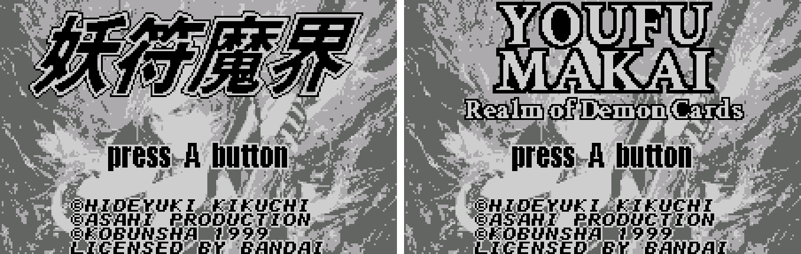
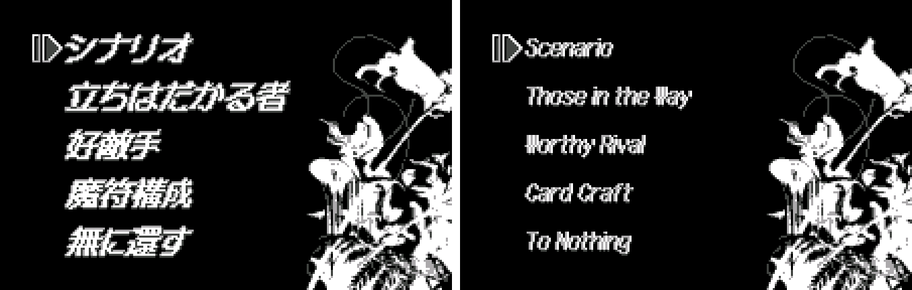
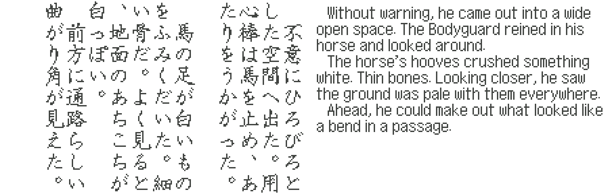
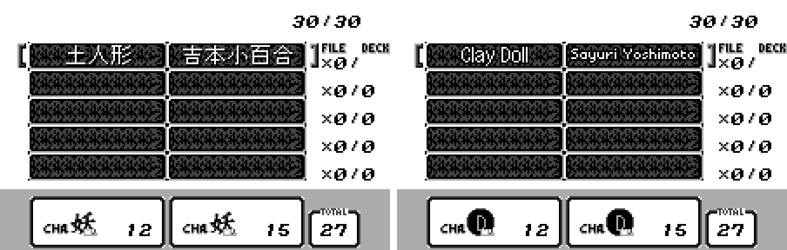
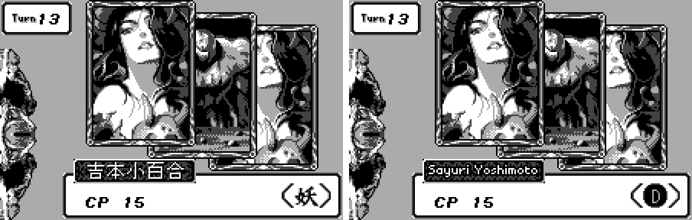
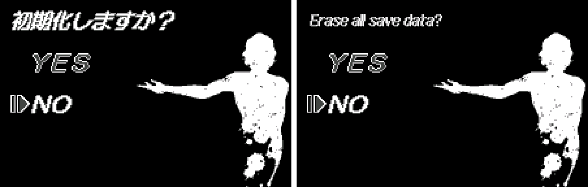

# Chou Denki Card Battle: Youfu Makai (WonderSwan) - AI English translation patch v1.0

**Youfu Makai** is a 1999 card battle game for the original WonderSwan, released only in Japan, with a scenario by Hideyuki Kikuchi (*Vampire Hunter D*) and art by Ayami Kojima. It's set in Kikuchi's Demon City Shinjuku: a three-part story told in illustrated prose, between battles where you cover the field with your Demon Cards.

> **Please read:** this translation was made **with AI** (Claude), as a hobby project. A person (me) made every judgement call before release, but nobody on the project is a professional translator. I'm sharing it as it is for anyone who wants to play. Please **don't upload it to romhacking sites** (romhacking.net and the like). It may not be up to the standard of a real fan translation and it doesn't belong there.

**What's translated**

* The whole story, as horizontal English in place of the vertical Japanese.
* Every card name, the menus, deck rules, battles and credits.
* Graphics: the YOUFU MAKAI title logo, chapter cards, result screens and attribute badges.

**How it was made**

* Claude translated the story and cards directly from the Japanese in the ROM and did all the hacking.
* Separate Claude reviewers checked everything against the Japanese, and every story page was compared on screen in an emulator.
* I made the judgement calls by hand: names from Kikuchi's world, menu titles and uncertain card readings.

**Changelog**

* **v1.0**: first release.

**Images** (original on the left, English on the right)

1. Title

   

2. Main menu

   

3. A story page

   

4. Deck

   

5. Battle

   

6. Erase save data?

   

**How to patch**

Apply the BPS to "Chou Denki Card Game - Youfu Makai - Kikuchi Shuukou (Japan)" (CRC32 56E2C069) with Floating IPS, beat or ROM Patcher JS. The result should be CRC32 CB5FACF7. The English ROM is 4 MB (the original is 2 MB), so use an emulator or a flash cart that takes 32 Mbit ROMs. Keep the .ws extension. You need your own copy of the Japanese game.

**Download:** `youfu-makai-en-1.0.bps` on the [release page](https://github.com/PokemonGoDB/wonderswan-english-patches/releases/tag/youfu-makai-v1.0).

**Known issues**

* Not played start to finish by a person. Please tell me where you find leftover Japanese, cut text or a crash.
* A few card names are best guesses at unconfirmed readings.

**Technical notes (for the curious)**

* The English story is stored as about 330 KB of pre-drawn text cells, which is why the ROM doubled in size. Names follow the official English editions of *Demon City Shinjuku* and *Yashakiden* (Digital Manga).

**A Note On My Justifications for AI Use**

I have been an avid fan of the Wonderswan system for a very long time now. It was actually a motivating factor for my various attempts to learn Japanese (which have all failed so far). I always wanted to explore the game catalog more, but the lack of English translations made it extremely difficult to do so. Here's the thing: There's a reason many of these games have not been translated yet. It's not just the fact that Japanese > English translation is difficult. There's also the fact that the original developers used all kinds of tricks and technical feats to make these games work. Most games do not have a searchable directory of text that you can just replace with English equivalents. While some are easier than others, translations for some of these would take not only an expert in Japanese > English translation, but also someone with vast game development and programming experience.

I say all that to say: I get why people are apprehensive about AI usage for this type of thing. However, these games have been around for a very long time now and most of them have still not received a translation. I (and others) have chosen to spend our time and money to utilize AI to translate the games and actually make them playable for the wider community. If you don't agree with that, that's completely fine. I am more than happy to remove any of my translations if better, human ran translations are released at a later date. We already decided to skip any games where someone is actively working on a manual translation. While nowhere near what a manual translation effort would be, I do spend a considerable amount of time trying to work through each game's translation. I stress over small details and try my best to make the right calls. And I've probably messed some stuff up, which is why I welcome feedback.

I'm just looking forward to digging through all of these games. It's a great time to be into Wonderswan games.
